# Zabbix Modules Collection

[中文](README.md)

## ✨ Version Compatibility

Supported Zabbix versions and deployment requirements vary by module. See the compatibility section in each module's README.

Zabbix Switch Visual's widget loading, configuration form, and default view were verified on Zabbix 7.0.32 and 8.0.0. See the [widget compatibility notes](./zabbix_switch_visual/README.md#版本兼容性) for the scope of testing on each version.

## Description

This collection contains independent modules that extend the Zabbix monitoring system.

## Modules

### 1. Zabbix Reports

A Zabbix frontend module for generating daily, weekly, and monthly reports, with report previews, PDF export, and email delivery.

**Features**

- Generate daily, weekly, and monthly reports.
- Summarize alert counts and statuses.
- List the 10 hosts with the most alerts.
- List the 10 hosts with the highest CPU and memory utilization.
- Preview reports in the frontend.
- Export reports to PDF manually.
- Send HTML reports by email.

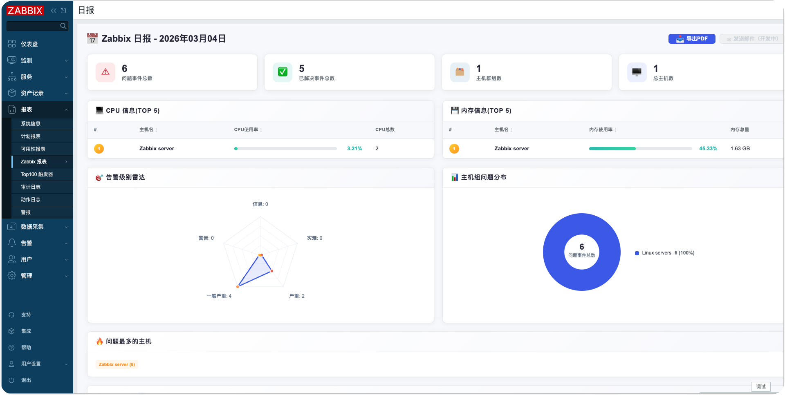
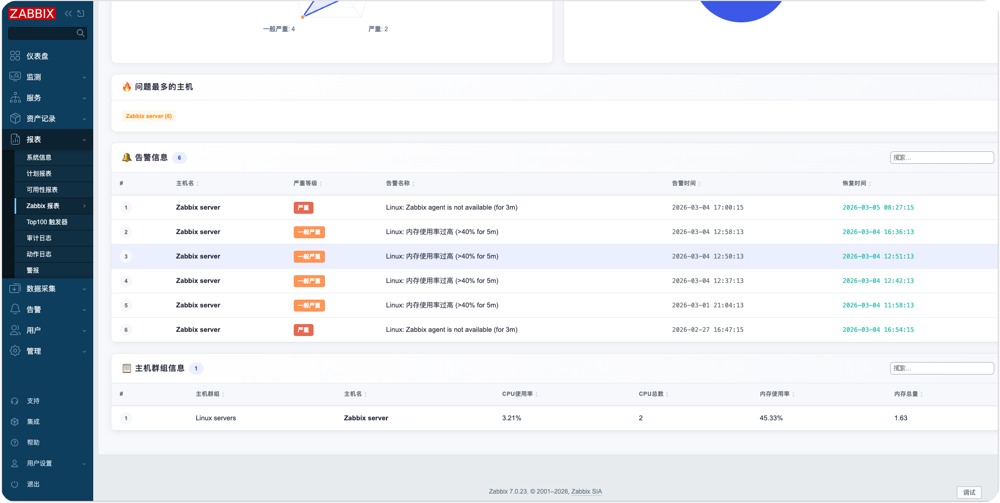

[Documentation](./zabbix_reports/README.md)

**Compatibility** — Zabbix 6.0.x, 7.0.x, 7.4.x, and 8.0.x

### 2. Zabbix CMDB

A configuration management database (CMDB) frontend module for viewing and managing host information in one place.

**Features**

- Search by host name or IP address.
- Filter by host group.
- View host names, IP addresses, interface types, CPU and memory totals, host groups, and other details.
- Use the interface in Chinese or English.
- Use the responsive layout on different screen sizes.

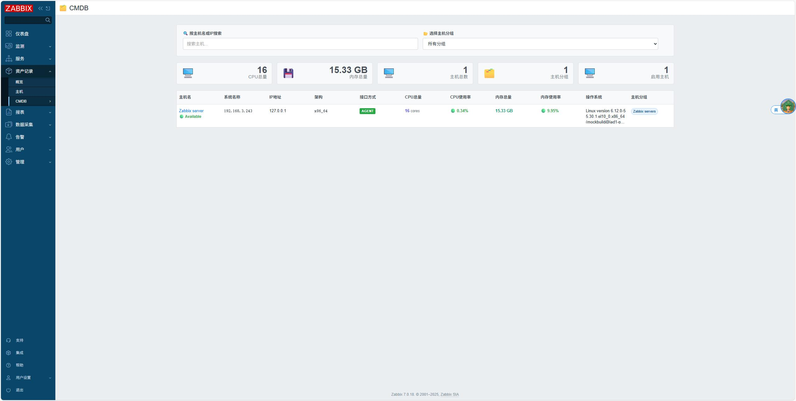
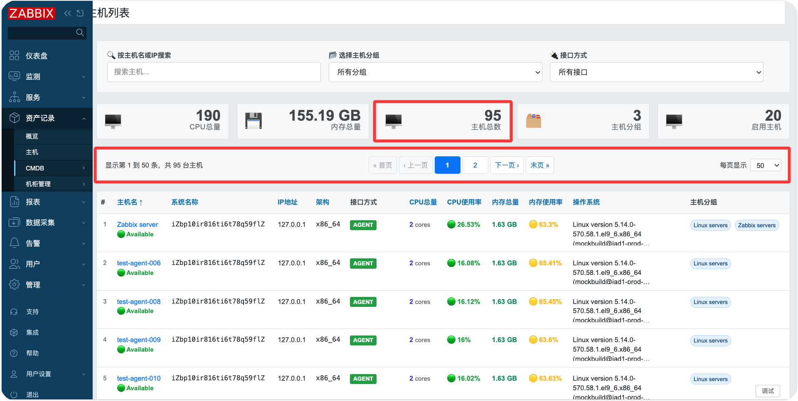
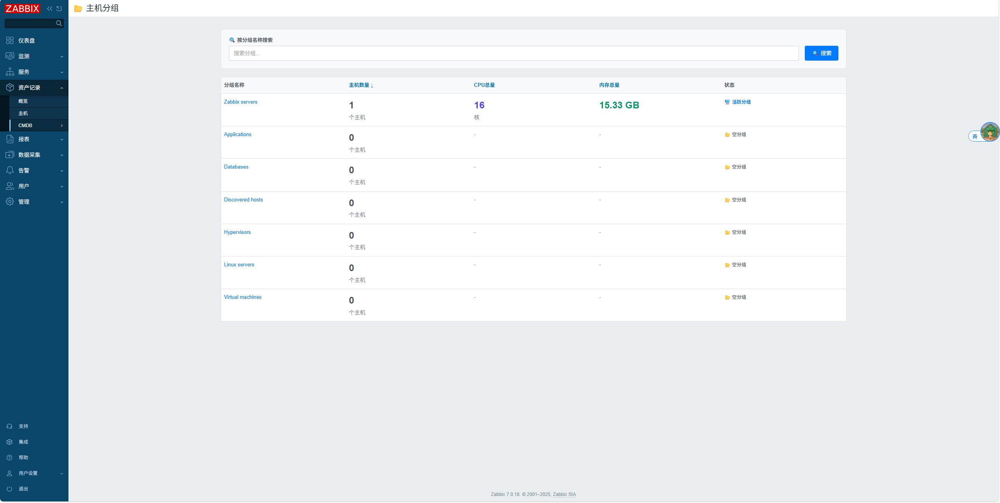

[Documentation](./zabbix_cmdb/README.md)

**Compatibility** — Zabbix 6.0.x, 7.0.x, 7.4.x, and 8.0.x

### 3. Zabbix Graph Trees

A Zabbix frontend module for browsing monitoring data through a host-group tree, filtering items, and viewing live charts.

**Features**

- Browse host groups and hosts in a tree.
- Filter items by tag and tag value.
- Select multiple items from a drop-down list to choose which charts to display.
- View live monitoring data in SVG line charts.
- Synchronize tooltips across charts.
- Expand charts to full screen.
- Refresh automatically at intervals of 5, 10, 20, 30, or 60 seconds.
- Select time ranges from 1 hour to 30 days.
- Use the interface in Chinese or English.

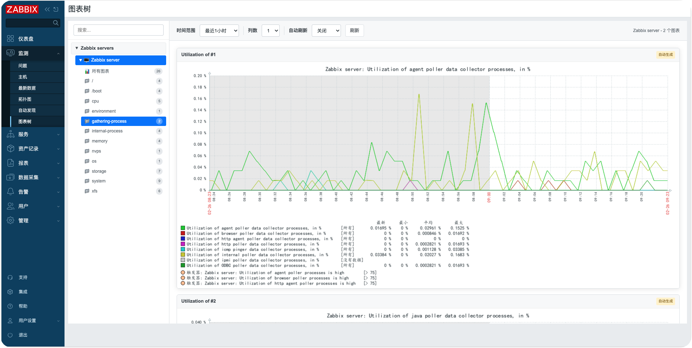
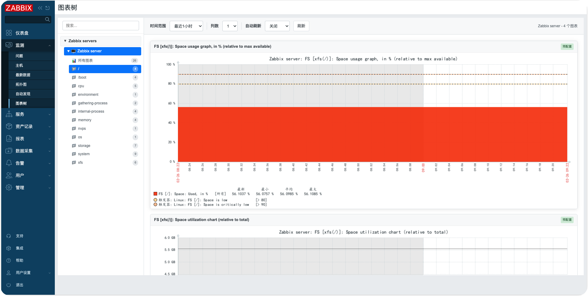

[Documentation](./zabbix_graphtrees/README.md)

**Compatibility** — Zabbix 6.0.x, 7.0.x, 7.4.x, and 8.0.x

### 4. Zabbix Rack

A Zabbix frontend module for visualizing data center racks and tracking host locations. Configure server rooms and racks, then assign hosts visually.

**Features**

- Create, edit, and delete server rooms.
- Create, edit, and delete racks with configurable heights from 1U to 60U.
- View occupied rack units in a vertical 42U rack layout.
- Assign Zabbix hosts to specific rack units.
- Search by rack or host name.
- Use the interface in Chinese or English.
- Use the responsive layout on different screen sizes.

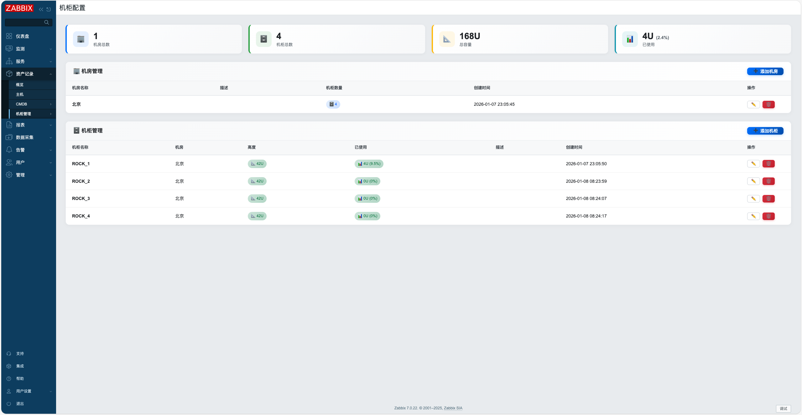
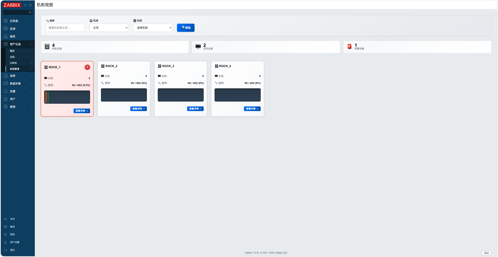
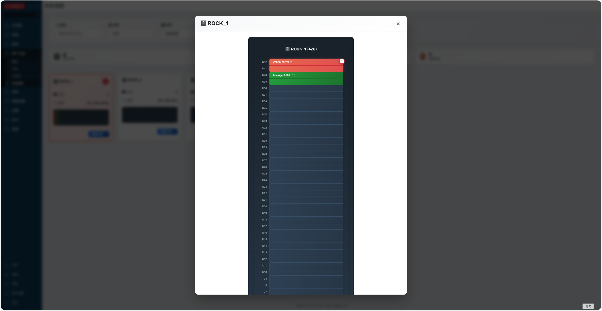

[Documentation](./zabbix_rack/README.md)

**Compatibility** — Zabbix 6.0.x, 7.0.x, 7.4.x, and 8.0.x

### 5. Zabbix SNMP

An SNMP assistant for the Zabbix frontend. Browse MIBs, run SNMP walks, resolve OIDs, create an item from a result, or build SNMP templates in bulk.

**Features**

- Scan common MIB directories automatically. View OIDs, resolved OIDs, syntax, permissions, and status in a table, and open MIB source files.
- Read the host's SNMP v1, v2c, or v3 connection settings automatically and display parsed walk results in a table with client-side pagination.
- View raw results and copy `snmpget` commands or OIDs.
- Create an item from a single result with automatic data-type mapping.
- Select multiple results to create SNMP templates and items in bulk.
- Use the interface in Chinese or English.

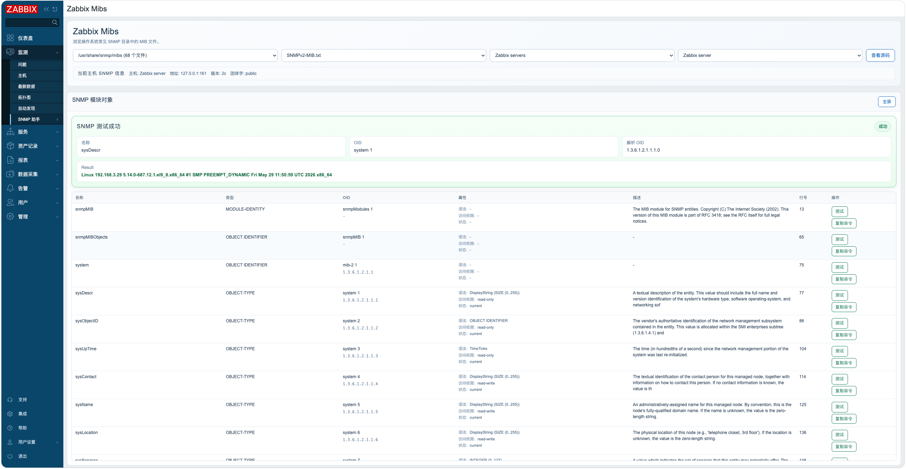
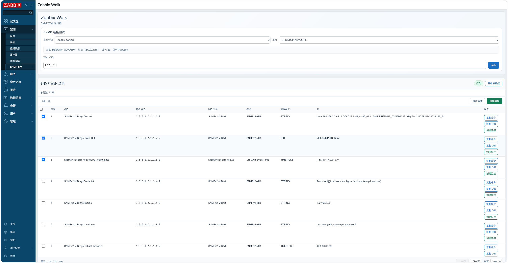
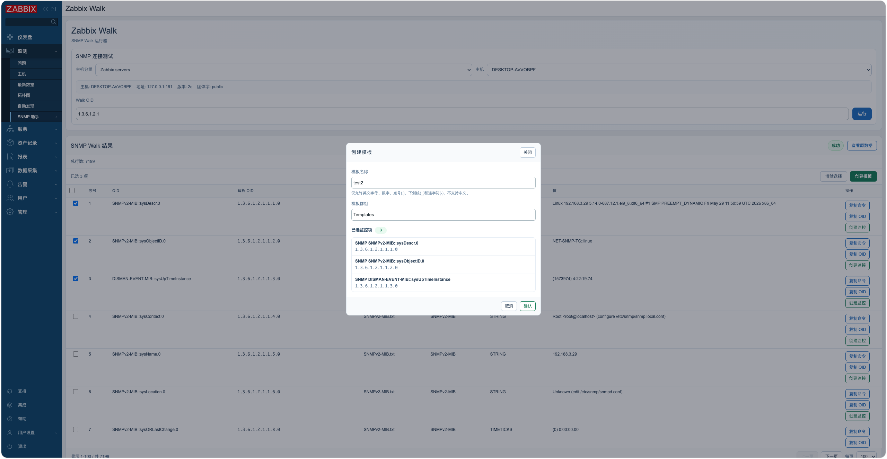

[Documentation](./zabbix_snmp/README.md)

**Compatibility** — Zabbix 6.0.x, 7.0.x, 7.4.x, and 8.0.x

### 6. Zabbix JumpServer

A Zabbix frontend module for synchronizing hosts and host groups with the JumpServer bastion host. It can push assets in bulk, create missing nodes, and open a host connection directly from Zabbix.

**Features**

- Filter by host group, host, or alert status, and search by IP address or host name. By default, all groups and hosts are shown.
- Push all host groups or all hosts in one click and create missing JumpServer nodes automatically.
- Use **Get JumpServer Asset ID** to match assets in JumpServer by IP address and write their IDs back to Zabbix as tags.
- Detect Linux and Windows hosts and create or update JumpServer assets. When creating an asset, optionally associate a login account from an account template.
- View alert counts by severity and expand a row for full alert details.
- Store JumpServer asset IDs as tags on Zabbix hosts. Hover over an already-pushed host to push it again.
- Use **Connect** in the last column to open the host's JumpServer connection page.
- Use the interface in Chinese or English.

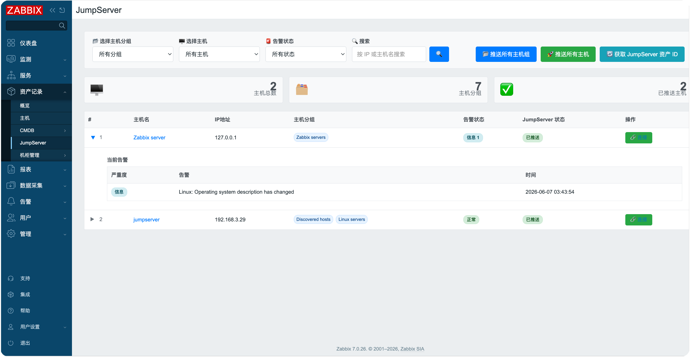

[Documentation](./zabbix_jumpserver/README.md)

**Compatibility** — Zabbix 6.0.x, 7.0.x, 7.4.x, and 8.0.x

### 7. IM Sync Assistant

A Zabbix frontend module that synchronizes the organizational structures of **WeCom**, **Feishu**, and **DingTalk** with Zabbix user groups. It matches members to existing Zabbix users or creates new users and adds them to the corresponding groups.

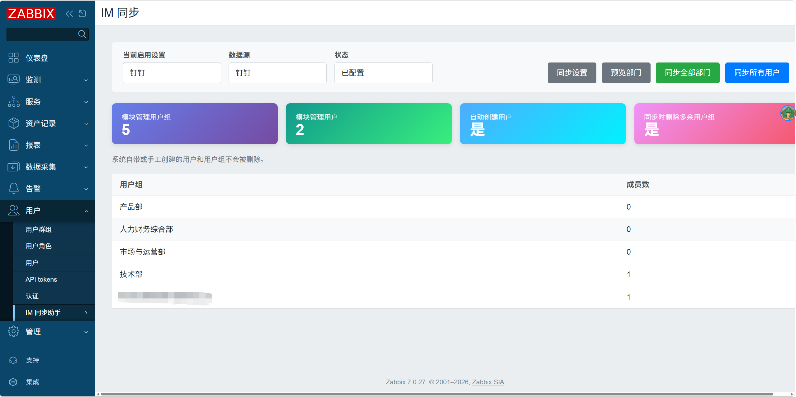
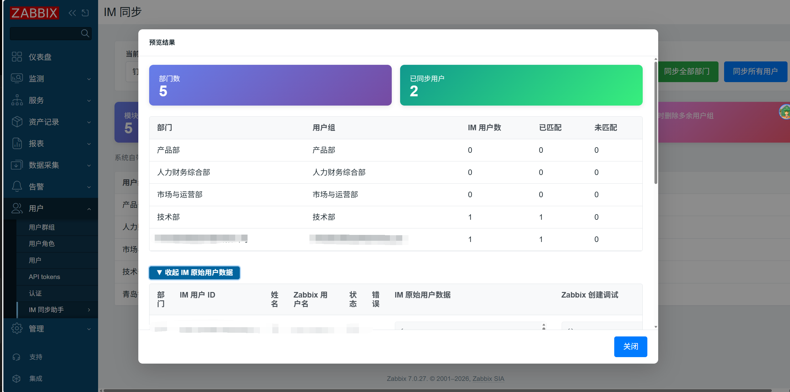
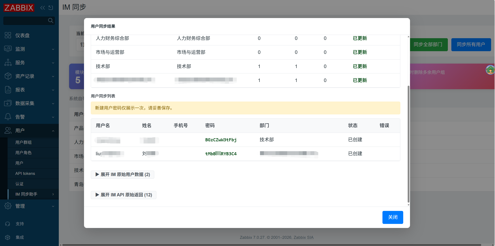

**Features**

- Support for WeCom, Feishu, and DingTalk.
- Manage synchronization credentials through **Users → Sync Settings**, with one configuration active at a time.
- Create or update Zabbix user groups by department, with an option to use full department paths as names.
- Match or create Zabbix users and add them to the corresponding groups. New users receive automatically generated 12-character passwords, shown once in the results.
- For DingTalk users without a phone number, convert their names to Pinyin for their Zabbix usernames.
- Preview department and user matches before synchronization.
- Use the interface in Chinese or English.

[Chinese documentation](./zabbix_im/README.md) · [English documentation](./zabbix_im/README_en.md)

**Compatibility** — Zabbix 6.0.x, 7.0.x, 7.4.x, and 8.0.x

### 8. Zabbix Clonehosts

A Zabbix frontend module for creating hosts in bulk by cloning an existing monitored host. It supports CSV import and browser-based table entry, with previews, conflict detection, selective import, and live progress.

**Features**

- Use any existing monitored host as the source and inherit its interfaces, groups, templates, tags, macros, TLS, IPMI, inventory mode, and other settings.
- Upload a CSV file with automatic UTF-8 or GBK detection and a downloadable template, or enter data in the browser with row editing, clearing, and live validation.
- Provide a host name and interface IP address. Blank optional fields inherit the source host's settings.
- Automatically create missing host groups specified in the CSV through the Zabbix API and associate them with the new hosts.
- Preview the import and detect host name conflicts, missing required fields, duplicates within the batch, and name collisions with existing hosts or templates. Status labels distinguish existing entries, entries to be created, missing entries, and values inherited from the source host.
- Select which hosts to import in the preview. Conflicting hosts are skipped automatically, and ready hosts can be deselected individually.
- Return from the preview to the table editor with the entered data intact to correct hosts that are not ready.
- Create hosts individually through AJAX and show live progress with success and failure counts.
- Download a CSV report with host name, IP address, host ID, result, and error details.
- Use the interface in Chinese or English.

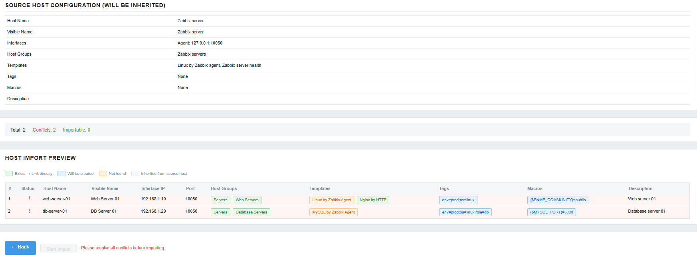
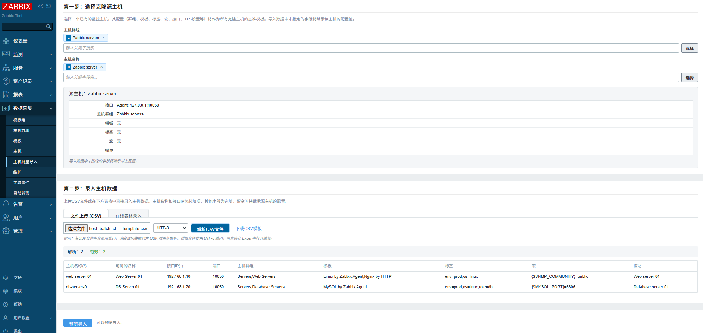
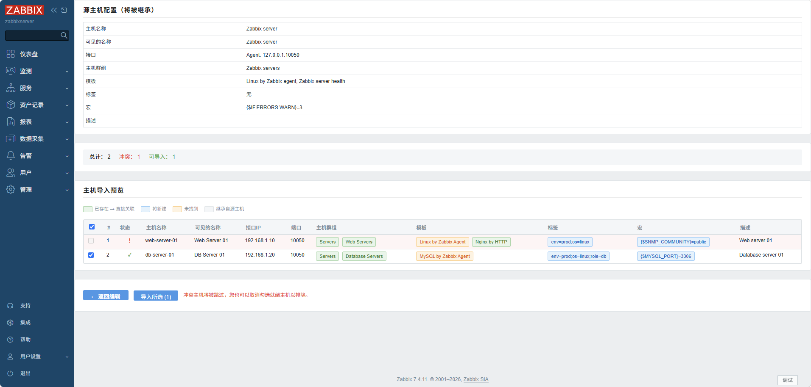
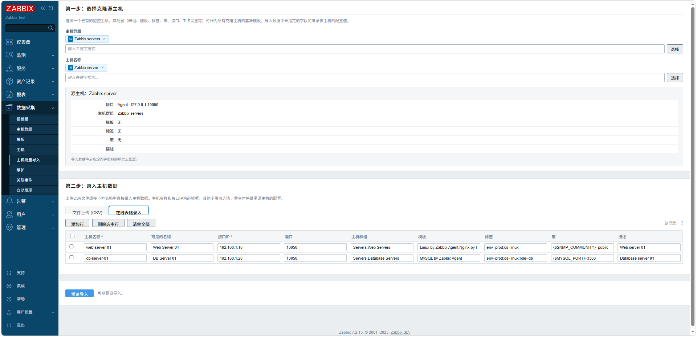

[Chinese documentation](./zabbix_clonehosts/README.md) · [English documentation](./zabbix_clonehosts/README_en.md)

**Compatibility** — Zabbix 6.0.x, 7.0.x, 7.4.x, and 8.0.x

### 9. Zabbix IPAM

A Zabbix frontend module for managing IPv4 address ranges and running asynchronous ICMP host discovery. It can associate addresses with Zabbix hosts by interface IP.

**Features**

- Accept CIDR notation and IPv4 start and end addresses, with up to 65,536 addresses per range.
- Check host reachability over ICMP using `fping`, without TCP port probing.
- Split large networks into batches and run scans in the background through PHP CLI, with support for `pcntl` multiprocessing.
- Start scans manually or schedule them through crontab and view progress as they run.
- View an IP usage matrix, address details, and host associations, with filtering and pagination.
- Use the interface in Chinese or English.

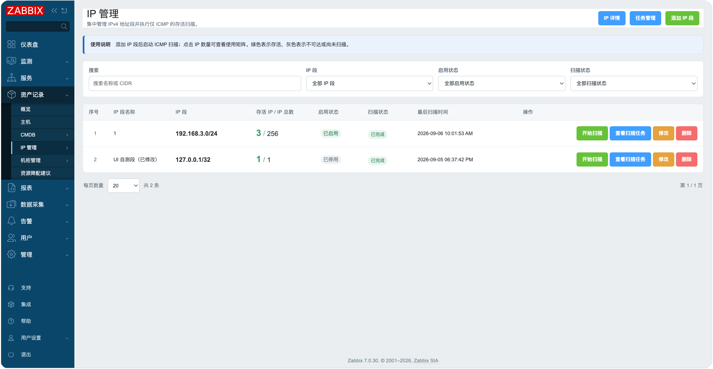
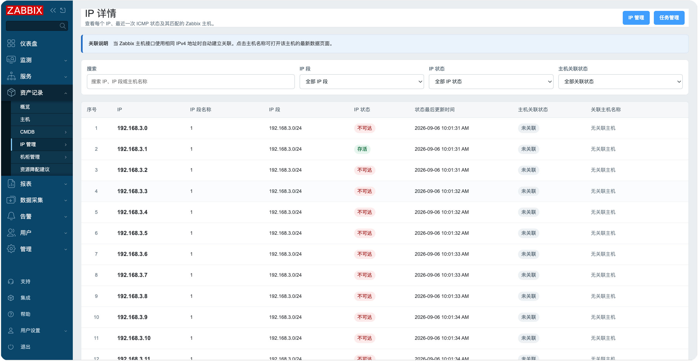
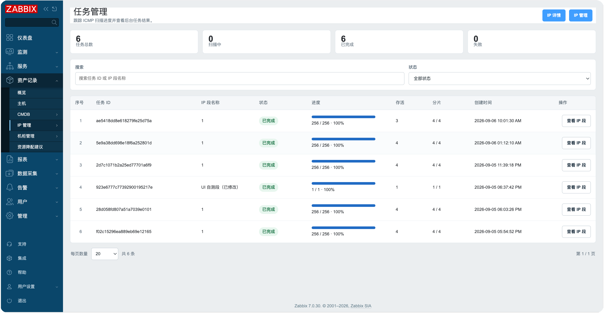

[Chinese documentation](./zabbix_ipam/README.md) · [English documentation](./zabbix_ipam/README_en.md)

**Compatibility** — Zabbix 6.0.x, 7.0.x, 7.4.x, and 8.0.x

### 10. Zabbix Switch Visual

A switch-port monitoring dashboard widget that presents Zabbix items as switch chassis, RJ45 and SFP ports, traffic trends, and device status.

**Features**

- Select a single host or display multiple switches by host group.
- View port status, speed, inbound and outbound traffic, errors, and alerts. Click a port to open its history graphs.
- Detect ports automatically and configure stack members, port layout, SNMP index offsets, exclusions, and manual aliases.
- View per-port and switch-wide traffic trends, with configurable CPU, memory, temperature, PoE, and fan metrics.
- Customize port styles, colors, zoom, and the summary bar, with Chinese and English interfaces.

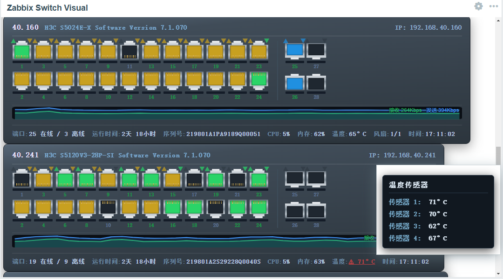

[Chinese documentation](./zabbix_switch_visual/README.md) · [English documentation](./zabbix_switch_visual/README_en.md)

**Compatibility** — Primarily targets Zabbix 7.x. See the widget README for adaptation and testing on other versions.

### 11. Zabbix Auto Topology Map

A Zabbix frontend module that discovers network connections through LLDP, CDP, and EDP neighbor data collected over SNMP. It generates editable topology maps that share data with native Zabbix maps.

**Features**

- Discover devices and port links automatically, with a depth of 1 to 10 levels and support for unmanaged devices and multiple port links.
- Create, search, sort, rename, bulk-delete, and export maps as JSON.
- Rediscover the network while optionally preserving existing coordinates, link metrics, and routing settings.
- Edit hosts, images, shapes, and links visually with automatic curves, orthogonal routing around obstacles, and manual waypoints.
- Assign bandwidth, upstream traffic, and downstream traffic items manually, with summation across items and unit conversion.
- Display host status and problems, match port status triggers, and change link colors when alerts occur.
- Refresh status and metrics every 60 seconds in the preview, with zoom, pan, fit to window, and native host menus.
- Use the interface in Chinese or English with light or dark themes.

[Chinese documentation](./zabbix_auto_topology_map/README.md) · [English documentation](./zabbix_auto_topology_map/README_en.md)

**Compatibility** — Developed for Zabbix 7.0 and verified on 7.0.28. Zabbix 6.x still needs testing, and other 7.x and 8.x versions need verification in the target environment.

### 12. Zabbix Import/Export

A frontend module for migrating hosts, monitoring templates, and host-level items between Zabbix environments. Open it from **Inventory → Zabbix Import/Export**.

**Features**

- Import and export hosts, templates, and items as CSV or JSON. The template page also supports native Zabbix JSON imports.
- Filter by group, select across pages, and export filtered results. Filename timestamps use the Zabbix user's time zone.
- Preview differences before importing and choose how to handle duplicates. Scripts and other executable configuration are blocked by default.
- Follow the Zabbix user's language setting with built-in Simplified Chinese and English translations.

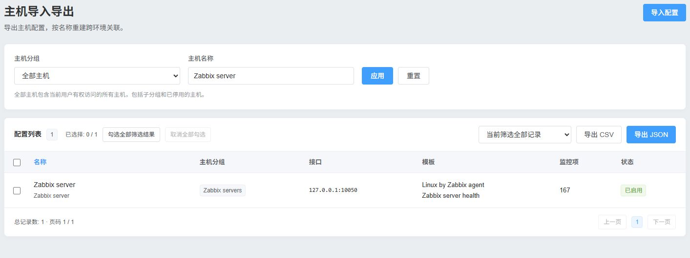

[Chinese documentation](./zabbix_export_import/README.md) · [English documentation](./zabbix_export_import/README_en.md)

**Compatibility** — Verified on Zabbix 7.0.32. Adaptations for 6.0 and 7.4 are available and need verification in the target environment.

### 13. Zabbix Rebrand Logo

Customize the Zabbix frontend's branding under **Administration → Zabbix Rebrand Logo**.

**Features**

- Replace the login logo, sidebar logo, collapsed sidebar icon, and browser favicon.
- Preview and crop images in place and resize the login logo to a 4:1 aspect ratio.
- Customize the server name, footer text, and Help link, with Chinese and English interfaces.

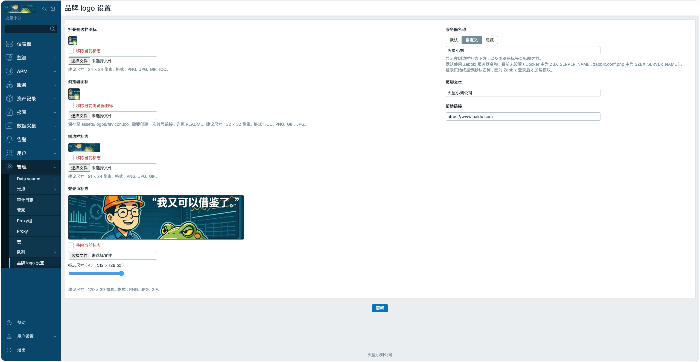

[Chinese documentation](./zabbix_rebrand_logo/README.md) · [English documentation](./zabbix_rebrand_logo/README_en.md)

**Compatibility** — Verified on Zabbix 7.0 and 8.0.

### 14. Zabbix MySQL Backup

Zabbix Super admins can export the current Zabbix MySQL or MariaDB database as a SQL file from **Administration → MySQL Backup**.

- View estimated table sizes, filter by name, and select tables in bulk.
- Export table structure and data, structure only, or data only. The SQL retains the table creation statements for unselected tables.
- Download in the browser or save on the server. When browser download is selected, SQL files over 500 MB are saved automatically to the specified directory, which defaults to `/tmp/zabbix`.
- Use the interface in Chinese or English. Filenames use the current user's time zone.

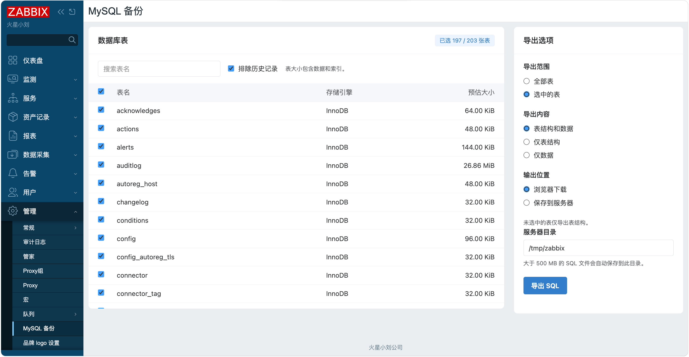

Supports Zabbix 7.0 and 8.0, verified on 7.0.32 and 8.0.0. [Chinese documentation](./zabbix_backup_mysql/README.md) · [English documentation](./zabbix_backup_mysql/README_en.md)

## Installation

The following steps apply to standard frontend modules. Install Zabbix Switch Visual using its dedicated instructions, then add the widget in dashboard edit mode. [Zabbix Switch Visual installation](./zabbix_switch_visual/README.md#安装步骤)

### Method 1. Download release archives for production deployment

The Releases page provides two types of archives that can be installed without Git.

- **All-in-one archive** `zabbix_modules-<version>.tar.gz` contains all modules. The version format is `module_count.major.minor`, for example `13.2.0`.
- **Single-module archive** `zabbix_<module-name>-<version>.tar.gz` contains an individual module.

#### Option A. Download the all-in-one archive

1. Download `zabbix_modules-<version>.tar.gz`, for example `zabbix_modules-13.2.0.tar.gz`. [Releases](https://github.com/X-Mars/zabbix_modules/releases)
2. Upload it to the Zabbix server and extract it into the modules directory.

```bash
# Zabbix 6.0 / 7.0
tar -xzf zabbix_modules-<version>.tar.gz -C /usr/share/zabbix/modules/

# Zabbix 6.4 / 7.2 / 7.4 / 8.0
tar -xzf zabbix_modules-<version>.tar.gz -C /usr/share/zabbix/ui/modules/
```

3. **On Zabbix 6.0, change `manifest_version` for standard modules that support Zabbix 6.0.**

```bash
for mod in /usr/share/zabbix/modules/zabbix_*/; do
  grep -Eq '"type"[[:space:]]*:[[:space:]]*"widget"' "${mod}manifest.json" && continue
  sed -i 's/"manifest_version": 2.0/"manifest_version": 1.0/' "${mod}manifest.json"
done
```

Use the default value on Zabbix 6.4, 7.0+, or 8.0+.

#### Option B. Download a single module

1. Download the `zabbix_<module-name>-<version>.tar.gz` archive for the module you need. [Releases](https://github.com/X-Mars/zabbix_modules/releases)
2. Upload it to the Zabbix server and extract it into the modules directory.

```bash
# Zabbix 6.0 / 7.0
tar -xzf zabbix_<module-name>-<version>.tar.gz -C /usr/share/zabbix/modules/

# Zabbix 7.2+ / 7.4 / 8.0
tar -xzf zabbix_<module-name>-<version>.tar.gz -C /usr/share/zabbix/ui/modules/
```

3. **On Zabbix 6.0, change `manifest_version`.**

```bash
sed -i 's/"manifest_version": 2.0/"manifest_version": 1.0/' /usr/share/zabbix/modules/zabbix_<module-name>/manifest.json
```

Use the default value on Zabbix 6.4, 7.0+, or 8.0+.

### Method 2. Deploy with Git for development or tracking updates

Deploy all modules together.

1. **Zabbix 6.0 / 7.0**

```bash
git clone https://github.com/X-Mars/zabbix_modules.git /usr/share/zabbix/modules/
```

2. **Zabbix 7.2+ / 7.4 / 8.0**

```bash
git clone https://github.com/X-Mars/zabbix_modules.git /usr/share/zabbix/ui/modules/
```

3. **On Zabbix 6.0, change `manifest_version`.**

To update standard modules in bulk, skipping dashboard widgets:

```bash
for mod in /usr/share/zabbix/modules/zabbix_*/; do
  grep -Eq '"type"[[:space:]]*:[[:space:]]*"widget"' "${mod}manifest.json" && continue
  sed -i 's/"manifest_version": 2.0/"manifest_version": 1.0/' "${mod}manifest.json"
done
```

To update a single module, such as Zabbix Reports:

```bash
sed -i 's/"manifest_version": 2.0/"manifest_version": 1.0/' /usr/share/zabbix/modules/zabbix_reports/manifest.json
```

Use the default value on Zabbix 6.4, 7.0+, or 8.0+.

### Enable Modules

After deploying the files, enable the modules in the Zabbix web interface.

1. Open the Zabbix web interface.
2. Go to **Administration → General → Modules**.
3. Click **Scan directory** to discover new modules.
4. Find and enable the modules you want to use.

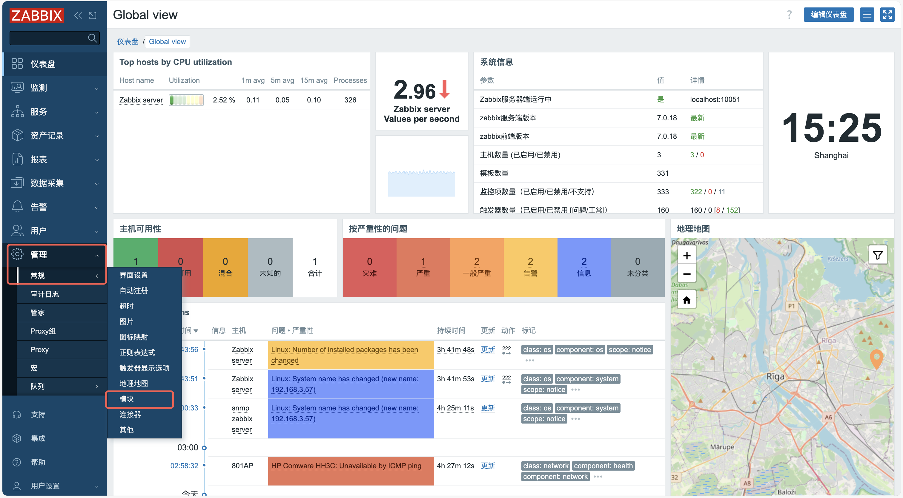
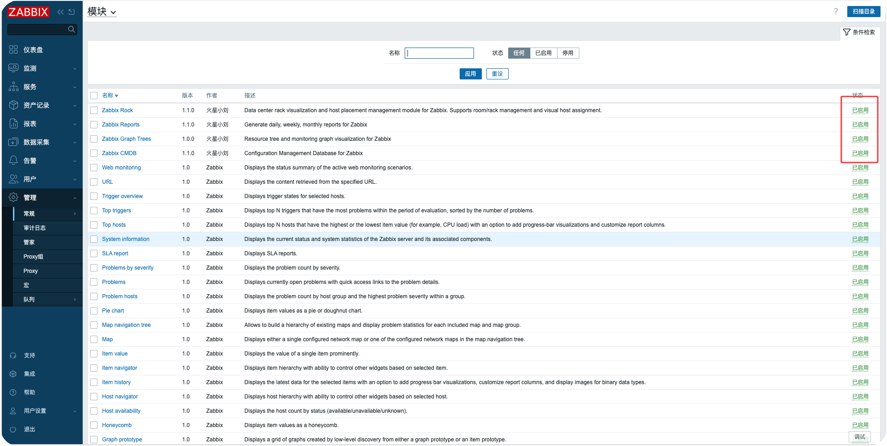

### Verify Installation

Refresh the page and look for the modules in the corresponding menus.

- **Reports → Zabbix Reports** (daily, weekly, and monthly reports)
- **Inventory → CMDB** (host list and host groups)
- **Monitoring → Graph Trees** (chart tree)
- **Inventory → Rack Management** (rack management)
- **Data collection → SNMP Assistant** (Zabbix Mibs and Zabbix Walk)
- **Inventory → JumpServer** (JumpServer synchronization)
- **Users → IM Sync Assistant** (synchronization and settings)
- **Data collection → Bulk Host Import** (clone hosts from an existing source host)
- **Inventory → IPAM** (IP management, address details, and task management)
- **Dashboard → Edit → Add widget → Zabbix Switch Visual** (switch-port visualization)
- **Monitoring → Auto Topology Map** (network discovery and topology editing)
- **Administration → MySQL Backup** (database SQL export for Super admins)

### Install an Individual Module

See each module's README for its installation and configuration instructions.

## Contributing

Issue reports and suggestions are welcome. Submit reports in the directory for the relevant module.

## License

All modules follow the Zabbix license terms. [Zabbix License](https://www.zabbix.com/license)
