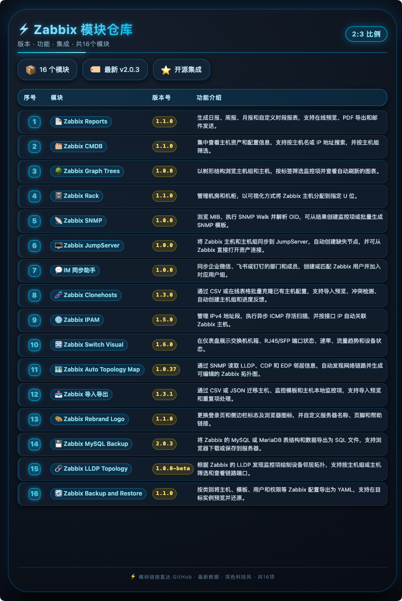
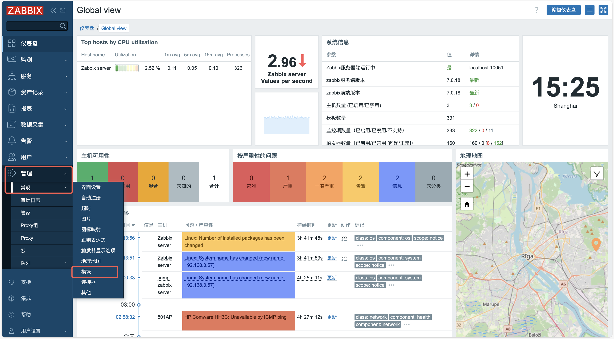
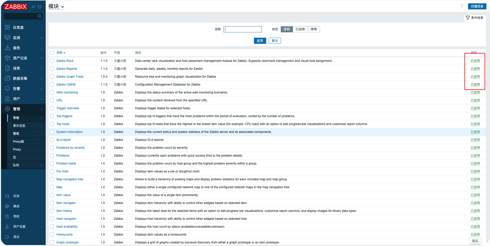

# Коллекция модулей Zabbix

[中文](README.md) · [English](README_en.md)

<div>
  
  
</div>

## О проекте

Коллекция независимых модулей для веб-интерфейса Zabbix. Каждый модуль можно установить отдельно.


## Язык интерфейса

Чтобы включить русскую локализацию, выберите **Русский** в профиле Zabbix. Если в профиле выбран язык по умолчанию, используется системный параметр `default_lang`.

## Модули



| Модуль | Версия | Назначение |
| --- | --- | --- |
| [Zabbix Reports](zabbix_reports/README_ru.md) | `1.1.0` | Дневные, недельные и месячные отчёты, отчёты за период, предпросмотр, экспорт PDF и отправка по почте. |
| [Zabbix CMDB](zabbix_cmdb/README_ru.md) | `1.1.0` | Инвентаризация и конфигурация узлов сети, поиск и статистика по группам. |
| [Zabbix Graph Trees](zabbix_graphtrees/README_ru.md) | `1.1.0` | Дерево узлов и групп, фильтры элементов данных, графики и экспорт изображений. |
| [Zabbix Rack](zabbix_rack/README_ru.md) | `1.1.0` | Помещения и стойки, размещение оборудования по юнитам, передняя и задняя стороны. |
| [Zabbix SNMP](zabbix_snmp/README_ru.md) | `1.0.0` | Просмотр MIB, обход SNMP, создание элементов данных и шаблонов. |
| [Zabbix JumpServer](zabbix_jumpserver/README_ru.md) | `1.0.0` | Синхронизация узлов и групп с JumpServer и переход к подключению. |
| [Zabbix IM](zabbix_im/README_ru.md) | `1.0.0` | Синхронизация пользователей и подразделений WeCom, Feishu и DingTalk. |
| [Zabbix Clonehosts](zabbix_clonehosts/README_ru.md) | `1.3.0` | Массовое клонирование узлов из CSV или таблицы с предпросмотром и проверкой конфликтов. |
| [Zabbix IPAM](zabbix_ipam/README_ru.md) | `1.5.0` | Управление IPv4-диапазонами, фоновая проверка ICMP и сопоставление с узлами сети. |
| [Zabbix Switch Visual](zabbix_switch_visual/README_ru.md) | `1.6.0` | Панель портов RJ45 и SFP, состояния, скорости и трафика коммутатора. |
| [Zabbix Auto Topology Map](zabbix_auto_topology_map/README_ru.md) | `1.0.37` | Обнаружение связей LLDP, CDP и EDP по SNMP и редактируемые карты. |
| [Zabbix Export Import](zabbix_export_import/README_ru.md) | `1.3.1` | Перенос узлов, шаблонов и локальных элементов данных в CSV и JSON. |
| [Zabbix Rebrand Logo](zabbix_rebrand_logo/README_ru.md) | `1.1.0` | Логотипы, favicon, имя сервера, текст подвала и ссылка на справку. |
| [Zabbix Database Export](zabbix_database_export/README_ru.md) | `3.0.4` | SQL-экспорт структуры и данных MySQL, MariaDB и PostgreSQL. |
| [Zabbix LLDP Topology](zabbix_lldp/README_ru.md) | `1.0.0-beta` | Визуализация соседей LLDP, групп и портов по данным обнаружения Zabbix. |
| [Zabbix Backup and Restore](zabbix_backup_restore/README_ru.md) | `1.1.1` | Экспорт конфигурации в YAML, предпросмотр и восстановление по категориям. |
| [Zabbix Assets Export and Import](zabbix_assets_export_import/README_ru.md) | `1.0.0` | Перенос инвентарных данных и последних значений элементов в CSV. |
| [Zabbix Clouds](zabbix_clouds/README_ru.md) | `1.0.0` | Импорт экземпляров Alibaba Cloud, Huawei Cloud и Tencent Cloud. |
| [Performance report](zabbix_performance_report/README_ru.md) | `1.4` | Отчёт о нагрузке ЦП и памяти, рекомендации и экспорт XLSX. |
| [Zabbix Rightsizing](zabbix_rightsizing/README_ru.md) | `1.0.0` | Рекомендации по ресурсам на основе пикового использования и экспорт CSV. |
| [Zabbix Switch Backup](zabbix_switch_backup/README_ru.md) | `1.0.0` | Список, предпросмотр и скачивание копий конфигураций коммутаторов. |

## Результаты проверки совместимости

В таблице указано число проверенных страниц в каждом окружении. Точные версии PHP и манифеста приведены в README соответствующего модуля.

| Модуль | Страниц на окружение | 6.0 | 7.0 | 8.0 |
| --- | ---: | --- | --- | --- |
| [zabbix_assets_export_import](zabbix_assets_export_import/README_ru.md) | 1 | Пройдено | Пройдено | Пройдено |
| [zabbix_auto_topology_map](zabbix_auto_topology_map/README_ru.md) | 1 | Пройдено | Пройдено | Пройдено |
| [zabbix_backup_restore](zabbix_backup_restore/README_ru.md) | 1 | Пройдено | Пройдено | Пройдено |
| [zabbix_clonehosts](zabbix_clonehosts/README_ru.md) | 1 | Пройдено | Пройдено | Пройдено |
| [zabbix_clouds](zabbix_clouds/README_ru.md) | 2 | Пройдено | Пройдено | Пройдено |
| [zabbix_cmdb](zabbix_cmdb/README_ru.md) | 3 | Пройдено | Пройдено | Пройдено |
| [zabbix_database_export](zabbix_database_export/README_ru.md) | 1 | Пройдено | Пройдено | Пройдено |
| [zabbix_export_import](zabbix_export_import/README_ru.md) | 3 | Пройдено | Пройдено | Пройдено |
| [zabbix_graphtrees](zabbix_graphtrees/README_ru.md) | 1 | Пройдено | Пройдено | Пройдено |
| [zabbix_im](zabbix_im/README_ru.md) | 2 | Пройдено | Пройдено | Пройдено |
| [zabbix_ipam](zabbix_ipam/README_ru.md) | 3 | Пройдено | Пройдено | Пройдено |
| [zabbix_jumpserver](zabbix_jumpserver/README_ru.md) | 1 | Пройдено | Пройдено | Пройдено |
| [zabbix_lldp](zabbix_lldp/README_ru.md) | 1 | Пройдено | Пройдено | Пройдено |
| [zabbix_performance_report](zabbix_performance_report/README_ru.md) | 2 | Пройдено | Пройдено | Пройдено |
| [zabbix_rack](zabbix_rack/README_ru.md) | 2 | Пройдено | Пройдено | Пройдено |
| [zabbix_rebrand_logo](zabbix_rebrand_logo/README_ru.md) | 1 | Пройдено | Пройдено | Пройдено |
| [zabbix_reports](zabbix_reports/README_ru.md) | 4 | Пройдено | Пройдено | Пройдено |
| [zabbix_rightsizing](zabbix_rightsizing/README_ru.md) | 1 | Пройдено | Пройдено | Пройдено |
| [zabbix_snmp](zabbix_snmp/README_ru.md) | 2 | Пройдено | Пройдено | Пройдено |
| [zabbix_switch_backup](zabbix_switch_backup/README_ru.md) | 1 | Пройдено | Пройдено | Пройдено |
| [zabbix_switch_visual](zabbix_switch_visual/README_ru.md) | 1 | Пройдено | Пройдено | Пройдено |

## Установка

Для стандартных модулей используйте архив из выпуска или копию Git. Для панели коммутатора на Zabbix 6.0 нужен отдельный манифест со страницей `switchvisual.view`. [Установка Zabbix Switch Visual](zabbix_switch_visual/README_ru.md#установка)

### Из архива выпуска

Выпуски содержат общий архив `zabbix_modules-<version>.tar.gz` и отдельные архивы `zabbix_<module-name>-<version>.tar.gz`. В имени общего архива используется формат `module_count.major.minor`, например `13.2.0`. [Выпуски проекта](https://github.com/X-Mars/zabbix_modules/releases)

#### Общий архив

1. Скачайте общий архив и перенесите его на сервер Zabbix.
2. Подставьте номер версии и распакуйте архив в каталог модулей веб-интерфейса.

```bash
# Zabbix 6.0 / 7.0
tar -xzf zabbix_modules-<version>.tar.gz -C /usr/share/zabbix/modules/

# Zabbix 6.4 / 7.2 / 7.4 / 8.0
tar -xzf zabbix_modules-<version>.tar.gz -C /usr/share/zabbix/ui/modules/
```

3. Для Zabbix 6.0 установите `manifest_version` равным `1.0` у совместимых стандартных модулей. Цикл пропускает виджеты.

```bash
for mod in /usr/share/zabbix/modules/zabbix_*/; do
  grep -Eq '"type"[[:space:]]*:[[:space:]]*"widget"' "${mod}manifest.json" && continue
  sed -i 's/"manifest_version": 2.0/"manifest_version": 1.0/' "${mod}manifest.json"
done
```

На Zabbix 6.4, 7.0 и новее используйте исходное значение манифеста. Перед запуском выберите каталог, который обслуживает ваш веб-интерфейс.

#### Архив отдельного модуля

1. Скачайте архив нужного модуля и перенесите его на сервер.
2. Подставьте имя и версию модуля, затем распакуйте архив.

```bash
# Zabbix 6.0 / 7.0
tar -xzf zabbix_<module-name>-<version>.tar.gz -C /usr/share/zabbix/modules/

# Zabbix 7.2+ / 7.4 / 8.0
tar -xzf zabbix_<module-name>-<version>.tar.gz -C /usr/share/zabbix/ui/modules/
```

3. Для Zabbix 6.0 измените значение манифеста стандартного модуля.

```bash
sed -i 's/"manifest_version": 2.0/"manifest_version": 1.0/' /usr/share/zabbix/modules/zabbix_<module-name>/manifest.json
```

### Из Git

Выберите команду для каталога модулей вашей установки.

**Zabbix 6.0 / 7.0**

```bash
git clone https://github.com/X-Mars/zabbix_modules.git /usr/share/zabbix/modules/
```

**Zabbix 7.2+ / 7.4 / 8.0**

```bash
git clone https://github.com/X-Mars/zabbix_modules.git /usr/share/zabbix/ui/modules/
```

Для Zabbix 6.0 можно изменить манифесты стандартных модулей сразу.

```bash
for mod in /usr/share/zabbix/modules/zabbix_*/; do
  grep -Eq '"type"[[:space:]]*:[[:space:]]*"widget"' "${mod}manifest.json" && continue
  sed -i 's/"manifest_version": 2.0/"manifest_version": 1.0/' "${mod}manifest.json"
done
```

Для изменения одного модуля, например Zabbix Reports, используйте команду ниже.

```bash
sed -i 's/"manifest_version": 2.0/"manifest_version": 1.0/' /usr/share/zabbix/modules/zabbix_reports/manifest.json
```

### Включение

1. В веб-интерфейсе Zabbix откройте **Администрирование → Общие → Модули**.
2. Нажмите **Сканировать каталог**.
3. Найдите и включите нужные модули.




### Проверка установки

Обновите страницу и откройте действие модуля в меню. Названия меню зависят от версии и языка веб-интерфейса.

- **Отчёты → Отчёты Zabbix** для дневных, недельных, месячных отчётов и отчётов за период.
- **Инвентаризация → CMDB** для списка узлов сети и групп.
- **Мониторинг → Дерево графиков** для просмотра графиков по узлам и группам.
- **Инвентаризация → Управление стойками** для просмотра стоек и размещения узлов.
- **Сбор данных → Помощник SNMP** для MIB и обхода SNMP.
- **Инвентаризация → JumpServer** для синхронизации и подключения.
- **Пользователи → Помощник синхронизации с мессенджерами** для синхронизации групп и пользователей.
- **Сбор данных → Массовый импорт узлов сети** для клонирования.
- **Инвентаризация → IPAM** для управления адресами и проверками.
- **Мониторинг → Автоматическая карта топологии** и **Мониторинг → Топология LLDP** для карт и связей.
- **Администрирование → Экспорт базы данных** и **Администрирование → Резервное копирование и восстановление** для резервных копий.
- В режиме редактирования панели добавьте виджет **Панель коммутатора Zabbix**. В Zabbix 6.0 используется отдельная страница.

Сведения о правах, настройках и действиях остальных модулей приведены в их README.

## Участие в проекте

При сообщении об ошибке укажите соответствующий модуль, версию Zabbix и шаги, на которых возникла проблема.

## Лицензия

К коллекции применяются условия лицензии Zabbix. Условия отдельных модулей и сведения о сторонних компонентах приведены в их README. [Лицензия Zabbix](https://www.zabbix.com/license)
