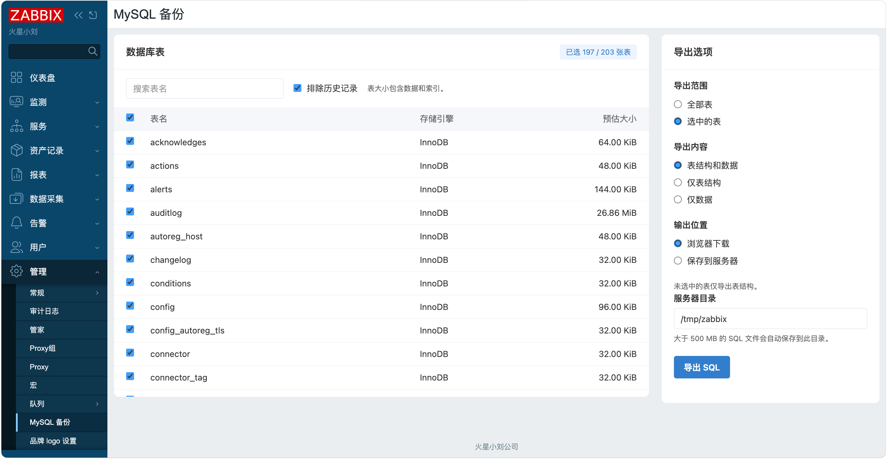

# Zabbix MySQL Backup Module

[中文](README.md)

## Version Compatibility

- Zabbix 7.0.x (verified on 7.0.32)
- Zabbix 8.0.x (verified on 8.0.0)

Supports Zabbix frontends backed by MySQL or MariaDB.

## Description

This frontend module exports database backups from Zabbix Web. It reuses the frontend's database connection to export base table definitions and rows as a SQL file. Open **Administration → MySQL backup** as a Zabbix Super admin.

## Features

- **Table selection**. View table names, storage engines, and estimated sizes including data and indexes. Filter by name and select tables in bulk.
- **Export modes**. Export structure and data, structure only, or data only. Unselected tables always retain their `CREATE TABLE` statements, including columns, indexes, and constraints.
- **Output destination**. Download in the browser or save on the server. When browser download is selected, files up to 500 MB (500,000,000 bytes) download directly. Larger files are saved automatically to the specified directory.
- **Time zone and language**. Filenames follow `zabbix_backup_yyyy-mm-dd_hh-mm-ss.sql` in the current user's time zone. The interface follows the frontend language setting and supports English and Chinese.
- **Interface**. Local CSS and JavaScript provide a responsive layout styled after Element Plus.
  


## Installation

### Install the Module

Copy `manifest.json`, `Module.php`, `actions/`, `assets/`, `lib/`, and `views/` from this directory into `modules/zabbix_backup_mysql/` under your Zabbix frontend. Common package paths are shown below.

| Zabbix version | Module directory |
| --- | --- |
| 7.0 | `/usr/share/zabbix/modules/zabbix_backup_mysql/` |
| 8.0 | `/usr/share/zabbix/ui/modules/zabbix_backup_mysql/` |

### Enable the Module

1. Sign in as a Super admin and open **Administration → General → Modules**.
2. Select **Scan directory** and enable **Zabbix MySQL Backup**.
3. Refresh the page and open **Administration → MySQL backup**.

## Usage

1. Under **Table scope**, choose all tables or selected tables. Use the search field to narrow the list and the header checkbox to select all filtered tables.
   Check **Exclude history records** to export only the structure of every table whose name starts with `history`.
2. Choose the export **Contents**.

   | Mode | Selected tables | Unselected tables |
   | --- | --- | --- |
   | Structure and data | `CREATE TABLE` and `INSERT` | `CREATE TABLE` |
   | Structure only | `CREATE TABLE` | `CREATE TABLE` |
   | Data only | `INSERT` | `CREATE TABLE` |

3. Choose **Download in browser** or **Save on server**, enter the server directory, and click **Export SQL**. For server saves, the page displays the absolute path and file size.

### Configure the Server Backup Directory

The default directory is `/tmp/zabbix`. The module attempts to create it if needed. To allow other locations, add `config.local.php` to the deployed module directory:

```php
<?php
return ['/var/lib/zabbix/mysql-backups'];
```

Enter a configured directory or one of its existing subdirectories in the form. The directory must be outside the web root, owned by the web service account, and have mode `0700`. Exported files use mode `0600`, and existing files with the same name are preserved. In container deployments, the directory is inside the frontend container and can be backed by a persistent volume.

## Notes

- **Backup contents**. A full backup includes users and credentials. SQL uses plain `CREATE TABLE` and `INSERT` with explicit column names. When importing a file generated in **Data only** mode, selected tables need existing compatible definitions, and unselected tables must be creatable in the destination database.
- **Data consistency**. InnoDB data is read from a single transaction snapshot.
- **Large files**. The module first writes the complete backup to the PHP temporary directory. Server saves also require enough free space at the destination. Web server, proxy, and PHP-FPM timeouts can affect long exports.

## Development

- `manifest.json`, `Module.php` — Module registration and menu entry
- `actions/BackupMysql.php`, `views/backupmysql.php` — Request handling and rendering
- `lib/SqlExport.php`, `lib/BackupFile.php` — SQL export and file saving
- `lib/LanguageManager.php`, `assets/` — Translations and frontend assets
- `tests/checks.php` — SQL export and 500 MB boundary regression checks
