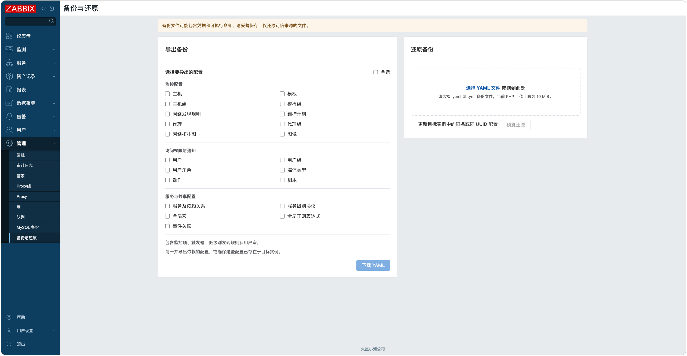

# Zabbix 备份与还原

[English](README_en.md)

## ✨ 版本兼容性

| Zabbix | PHP | manifest_version | 结果 |
|---|---|---|---|
| 6.0.49 | 7.3.33 | 1.0 | 两个扩展配置大类共 11 种配置通过真实导出、预览、新建还原、更新和回滚测试 |
| 7.0.32 | 8.0.30 | 2.0 | 可识别、可启用；页面通过 |
| 8.0.0 | 8.4.27 | 2.0 | 可识别、可启用；页面通过 |

## 描述

从 Zabbix 前端按类别导出配置到一个 YAML 文件，然后在目标实例预览并还原。单个 YAML 的导出和上传上限均为 **500 MiB（524,288,000 字节）**。支持 7.0 → 7.0、7.0 → 8.0 和 8.0 → 8.0，并可读取本模块旧版生成的 YAML。
  


## 功能特性

- 按类别导出 Zabbix 配置到 YAML，单文件上限为 500 MiB。
- 还原前预览源版本、目标版本与配置记录数。
- 创建缺失对象或更新匹配对象，失败时回滚当前批次。

## 安装步骤

### 安装模块

1. 在源、目标 Zabbix 前端创建 `modules/zabbix_backup_restore`，复制 `Module.php`、`manifest.json`、`actions/`、`assets/`、`lib/` 和 `views/`。

### ⚠️ 修改 manifest.json 文件

Zabbix 6.0 将模块清单版本改为 1.0；7.0/8.0 保持 2.0。

```bash
sed -i 's/"manifest_version": 2.0/"manifest_version": 1.0/' /usr/share/zabbix/modules/zabbix_backup_restore/manifest.json
```

### 启用模块

1. 用超级管理员打开 **管理 → 常规 → 模块**，扫描目录并启用 **Zabbix Backup and Restore**。
2. 进入 **管理 → 备份与还原**。模块的菜单、导出、预览和还原均要求超级管理员权限。

## 注意事项

### 目录归属与保存提示

仅当模块目录的属主或属组与 PHP 运行账号不匹配时，显示实际安装目录的归属修改命令；归属正确时不显示提醒。保存失败时，在原错误提示中补充修改目录归属和 `getenforce` 检查 SELinux 的提醒。提示跟随 Zabbix Web 用户语言，不增加弹窗或命令折叠区。

## 开发

### 本地回归测试

7.0/8.0 运行 `php tests/regression.php /path/to/zabbix/ui`，覆盖新版和旧版文件、500 MiB 边界、时区、引用映射、回滚及重复还原。6.0 运行 `php tests/legacy.php /path/to/zabbix`，检查旧版原生导出规则、两个扩展分类、用户组权限映射及 YAML 往返。各测试使用目标版本自带的 YAML 库和常量。

## 模块配置

### 导出和还原

1. 在源实例勾选配置类别。主机、模板、分组及引用对象可一起导出，也可以在目标实例预先准备依赖。点击 **下载 YAML**。文件名为 `zabbix_backup_yyyy-mm-dd_hh-mm-ss.yaml`，时间取自当前 Zabbix 用户的时区。
2. 在目标实例上传 `.yaml` 或 `.yml` 文件，选择还原方式。默认创建缺失对象。勾选 **更新目标实例中的同名或同 UUID 配置** 后，匹配对象的字段和相关子列表可被源配置更新或替换。执行更新前，可以先导出目标实例的配置作备份。
3. 点击 **预览还原**，核对来源和目标版本、文件记录数及需要手工补充的内容。预览校验文件结构和版本，记录数表示文件里包含的条目。目标依赖和写入校验在执行还原时完成。
4. 点击 **执行还原**。浏览器会再次上传同一文件。预览凭证与文件内容及还原选项绑定，有效期为一小时。重新选择文件、修改更新选项或预览过期后，需重新预览。
5. 模块使用 Zabbix API 创建、更新并重建引用。缺失或存在歧义的依赖会终止处理，失败的批次会回滚。完成后可按模板名、主机名或所属分组核对关键对象。

### 迁移范围

| 类别 | 可迁移配置 |
| --- | --- |
| 监控 | 主机、模板、主机组、模板组、网络发现规则、维护计划、代理、代理组 |
| 可视化 | 拓扑图、图像、模板仪表板、8.0 全局仪表板 |
| 访问与通知 | 用户、用户组、角色、通知接收地址、媒体类型、动作、脚本 |
| 服务与共享 | 服务及依赖、SLA、全局宏、全局正则表达式、事件关联 |

Zabbix 6.0 页面同样提供 **访问权限与通知**（用户、用户组、角色、媒体类型、动作、脚本）和 **服务与共享配置**（服务及依赖、SLA、全局宏、全局正则表达式、事件关联）。6.0 使用旧版用户组 rights、脚本字段和动作条件常量进行备份及还原。已在开发环境 6.0.49 上实测。更早的 6.0 补丁版本仍需在目标环境确认 API 能力。

6.0 的监控分类提供主机组、模板、主机、图像和拓扑图；模板组、代理组等后续版本配置请按对应版本的导出页面选择。本次 6.0 扩展配置验收覆盖同版本还原；跨大版本还原需在目标实例核对依赖与 API 差异。

监控项、触发器、低级别发现规则及其原型、Web 场景、值映射和用户宏随所属主机或模板迁移。选择带有依赖关系的模板或主机时，应同时导出所需父模板、分组、代理等对象，或确认目标实例已有这些依赖。低级别发现产生的对象由目标服务器重新发现。

- 配置备份的范围限于配置对象。历史、趋势、事件和当前运行状态需要通过相应的数据迁移方式处理。
- 新建本地账户后需要重置密码，机密宏的值需要重新配置。涉及 LDAP/SAML、MFA 或前端模块权限时，请先在目标准备对应的目录、认证方式及模块。外部系统预配的用户需要重新预配。
- 图像、拓扑图和仪表板采用 Zabbix 原生导出范围。相关所有者和共享权限请在目标核对。8.0 生成的备份需要 8.0 目标。
- YAML 可能包含 PSK、SNMP、媒体类型凭据和可执行配置。通过 HTTPS 传输，限制文件的存储和访问权限，并只还原可信文件。

### 500 MiB 大文件环境配置

500 MiB 指 YAML 文件本身。上传是 `multipart/form-data` 请求，请为表单字段和头部留出空间。可将各层请求体上限设为 **512 MiB（536,870,912 字节）**，单文件上限设为 500 MiB。代理、负载均衡器或 WAF 的较低限制也会生效。页面显示模块与 PHP 限制计算出的上传上限。Web 服务器和上游代理的限制需要分别核对。

模块按记录读写 YAML，导出先写到 PHP 临时目录，再向浏览器发送文件。上传临时目录和代理缓冲目录也可能落盘。为每个并发请求预留足够的可用磁盘空间，并确认运行用户可以写入相应目录。Zabbix 原生 API 仍会在 PHP 内存中构建待导出或还原的配置。内存峰值与对象数量、嵌套规模和并发量有关，可能达到文件体积的多倍。建议在目标环境测量代表性备份的峰值，再确定 PHP 内存配额、容器上限和 PHP-FPM 的 `pm.max_children`。资源紧张时可分批迁移，按依赖顺序还原。

#### PHP / PHP-FPM

在处理 Zabbix 的 PHP-FPM 池配置中设置参数。池配置常见于 `/etc/php-fpm.d/` 或 `/etc/php/<版本>/fpm/pool.d/`。请核对 Web 请求实际使用的池及其配置，CLI 的 `php -i` 只反映 CLI 环境。

```ini
; 合并到当前 Zabbix FPM 池
php_value[upload_max_filesize] = 500M
php_value[post_max_size] = 512M
php_value[max_input_time] = 1800
php_value[max_execution_time] = 1800
request_terminate_timeout = 2100s

; 内存充足的测试环境示例。按实测峰值、可用内存及并发量调整
php_value[memory_limit] = 16G
```

如使用 PHP 的 Web SAPI `php.ini`，直接设置 `upload_max_filesize`、`post_max_size`、`max_input_time`、`max_execution_time` 及 `memory_limit`；`request_terminate_timeout` 属于 FPM 池。必要时用 `upload_tmp_dir` 指定有足够空间、由 PHP 运行用户访问的上传临时目录。导出临时文件通常位于 PHP 的系统临时目录，可用 `sys_temp_dir` 指定。修改后用 `php-fpm -t` 或对应版本的 FPM 命令检查配置，再重载实际运行的服务。部署在容器时，同时核对容器的内存配额和挂载空间。 [PHP 参数手册](https://www.php.net/manual/zh/ini.core.php) · [PHP-FPM 池配置](https://www.php.net/manual/zh/install.fpm.configuration.php)

#### Apache 2.4 + PHP-FPM

把请求体设置放入服务 Zabbix 的虚拟主机或路径，把 `ProxyTimeout` 放入对应虚拟主机。下面的路径需与访问 URL 一致。

```apache
# Zabbix 虚拟主机内
ProxyTimeout 2100
<Location "/zabbix/">
    LimitRequestBody 536870912
</Location>
```

如果配置了 `RequestReadTimeout`，慢速上传还会受 `mod_reqtimeout` 的读取时间和最低速率限制。出现 HTTP 408 时检查该层。使用 `apachectl configtest` 或 `httpd -t` 检查后重载 Apache。 [LimitRequestBody](https://httpd.apache.org/docs/2.4/mod/core.html#limitrequestbody) · [ProxyTimeout](https://httpd.apache.org/docs/2.4/mod/mod_proxy.html#proxytimeout) · [mod_reqtimeout](https://httpd.apache.org/docs/2.4/mod/mod_reqtimeout.html)

#### Nginx

把以下设置合并到现有 Zabbix `server` 或匹配 `zabbix.php` 的 `location`。直连 PHP-FPM 时使用 `fastcgi_*`；Nginx 反代 Apache 时在执行 `proxy_pass` 的位置使用 `proxy_*`。

```nginx
client_max_body_size 512m;
client_body_timeout 300s;

# Nginx → PHP-FPM
fastcgi_send_timeout 2100s;
fastcgi_read_timeout 2100s;

# Nginx → Apache / 其他 HTTP 后端时，在现有 proxy_pass 位置设置
proxy_send_timeout 2100s;
proxy_read_timeout 2100s;
```

`client_body_timeout`、`fastcgi_read_timeout` 和 `proxy_read_timeout` 衡量的是连续两次读取数据之间的等待时间。大上传可能写入 `client_body_temp_path`。使用 `nginx -t` 校验后重载 Nginx。 [Nginx 请求体参数](https://nginx.org/en/docs/http/ngx_http_core_module.html#client_max_body_size) · [FastCGI 参数](https://nginx.org/en/docs/http/ngx_http_fastcgi_module.html#fastcgi_read_timeout) · [HTTP 反代参数](https://nginx.org/en/docs/http/ngx_http_proxy_module.html#proxy_read_timeout)

#### 验证和排错

| 现象 | 检查位置 |
| --- | --- |
| HTTP 413 或浏览器提示文件过大 | 模块的 500 MiB 上限、`upload_max_filesize`、`post_max_size` 及每一层代理的请求体限制 |
| `POST Content-Length ... exceeds the limit` | Web SAPI 生效的 `post_max_size`，其值需要大于文件和表单开销之和 |
| HTTP 500、`Allowed memory size ... exhausted` 或 FastCGI 连接被重置 | PHP-FPM 日志、池的 `memory_limit` 及容器或主机的内存限制 |
| HTTP 502、503 或 504 | PHP-FPM 工作进程状态、Apache/Nginx 错误日志、相应的执行时间和上游超时 |
| 预览可用，还原失败 | 文件及选项是否与预览一致，错误中列出的目标依赖、权限或 API 校验条件 |

重载后刷新模块页面，检查显示的 PHP 上传上限。先导出并预览一份小文件，再在隔离目标上验证代表性的大文件和正式还原。留意 Web 和 PHP-FPM 日志，并记录耗时、内存和临时磁盘峰值。

## 许可证

本模块的许可说明见仓库[许可证](../README.md#许可证)。分发时保留相关第三方署名。
