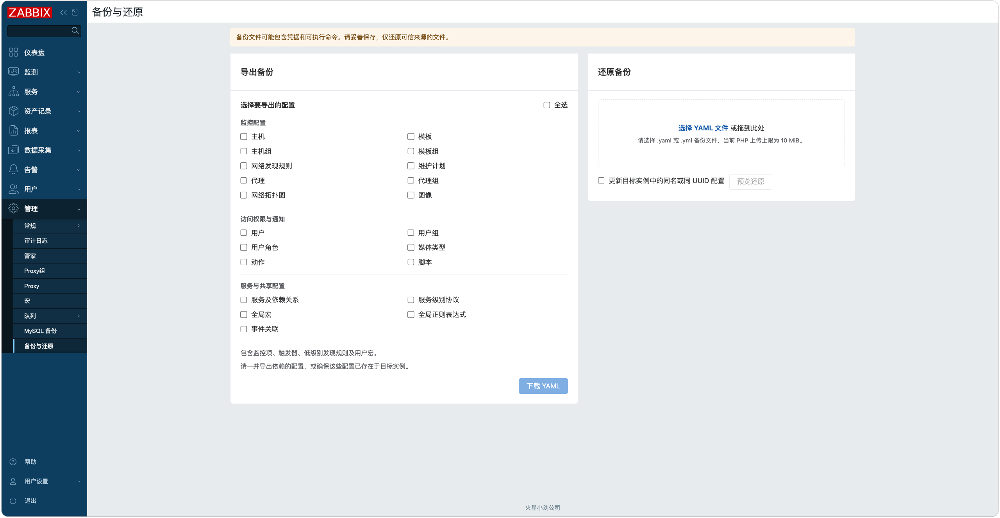

# Zabbix Backup and Restore

[中文](README.md)

## ✨ Version Compatibility

| Zabbix | PHP | manifest_version | Result |
|---|---|---|---|
| 6.0.49 | 7.3.33 | 1.0 | Recognized, enabled; pages pass |
| 7.0.32 | 8.0.30 | 2.0 | Recognized, enabled; pages pass |
| 8.0.0 | 8.4.27 | 2.0 | Recognized, enabled; pages pass |

## Description

Select configuration in the Zabbix frontend, export one YAML file, and preview and restore it on the destination. The per-file limit is **500 MiB (524,288,000 bytes)** for both export and upload. Supported migration paths are 7.0 → 7.0, 7.0 → 8.0, and 8.0 → 8.0. The module also reads backups made by earlier releases of this module.
  


## Features

- Export configuration categories to YAML, up to 500 MiB per file.
- Preview source and target versions and record counts before restoring.
- Create missing objects or update matching objects, with batch rollback on failure.

## Installation

### Install Module

1. Create `modules/zabbix_backup_restore` in both Zabbix frontends and copy `Module.php`, `manifest.json`, `actions/`, `assets/`, `lib/`, and `views/` into it.

### ⚠️ Modify manifest.json

For Zabbix 6.0, change the module manifest version to 1.0. Keep 2.0 on 7.0/8.0.

```bash
sed -i 's/"manifest_version": 2.0/"manifest_version": 1.0/' /usr/share/zabbix/modules/zabbix_backup_restore/manifest.json
```

### Enable Module

1. As a Super admin, open **Administration → General → Modules**, scan the directory, and enable **Zabbix Backup and Restore**.
2. Open **Administration → Backup and restore**. The menu and all backup operations require Super admin access.

## Notes

### Directory ownership and save errors

Module pages show an ownership command only when the directory owner or group differs from the PHP runtime account. Correct ownership produces no reminder. Save errors retain their original message and add directory ownership and SELinux (`getenforce`) reminders. Text follows the Zabbix Web user language. No extra dialogs or command panels are added.

## Development

### Local regression tests

`php tests/regression.php /path/to/zabbix/ui` uses the YAML parser and constants bundled with that frontend. It covers current and legacy files, the 500 MiB boundary, timezone-aware filenames, portable references, rollback, and retries.

## Module Configuration

### Export and restore

1. Select the configuration categories on the source. Include related configuration or confirm that it already exists on the destination. Click **Download YAML**. The filename follows `zabbix_backup_yyyy-mm-dd_hh-mm-ss.yaml` in the current Zabbix user's timezone.
2. On the destination, select the `.yaml` or `.yml` file and choose the restore mode. The default creates missing configuration. The update option also changes matching records by name or UUID and can replace their nested lists. Consider exporting the destination configuration before enabling updates.
3. Click **Preview restore**. Review the source and destination versions, counts from the file, and any manual follow-up. Preview checks the file structure and version. The module validates destination dependencies and writes during restore.
4. Click **Restore configuration**. The browser uploads the same file again. The confirmation is bound to the file contents and the restore option and expires after one hour. Preview again after selecting a different file, changing the option, or letting the confirmation expire.
5. The module writes through the Zabbix API and rebuilds references. A missing or ambiguous dependency stops the restore and rolls back the batch. Afterward, verify important records by their names or groups in the destination frontend.

### Migration coverage

| Area | Configuration |
| --- | --- |
| Monitoring | Hosts, templates, host groups, template groups, network discovery, maintenance periods, proxies, proxy groups |
| Visualization | Maps, images, template dashboards, global dashboards on 8.0 |
| Access and notifications | Users, user groups, roles, notification destinations, media types, actions, scripts |
| Services and shared configuration | Services and dependencies, SLAs, global macros, global regular expressions, event correlations |

Items, triggers, low-level discovery rules and prototypes, web scenarios, value maps, and user macros travel with their hosts or templates. Include referenced parent templates, groups, and proxies or make sure they exist on the destination. The destination rediscovers objects generated by discovery.

- The backup covers configuration objects. Migrate history, trends, events, and runtime state through the corresponding data migration workflows.
- Reset newly created local account passwords and re-enter secret macro values. Prepare referenced LDAP/SAML directories, MFA methods, and frontend modules on the destination. Provision externally managed users again.
- Zabbix native export determines map, image, and dashboard coverage. Check ownership and sharing on the destination. Backups created on 8.0 require an 8.0 destination.
- YAML can contain PSKs, SNMP or media credentials, and executable configuration. Use HTTPS, restrict access to the files, and restore backups from trusted sources.

### Server settings for 500 MiB files

The 500 MiB limit applies to the YAML file. A `multipart/form-data` upload also contains headers and form fields. Allow at least **512 MiB (536,870,912 bytes)** for the HTTP request and 500 MiB for the file. A lower limit on any web server, reverse proxy, load balancer, or WAF can reject the request. The module displays the limit calculated from the application and PHP settings. Check upstream limits separately.

The module reads and writes YAML by record. Export uses temporary storage before streaming the download. PHP uploads and proxy buffering can also consume temporary disk space. Allow enough space for concurrent requests and check directory access for the services involved. The native Zabbix APIs still build configuration structures in PHP memory. Peak usage can be several times the YAML size and depends on object count, nesting and concurrency. Measure a representative backup before sizing PHP memory, the container limit, and PHP-FPM's `pm.max_children`. With constrained resources, migrate in smaller batches and restore in dependency order.

#### PHP / PHP-FPM

Apply these settings to the pool that handles the Zabbix frontend. Pool files are commonly under `/etc/php-fpm.d/` or `/etc/php/<version>/fpm/pool.d/`. Confirm the effective settings for the web SAPI. The CLI configuration reported by `php -i` may differ.

```ini
; Add to the existing Zabbix FPM pool
php_value[upload_max_filesize] = 500M
php_value[post_max_size] = 512M
php_value[max_input_time] = 1800
php_value[max_execution_time] = 1800
request_terminate_timeout = 2100s

; Example for a test environment with sufficient RAM.
; Base this value on measured peak usage and available memory per worker.
php_value[memory_limit] = 16G
```

In the web SAPI's `php.ini`, use the regular PHP directives directly. `request_terminate_timeout` belongs to the FPM pool. Set `upload_tmp_dir` if PHP's upload directory needs a separate volume. PHP's system temporary directory, configurable with `sys_temp_dir`, holds the temporary export. Test with `php-fpm -t` or the matching versioned binary, then reload the correct service. For containers, check memory limits and mounted storage as well. [PHP configuration](https://www.php.net/manual/en/ini.core.php) · [PHP-FPM pool configuration](https://www.php.net/manual/en/install.fpm.configuration.php)

#### Apache 2.4 + PHP-FPM

Set `ProxyTimeout` in the Zabbix virtual host. Set `LimitRequestBody` for the frontend path, adjusting it to match the URL.

```apache
# Inside the Zabbix virtual host
ProxyTimeout 2100
<Location "/zabbix/">
    LimitRequestBody 536870912
</Location>
```

If `RequestReadTimeout` is set, its body timeout and minimum data rate also apply to slow uploads. Check that layer for HTTP 408. Run `apachectl configtest` or `httpd -t` before reloading Apache. [LimitRequestBody](https://httpd.apache.org/docs/2.4/mod/core.html#limitrequestbody) · [ProxyTimeout](https://httpd.apache.org/docs/2.4/mod/mod_proxy.html#proxytimeout) · [mod_reqtimeout](https://httpd.apache.org/docs/2.4/mod/mod_reqtimeout.html)

#### Nginx

Apply the directives in the existing Zabbix `server` or the `location` handling `zabbix.php`. Use the FastCGI timeouts when Nginx connects to PHP-FPM. Use the proxy timeouts in the existing `proxy_pass` location when it forwards to Apache or another HTTP backend.

```nginx
client_max_body_size 512m;
client_body_timeout 300s;

# Nginx → PHP-FPM
fastcgi_send_timeout 2100s;
fastcgi_read_timeout 2100s;

# Nginx → Apache or another HTTP backend
proxy_send_timeout 2100s;
proxy_read_timeout 2100s;
```

The client body and upstream read timeouts measure idle time between reads. Large uploads may use disk in `client_body_temp_path`. Run `nginx -t` before reloading Nginx. [Nginx request body settings](https://nginx.org/en/docs/http/ngx_http_core_module.html#client_max_body_size) · [FastCGI settings](https://nginx.org/en/docs/http/ngx_http_fastcgi_module.html#fastcgi_read_timeout) · [HTTP proxy settings](https://nginx.org/en/docs/http/ngx_http_proxy_module.html#proxy_read_timeout)

#### Verification and troubleshooting

| Symptom | What to check |
| --- | --- |
| HTTP 413 or file size error | The module's 500 MiB limit, `upload_max_filesize`, `post_max_size`, and the request limit at every proxy |
| `POST Content-Length ... exceeds the limit` | Effective web SAPI `post_max_size`, with room for both the YAML and multipart overhead |
| HTTP 500, `Allowed memory size ... exhausted`, or a reset FastCGI connection | PHP-FPM logs, pool `memory_limit`, and host or container memory limits |
| HTTP 502, 503, or 504 | PHP-FPM workers, Apache/Nginx error logs, execution limits, and upstream timeouts |
| Preview succeeds and restore fails | The file and option used in preview, then destination references and API validation errors |

After reloading the services, refresh the module and check the PHP upload limit displayed on the page. Export and preview a small file first. Then test a representative large file and an actual restore on an isolated destination. Review both PHP and web server logs, and record elapsed time, memory and temporary disk usage.

## License

See the repository [license terms](../README_en.md#license). Preserve third-party attribution when redistributing.
