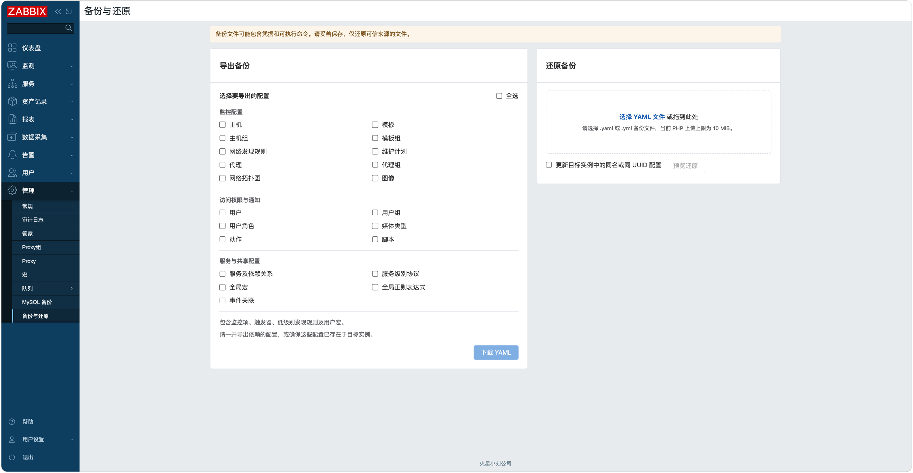

# Zabbix Backup and Restore — резервное копирование и восстановление

[中文](README.md) · [English](README_en.md)

## Совместимость версий

| Zabbix | PHP | `manifest_version` | Результат проверки |
| --- | --- | --- | --- |
| 6.0.49 | 7.3.33 | 1.0 | Для всех 11 типов из категорий доступа и общей конфигурации проверены экспорт, предпросмотр, создание, обновление и откат |
| 7.0.32 | 8.0.30 | 2.0 | Модуль обнаружен и включён, страницы прошли проверку |
| 8.0.0 | 8.4.27 | 2.0 | Модуль обнаружен и включён, страницы прошли проверку |

## Описание

В веб-интерфейсе можно выбрать категории конфигурации, выгрузить единый файл YAML, проверить его в предпросмотре и восстановить на целевом экземпляре. Лимит при экспорте и загрузке — **500 МиБ (524 288 000 байт)** на файл.

Поддерживаются переносы 7.0 → 7.0, 7.0 → 8.0 и 8.0 → 8.0. Модуль читает копии из своих предыдущих выпусков. Для Zabbix 6.0 проверено восстановление на той же версии.



Интерфейс поддерживает китайский, английский и русский языки. Чтобы включить русский, выберите **Русский** в профиле Zabbix. При выборе языка по умолчанию используется системная настройка `default_lang`.

## Установка

### Размещение модуля

Создайте `modules/zabbix_backup_restore` в исходном и целевом веб-интерфейсах. Скопируйте `Module.php`, `manifest.json`, `actions/`, `assets/`, `lib/` и `views/`.

### Манифест для Zabbix 6.0

Для Zabbix 6.0 измените `manifest_version` на `1.0`. Для Zabbix 7.0 и 8.0 используется `2.0`.

```bash
sed -i 's/"manifest_version": 2.0/"manifest_version": 1.0/' /usr/share/zabbix/modules/zabbix_backup_restore/manifest.json
```

### Включение модуля

Войдите с правами суперадминистратора.

1. Откройте **Администрирование → Общие → Модули**.
2. Нажмите **Сканировать каталог**.
3. Найдите и включите **Zabbix Backup and Restore**.
4. Откройте **Администрирование → Резервное копирование и восстановление**. Для всех операций нужны права суперадминистратора.

### Владелец каталога и ошибки сохранения

Если владелец или группа каталога отличаются от учётной записи, под которой работает PHP, на странице модуля появится команда для изменения владельца. В сообщении об ошибке сохранения будут подсказки о правах на каталог и проверке SELinux командой `getenforce`.

## Экспорт и восстановление

1. На исходном экземпляре выберите категории. Добавьте связанные настройки или убедитесь, что они уже есть на целевом сервере. Нажмите **Скачать YAML**. Имя `zabbix_backup_yyyy-mm-dd_hh-mm-ss.yaml` использует часовой пояс профиля.
2. На целевой стороне выберите файл `.yaml` или `.yml` и режим. По умолчанию создаются отсутствующие объекты. Обновление также изменяет записи с совпадающими именами или UUID и может заменять вложенные списки. Перед обновлением сохраните копию целевой конфигурации.
3. Нажмите **Предпросмотр восстановления** и проверьте версии, количество записей и указания по ручным действиям. Модуль проверяет структуру и версию файла. Целевые зависимости проверяются на этапе записи.
4. Нажмите **Восстановить конфигурацию**. Браузер повторно загружает тот же файл. Подтверждение действует один час и привязано к содержимому файла и режиму. После изменения файла, режима или истечения срока повторите предпросмотр.
5. Модуль записывает через API Zabbix и восстанавливает ссылки. Отсутствующая или неоднозначная зависимость останавливает запись и откатывает весь пакет. После восстановления проверьте важные записи по имени или группе.

### Что переносится

| Категория | Конфигурация |
| --- | --- |
| Мониторинг | Узлы сети и их группы, шаблоны и их группы, сетевое обнаружение, обслуживание, прокси и группы прокси. |
| Визуализация | Карты, изображения, панели шаблонов и глобальные панели Zabbix 8.0. |
| Доступ и оповещения | Пользователи, группы, роли, получатели, способы оповещения, действия и скрипты. |
| Услуги и общая конфигурация | Услуги и зависимости, SLA, глобальные макросы и регулярные выражения, корреляции событий. |

В Zabbix 6.0 категория **Мониторинг** охватывает группы узлов, шаблоны, узлы, изображения и карты. Группы шаблонов и прокси появляются в новых версиях. Для двух расширенных категорий модуль адаптирует права групп, поля скриптов и константы условий действий. Операции проверены на 6.0.49. Для ранних исправлений 6.0 и переноса между версиями предварительно проверьте API и зависимости.

Элементы данных, триггеры, правила и прототипы низкоуровневого обнаружения, веб-сценарии, преобразования значений и пользовательские макросы переносятся вместе с узлами или шаблонами. Ссылки на родительские шаблоны, группы и прокси должны разрешаться на целевой стороне. Обнаруженные объекты создаются заново правилами обнаружения.

- Для истории, динамики, событий и рабочего состояния используйте соответствующие инструменты миграции данных.
- Сбросьте пароли новых локальных учётных записей и заново задайте скрытые значения макросов. Подготовьте каталоги LDAP/SAML, методы MFA и модули веб-интерфейса. Повторно подготовьте внешних пользователей.
- Набор переносимых карт, изображений и панелей определяется штатным экспортом Zabbix. На целевой стороне проверьте владельцев и общий доступ. Копии 8.0 требуют целевой версии 8.0.
- YAML может содержать PSK, учётные данные SNMP и оповещений, а также исполняемую конфигурацию. Используйте HTTPS, храните файлы с ограниченным доступом и восстанавливайте из доверенных источников.

## Настройки сервера для файлов до 500 МиБ

Для самого файла разрешите 500 МиБ. Для HTTP-запроса `multipart/form-data` с заголовками и полями выделите не менее **512 МиБ (536 870 912 байт)**. Проверьте ограничения веб-сервера, обратного прокси, балансировщика и WAF. Интерфейс показывает лимит, вычисленный из настроек приложения и PHP.

Модуль обрабатывает YAML по записям. При экспорте, загрузке PHP и буферизации прокси используется временное дисковое пространство. Зарезервируйте место на одновременные запросы и проверьте права каталогов. Штатный API Zabbix собирает структуры в памяти PHP. Пиковый расход зависит от числа объектов, вложенности и параллельных операций и может превышать размер файла в несколько раз. Измерьте расход на типичной копии перед настройкой `memory_limit`, памяти контейнера и `pm.max_children`. При ограниченных ресурсах переносите небольшие пакеты в порядке зависимостей.

### PHP и PHP-FPM

Примените настройки к пулу веб-интерфейса Zabbix. Файлы пула обычно находятся в `/etc/php-fpm.d/` или `/etc/php/<version>/fpm/pool.d/`. Проверяйте действующие настройки веб-SAPI, поскольку вывод `php -i` относится к CLI.

```ini
; Добавьте в существующие настройки пула FPM для Zabbix
php_value[upload_max_filesize] = 500M
php_value[post_max_size] = 512M
php_value[max_input_time] = 1800
php_value[max_execution_time] = 1800
request_terminate_timeout = 2100s

; Пример для тестовой среды с достаточной памятью.
; Рассчитайте по пиковому расходу и памяти, доступной отдельному процессу.
php_value[memory_limit] = 16G
```

В `php.ini` веб-SAPI указывайте обычные PHP-директивы напрямую. Параметр `request_terminate_timeout` задаётся в пуле FPM. При необходимости отдельного тома задайте `upload_tmp_dir`. Для временного экспорта PHP использует системный каталог `sys_temp_dir`. Перед перезагрузкой выполните `php-fpm -t` или проверку эквивалентным бинарным файлом. В контейнере проверьте лимит памяти и смонтированные тома. [Настройки PHP](https://www.php.net/manual/en/ini.core.php) · [Настройки PHP-FPM](https://www.php.net/manual/en/install.fpm.configuration.php)

### Apache 2.4 с PHP-FPM

Укажите `ProxyTimeout` в виртуальном хосте Zabbix и настройте `LimitRequestBody` для фактического пути веб-интерфейса.

```apache
# Внутри виртуального хоста Zabbix
ProxyTimeout 2100
<Location "/zabbix/">
    LimitRequestBody 536870912
</Location>
```

При `RequestReadTimeout` тайм-аут тела и минимальная скорость влияют на медленные загрузки. При HTTP 408 проверьте этот параметр. Перед перезагрузкой запустите `apachectl configtest` или `httpd -t`. [LimitRequestBody](https://httpd.apache.org/docs/2.4/mod/core.html#limitrequestbody) · [ProxyTimeout](https://httpd.apache.org/docs/2.4/mod/mod_proxy.html#proxytimeout) · [mod_reqtimeout](https://httpd.apache.org/docs/2.4/mod/mod_reqtimeout.html)

### Nginx

Примените директивы в существующем блоке `server` или в `location`, который обслуживает `zabbix.php`. Для PHP-FPM настройте FastCGI, а для Apache или другого HTTP-сервера — параметры в блоке с `proxy_pass`.

```nginx
client_max_body_size 512m;
client_body_timeout 300s;

# Nginx → PHP-FPM
fastcgi_send_timeout 2100s;
fastcgi_read_timeout 2100s;

# Nginx → Apache или другой HTTP-сервер
proxy_send_timeout 2100s;
proxy_read_timeout 2100s;
```

Тайм-ауты тела запроса и чтения от сервера измеряют ожидание между чтениями. Большие запросы могут использовать диск в `client_body_temp_path`. Перед перезагрузкой выполните `nginx -t`. [Тело запроса](https://nginx.org/en/docs/http/ngx_http_core_module.html#client_max_body_size) · [FastCGI](https://nginx.org/en/docs/http/ngx_http_fastcgi_module.html#fastcgi_read_timeout) · [Обратный прокси](https://nginx.org/en/docs/http/ngx_http_proxy_module.html#proxy_read_timeout)

### Проверка и устранение неполадок

| Симптом | Что проверить |
| --- | --- |
| HTTP 413 или сообщение о размере | Лимит модуля 500 МиБ, `upload_max_filesize`, `post_max_size` и лимиты всех прокси. |
| `POST Content-Length ... exceeds the limit` | `post_max_size` веб-SAPI с запасом на служебные данные multipart. |
| HTTP 500, `Allowed memory size ... exhausted` или сброс FastCGI | Журнал PHP-FPM, `memory_limit` пула и лимит памяти хоста или контейнера. |
| HTTP 502, 503 или 504 | Процессы PHP-FPM, журналы Apache/Nginx, ограничения выполнения и тайм-ауты. |
| Предпросмотр проходит, восстановление завершается ошибкой | Проверьте совпадение файла и режима с предпросмотром, зависимости назначения и ошибки API. |

После перезагрузки проверьте лимит в интерфейсе и начните с небольшой копии. Затем испытайте типичный большой файл и восстановление на изолированном целевом экземпляре. Проверьте журналы PHP и веб-сервера, время выполнения, память и временное место на диске.

## Регрессионные тесты

Для 7.0/8.0 запустите `php tests/regression.php /path/to/zabbix/ui`. Проверяются текущие и предыдущие форматы, предел 500 МиБ, часовые пояса, ссылки, откат и повторные попытки. Для 6.0 запустите `php tests/legacy.php /path/to/zabbix`. Проверяются штатные правила импорта, две расширенные категории, права групп и цикл YAML. Оба набора используют YAML-парсер и константы установленной версии Zabbix.

## Лицензия

См. [условия лицензии проекта](../README_ru.md#лицензия). При распространении сохраняйте сведения об авторах сторонних компонентов.
