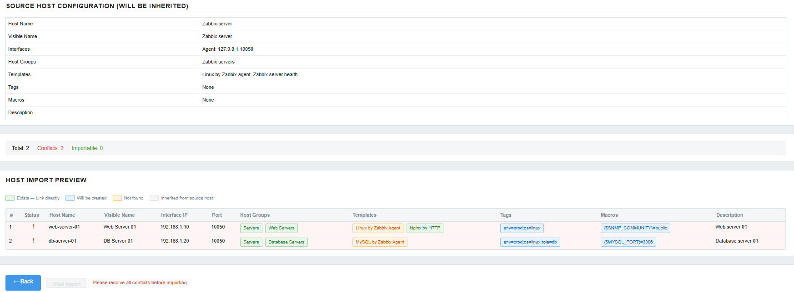
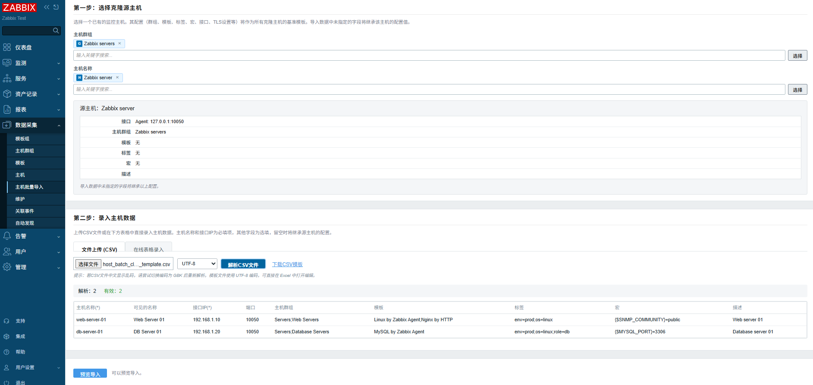
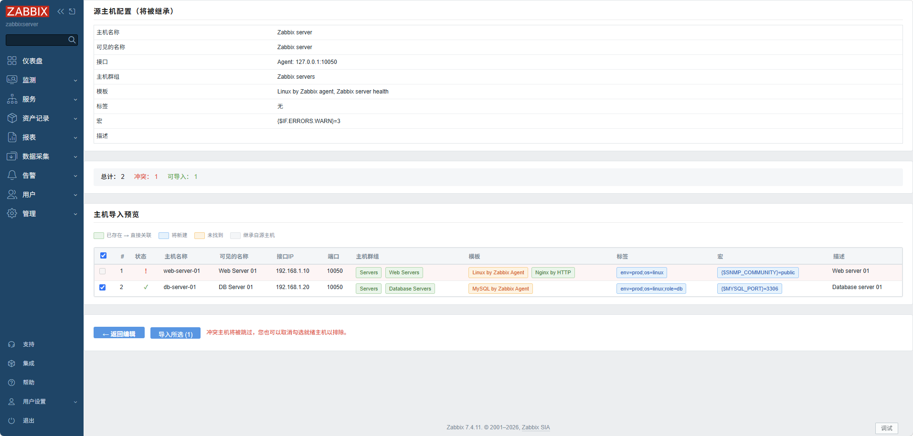
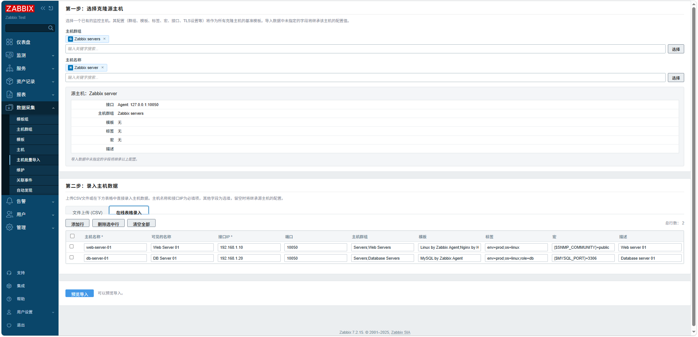

# Zabbix Clonehosts — массовый импорт узлов сети

[中文](README.md) · [English](README_en.md)

## Совместимость версий

| Zabbix | PHP | `manifest_version` | Результат проверки |
| --- | --- | --- | --- |
| 6.0.49 | 7.3.33 | 1.0 | Модуль обнаружен и включён, страницы прошли проверку |
| 7.0.32 | 8.0.30 | 2.0 | Модуль обнаружен и включён, страницы прошли проверку |
| 8.0.0 | 8.4.27 | 2.0 | Модуль обнаружен и включён, страницы прошли проверку |

## Описание

Модуль создаёт узлы сети на основе существующего узла под мониторингом. В меню **Сбор данных → Массовый импорт узлов сети** можно загрузить CSV или заполнить таблицу в браузере, проверить конфликты и наблюдать за ходом импорта.






## Возможности

- Исходный узел задаёт интерфейсы, группы, шаблоны, теги, макросы, TLS, IPMI, режим инвентаризации и другие параметры для наследования.
- При загрузке CSV доступны UTF-8, GBK и Windows-1251. Модуль распознаёт заголовки и позволяет скачать шаблон. В онлайн-таблице можно добавлять, удалять и проверять строки.
- Имя и IP-адрес интерфейса обязательны. Пустые необязательные поля заполняются на основе настроек исходного узла.
- Отсутствующие группы узлов создаются через API перед привязкой.
- Предпросмотр выявляет дубликаты в пакете, конфликты имён с узлами и шаблонами в Zabbix и незаполненные обязательные поля. Статусы показывают, будет ли объект создан, привязан или унаследован.
- Узлы с конфликтами пропускаются. Готовые к импорту узлы можно исключить вручную. При возврате в редактор заполненные данные сохраняются.
- Узлы создаются последовательно через AJAX. Страница показывает ход операции и счётчики, а по завершении предлагает CSV с результатами, ID и сообщениями об ошибках.

Интерфейс поддерживает китайский, английский и русский языки. Чтобы включить русский, выберите **Русский** в профиле Zabbix. При выборе языка по умолчанию используется системная настройка `default_lang`.

## Установка

### Размещение модуля

```bash
# Установка в Zabbix 6.0 / 7.0
git clone https://github.com/X-Mars/zabbix_modules.git /usr/share/zabbix/modules/

# Установка в Zabbix 7.2+ / 7.4 / 8.0
git clone https://github.com/X-Mars/zabbix_modules.git /usr/share/zabbix/ui/modules/
```

### Манифест для Zabbix 6.0

Для Zabbix 6.0 измените `manifest_version` на `1.0`. Для Zabbix 7.0 и 8.0 используется `2.0`.

```bash
sed -i 's/"manifest_version": 2.0/"manifest_version": 1.0/' zabbix_clonehosts/manifest.json
```

### Включение модуля

1. Откройте **Администрирование → Общие → Модули**.
2. Нажмите **Сканировать каталог**.
3. Найдите и включите **Zabbix Clonehosts**.
4. Обновите страницу. В разделе **Сбор данных** после списка узлов сети появится пункт **Массовый импорт узлов сети**.

## Примечания

- Для больших наборов рекомендуется импортировать около 500 узлов за запуск, поскольку они создаются последовательно.
- Техническое имя узла уникально среди узлов и шаблонов. Недостающие шаблоны помечаются в предпросмотре и пропускаются.
- Для CSV рекомендуется UTF-8. Если символы искажены, выберите кодировку исходного файла и повторите разбор.
- Для импорта нужны права администратора Zabbix или суперадминистратора.
- Импорт использует снимок конфигурации исходного узла. Изменения исходного узла во время импорта не затрагивают уже созданные узлы.

### Владелец каталога и ошибки сохранения

Если владелец или группа каталога отличаются от учётной записи, под которой работает PHP, на странице модуля появится команда для изменения владельца. В сообщении об ошибке сохранения будут подсказки о правах на каталог и проверке SELinux командой `getenforce`.

## Разработка

- `manifest.json` — конфигурация, маршруты и ресурсы.
- `Module.php` и `CompatHelper.php` — регистрация меню и совместимость API Zabbix 6.0/6.4/7.x/8.x.
- `LangHelper.php` — локализация в PHP-массиве без зависимости от gettext.
- `actions/Clonehosts.php` — выбор исходного узла, загрузка CSV и ввод в таблицу.
- `actions/ClonehostsSource.php` — загрузка параметров исходного узла через AJAX.
- `actions/ClonehostsPreview.php` — проверка конфликтов и предпросмотр.
- `actions/ClonehostsImport.php` — последовательное создание узлов через AJAX.
- `views/`, `assets/js/` и `assets/css/` — представления, скрипты и стили.
- `clonehosts_template.csv` — шаблон импорта.

Подробнее о структуре см. в [документации Zabbix](https://www.zabbix.com/documentation/current/en/devel/modules/file_structure).

## Формат CSV

Шаблон `clonehosts_template.csv` доступен на странице импорта по кнопке **Скачать шаблон CSV**. Столбцы идут в указанном порядке.

| Поле | Обязательно | Назначение |
| --- | --- | --- |
| Имя узла сети (*) | Да | Уникальное техническое имя в общем пространстве имён узлов и шаблонов. |
| Видимое имя | Нет | При пустом значении используется имя узла. |
| IP-адрес интерфейса (*) | Да | Адрес интерфейса узла. |
| Порт | Нет | При пустом значении используется порт исходного узла. |
| Группы узлов сети | Нет | Группы через `;`. Отсутствующие группы создаются. |
| Шаблоны | Нет | Шаблоны через `;`. Поиск выполняется по техническому или видимому имени. |
| Теги | Нет | Пары `tag=value` через `;`. |
| Макросы | Нет | Пары `{$MACRO}=value` через `;`. |
| Описание | Нет | Описание узла сети. |

Ниже приведён пример файла с русскими заголовками.

```csv
Имя узла сети (*),Видимое имя,IP-адрес интерфейса (*),Порт,Группы узлов сети,Шаблоны,Теги,Макросы,Описание
web-server-01,Web Server 01,192.168.1.10,10050,Servers;Web Servers,Linux by Zabbix Agent;Nginx by HTTP,env=prod;os=linux,{$SNMP_COMMUNITY}=public,Web server 01
db-server-01,DB Server 01,192.168.1.20,10050,Servers;Database Servers,MySQL by Zabbix Agent,env=prod;os=linux;role=db,{$MYSQL_PORT}=3306,Database server 01
```

## Лицензия

Модуль распространяется по лицензии GPL-2.0.
