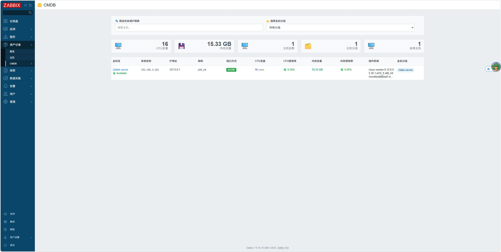
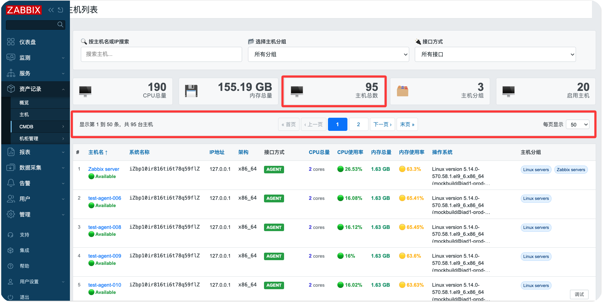
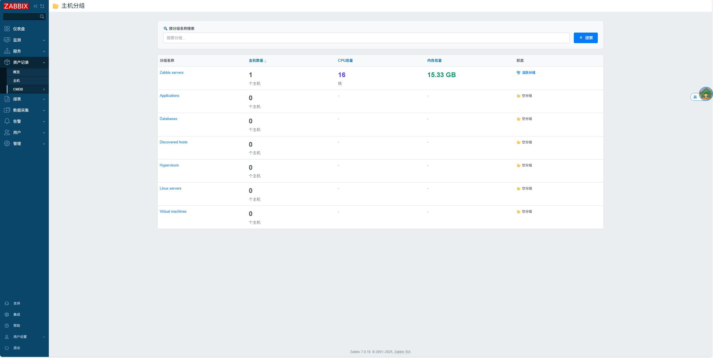

# Zabbix CMDB Module

[中文](README.md)

## ✨ Version Compatibility

| Zabbix | PHP | manifest_version | Result |
|---|---|---|---|
| 6.0.49 | 7.3.33 | 1.0 | Recognized, enabled; pages pass |
| 7.0.32 | 8.0.30 | 2.0 | Recognized, enabled; pages pass |
| 8.0.0 | 8.4.27 | 2.0 | Recognized, enabled; pages pass |

## Description

This is a Zabbix frontend module that provides Configuration Management Database (CMDB) functionality, offering centralized viewing and management of host information. The module adds a CMDB menu under the Inventory section of Zabbix Web, supporting host search and group filtering.





## Features

- **Host Search**: Search by hostname or IP address
- **Group Filtering**: Filter by host groups
- **Host Information Display**:
  - Host name (clickable link to host details)
  - IP address
  - Interface type (Agent, SNMP, IPMI, JMX)
  - CPU total
  - Memory total
  - Kernel version
  - Host groups
  - Host status (Active/Disabled)
- **Host Group Management**: View statistics for all host groups
- **Group Search**: Search by group name
- **Group Statistics**: Display host count, CPU total, memory total per group
- **Internationalization**: Support for Chinese and English interfaces
- **Responsive Design**: Adapts to different screen sizes
- **Modern Interface**: Modern design with gradient colors and animation effects
- **Statistics**: Display total hosts, total groups, and active host counts

## Installation

### Install Module

```bash
# Zabbix 6.0 / 7.0 deployment
git clone https://github.com/X-Mars/zabbix_modules.git /usr/share/zabbix/modules/

# Zabbix 7.2+ / 7.4 / 8.0 deployment
git clone https://github.com/X-Mars/zabbix_modules.git /usr/share/zabbix/ui/modules/
```

### ⚠️ Modify manifest.json

```bash
# ⚠️ For Zabbix 6.0, modify manifest_version
sed -i 's/"manifest_version": 2.0/"manifest_version": 1.0/' zabbix_cmdb/manifest.json
```

### Enable Module

1. Go to **Administration → General → Modules**.
2. Click **Scan directory** to scan for new modules.
3. Find the "Zabbix CMDB" module and enable it.
4. Refresh the page. The module will appear under the **Inventory** menu as "CMDB" submenu, containing "Host List" and "Host Groups" subitems.

## Notes

- **Performance**: For large environments, consider limiting query result quantities appropriately.
- **Data Accuracy**: Displayed information is based on the current state of the Zabbix database.
- **Item Dependencies**: Display of CPU and memory information depends on corresponding item configuration.

### Directory ownership and save errors

Module pages show an ownership command only when the directory owner or group differs from the PHP runtime account. Correct ownership produces no reminder. Save errors retain their original message and add directory ownership and SELinux (`getenforce`) reminders. Text follows the Zabbix Web user language. No extra dialogs or command panels are added.

## Development

The module is built on the Zabbix module framework. File structure:

- `manifest.json`: Module configuration
- `Module.php`: Menu registration
- `actions/Cmdb.php`: Host list business logic
- `actions/CmdbGroups.php`: Host groups business logic
- `views/cmdb.php`: Host list page view
- `views/cmdb.groups.php`: Host groups page view
- `lib/LanguageManager.php`: Internationalization language management
- `lib/ItemFinder.php`: Item finder utilities
- `lib/ViewRenderer.php`: View rendering utilities
- `lib/ZabbixVersion.php`: Version compatibility utilities

For extensions, refer to [Zabbix module documentation](https://www.zabbix.com/documentation/7.0/en/devel/modules).

## Module Configuration

### CMDB Item Configuration

Super admins can manage matching rules for CPU total, CPU utilization, memory total and memory utilization under Inventory → CMDB → Monitoring item settings.

- Rules are stored in `data/item_rules.json`; the first matching rule in each metric list wins.
- Match an item name or key exactly or by a case-insensitive pattern. Pattern matching supports substring matching and `*`; brackets are literal.
- Reorder rules with Move up / Move down. If multiple enabled items match, choose the lowest item ID. If its latest value is missing, read its history instead of skipping to a later rule.
- CPU total uses cores, memory total uses bytes, and utilization uses percentages. Idle/available values can use the `100 − value` conversion.
- An empty list disables the metric. Host lists, totals and group statistics share the same rules; saved changes apply on the next request.
- The default JSON preserves existing rules, including system information. Check that fallback CPU load, Used memory and broad memory.size items use the expected units for your templates.
- PHP needs read/write access to `data` and read access to the JSON. Other code directories may remain read-only. Saves use atomic replacement with Super admin and CSRF checks. Preserve `data/item_rules.json` during upgrades.
- Read failures are reported; there is no hidden hardcoded fallback.

Rule tests: `php zabbix_cmdb/tests/item_rules.php` (writes only to a system temporary directory).

## License

This project follows the Zabbix license. For details, see [Zabbix License](https://www.zabbix.com/license).
