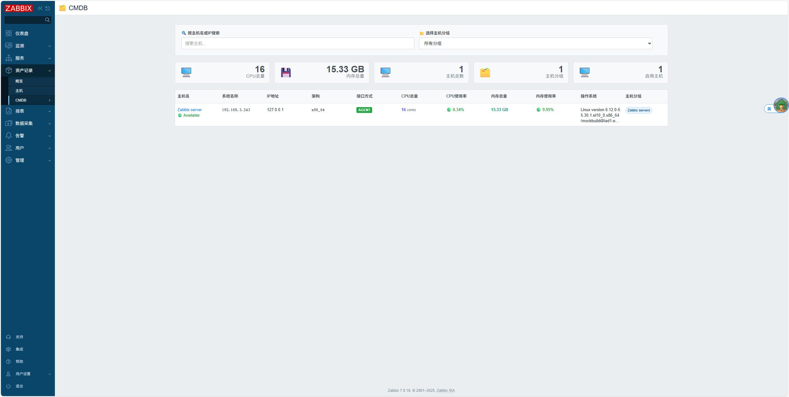
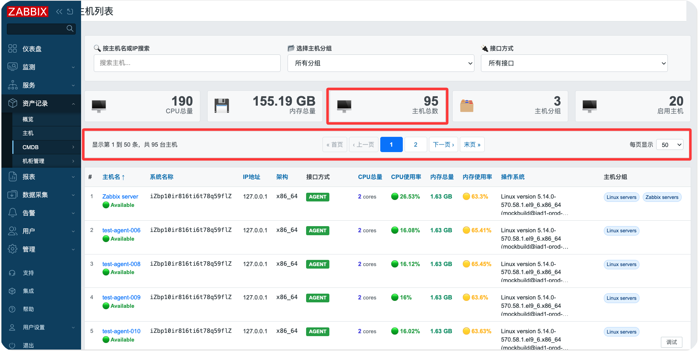
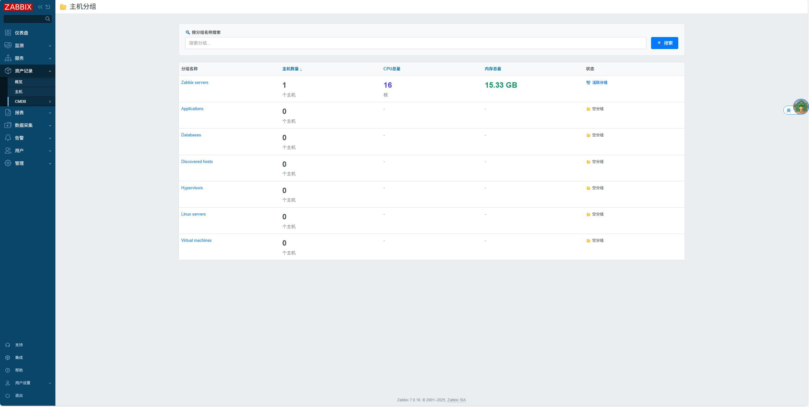

# Zabbix CMDB — база данных управления конфигурациями

[中文](README.md) · [English](README_en.md)

## Совместимость версий

| Zabbix | PHP | `manifest_version` | Результат проверки |
| --- | --- | --- | --- |
| 6.0.49 | 7.3.33 | 1.0 | Модуль обнаружен и включён, страницы прошли проверку |
| 7.0.32 | 8.0.30 | 2.0 | Модуль обнаружен и включён, страницы прошли проверку |
| 8.0.0 | 8.4.27 | 2.0 | Модуль обнаружен и включён, страницы прошли проверку |

## Описание

В разделе **Инвентаризация → CMDB** собраны сведения о конфигурации узлов сети. Можно искать узлы по имени и IP-адресу и фильтровать по группам.





## Возможности

- Список узлов сети с переходом к сведениям об узле. В списке видны IP-адреса, типы интерфейсов (агент, SNMP, IPMI, JMX), число ядер ЦП, объём памяти, версия ядра ОС, группы и состояние узла.
- Поиск групп по имени, статистика числа узлов, ядер и объёма памяти в каждой группе.
- Сводные счётчики узлов, групп и активных узлов.
- Адаптивное отображение на экранах разного размера.

Интерфейс поддерживает китайский, английский и русский языки. Чтобы включить русский, выберите **Русский** в профиле Zabbix. При выборе языка по умолчанию используется системная настройка `default_lang`.

## Установка

### Размещение модуля

```bash
# Установка в Zabbix 6.0 / 7.0
git clone https://github.com/X-Mars/zabbix_modules.git /usr/share/zabbix/modules/

# Установка в Zabbix 7.2+ / 7.4 / 8.0
git clone https://github.com/X-Mars/zabbix_modules.git /usr/share/zabbix/ui/modules/
```

### Манифест для Zabbix 6.0

Для Zabbix 6.0 измените `manifest_version` на `1.0`. Для Zabbix 7.0 и 8.0 используется `2.0`.

```bash
# Для Zabbix 6.0 измените manifest_version
sed -i 's/"manifest_version": 2.0/"manifest_version": 1.0/' zabbix_cmdb/manifest.json
```

### Включение модуля

1. Откройте **Администрирование → Общие → Модули**.
2. Нажмите **Сканировать каталог**.
3. Найдите и включите **Zabbix CMDB**.
4. Обновите страницу и откройте **Инвентаризация → CMDB → Список узлов сети** или **Группы узлов сети**.

## Примечания

Данные отражают текущее состояние базы Zabbix. Для отображения показателей ЦП и памяти настройте соответствующие элементы данных. В крупных установках ограничивайте выборку для ускорения запросов.

### Владелец каталога и ошибки сохранения

Если владелец или группа каталога отличаются от учётной записи, под которой работает PHP, на странице модуля появится команда для изменения владельца. В сообщении об ошибке сохранения будут подсказки о правах на каталог и проверке SELinux командой `getenforce`.

## Разработка

- `manifest.json` и `Module.php` — конфигурация и регистрация меню.
- `actions/Cmdb.php`, `actions/CmdbGroups.php` — контроллеры списка узлов и групп.
- `views/cmdb.php`, `views/cmdb.groups.php` — представления.
- `lib/LanguageManager.php`, `lib/ItemFinder.php`, `lib/ViewRenderer.php` и `lib/ZabbixVersion.php` — локализация, поиск элементов данных, вывод и совместимость версий.

Сведения о расширении модуля см. в [документации по разработке модулей Zabbix](https://www.zabbix.com/documentation/7.0/en/devel/modules).

## Настройка элементов данных

Суперадминистраторы могут настроить правила в разделе **Инвентаризация → CMDB → Настройка элементов данных**. Правила определяют число ядер ЦП, объём памяти и степень их использования.

- Правила хранятся в `data/item_rules.json`. Для каждой метрики применяется первое совпавшее правило.
- Для имени или ключа можно выбрать точное или нечёткое совпадение. Нечёткий поиск учитывает подстроку и символ `*` и игнорирует регистр. Скобки обрабатываются буквально.
- Порядок меняется кнопками **Переместить вверх** и **Переместить вниз**. Если совпадает несколько включённых элементов, выбирается наименьший ID. При отсутствии последнего значения модуль обращается к истории этого элемента.
- Число ядер ЦП выражается в ядрах, объём памяти — в байтах, использование — в процентах. Для элементов простоя или свободного ресурса можно выбрать `100 − значение`.
- Пустой список правил отключает метрику. Списки, сводные значения и статистика групп используют общие правила. Изменения применяются со следующего запроса.
- Исходная конфигурация сохраняет правила системных сведений. Проверьте единицы измерения резервных элементов загрузки ЦП, используемой памяти и `memory.size` по вашим шаблонам.
- Учётной записи PHP нужен доступ на чтение и запись в `data` и на чтение JSON. Сохранение атомарно и проверяет права суперадминистратора и токен CSRF. Сохраняйте `data/item_rules.json` при обновлении.
- При ошибке чтения модуль показывает сообщение о ней.

Тест правил `php zabbix_cmdb/tests/item_rules.php` использует системный временный каталог.

## Лицензия

Применяются [условия лицензии Zabbix](https://www.zabbix.com/license).
