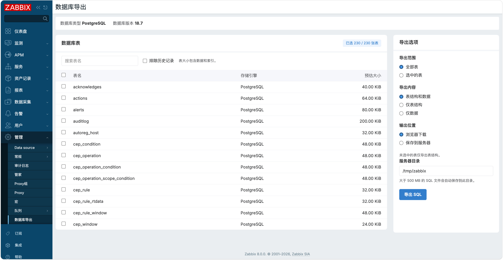

# Zabbix 数据库导出模块

[English](README_en.md)

当前版本为 **3.0.4**，模块目录为 `zabbix_database_export`。

## 版本兼容性

- Zabbix 7.0.x（已在 7.0.32 验证）
- Zabbix 8.0.x（已在 8.0.0 验证）

支持使用 MySQL、MariaDB 或 PostgreSQL 的 Zabbix 前端，自动识别数据库类型并在页面显示实际版本。

## 描述

这是一个从 Zabbix Web 导出数据库备份的前端模块。它复用前端当前的数据库连接，将数据库基础表的结构和数据导出为 SQL 文件。模块入口位于 **管理 → 数据库导出**，仅 Zabbix 超级管理员可使用。

## 功能特性

- **数据库识别**。自动选择 MySQL/MariaDB 或 PostgreSQL 导出方式，页面显示数据库类型和版本。
- **选表**。查看表名、存储引擎和预估大小（数据与索引合计），按表名筛选并批量选择。
- **导出模式**。支持表结构和数据、仅表结构、仅数据。未选中的表始终保留 `CREATE TABLE`，包括字段、索引和约束。
- **输出位置**。可在浏览器下载或保存到服务器。选择浏览器下载时，实际大小不超过 500 MB（500,000,000 字节）的文件直接下载，更大的文件自动保存到指定目录。
- **时区与语言**。文件名包含数据库类型，时间使用当前用户的时区。页面跟随前端语言设置，支持中英文。
- **界面**。使用本地 CSS 和 JavaScript 实现响应式 Element Plus 风格。



## 安装步骤

### 安装模块

将本目录下的 `manifest.json`、`Module.php`、`actions/`、`assets/`、`lib/` 和 `views/` 复制到前端的 `modules/zabbix_database_export/`。常见部署路径如下。

| Zabbix 版本 | 模块目录 |
| --- | --- |
| 7.0 | `/usr/share/zabbix/modules/zabbix_database_export/` |
| 8.0 | `/usr/share/zabbix/ui/modules/zabbix_database_export/` |

### 启用模块

1. 使用超级管理员账号进入 **管理 → 一般 → 模块**（**Administration → General → Modules**）。
2. 选择 **扫描目录**（**Scan directory**），启用 **Zabbix Database Export**。
3. 刷新页面并打开 **管理 → 数据库导出**。

## 使用方法

1. 在 **导出范围** 中选择全部表或选中的表。可用搜索框缩小范围，用表头复选框选择筛选出的全部表。
   勾选 **排除历史记录** 后，所有以 `history` 开头的表均仅导出结构。
2. 选择 **导出内容**。

   | 模式 | 选中的表 | 未选中的表 |
   | --- | --- | --- |
   | 表结构和数据 | 表结构和行数据 | 表结构 |
   | 仅表结构 | 表结构 | 表结构 |
   | 仅数据 | 行数据 | 表结构 |

3. 选择 **浏览器下载** 或 **保存到服务器**，填写服务器目录并点击 **导出 SQL**。保存到服务器后，页面会显示绝对路径和文件大小。

### 导出文件名

浏览器下载、手动保存和超过 500 MB 后自动保存均使用以下格式。时间为当前 Zabbix 用户的时区时间。

| 数据库类型 | 文件名格式 |
| --- | --- |
| MySQL | `zabbix_database_backup_mysql_yyyy-mm-dd_hh-mm-ss.sql` |
| MariaDB | `zabbix_database_backup_mariadb_yyyy-mm-dd_hh-mm-ss.sql` |
| PostgreSQL | `zabbix_database_backup_postgresql_yyyy-mm-dd_hh-mm-ss.sql` |

### 配置服务器备份目录

默认目录为 `/tmp/zabbix`。该目录不存在时，模块会尝试创建。要允许其他位置，可在模块部署目录添加 `config.local.php`：

```php
<?php
return ['/var/lib/zabbix/database-backups'];
```

页面可填写配置的目录或其下已有的子目录。备份目录须位于 Web 根目录之外，归 Web 服务账号所有，权限为 `0700`。导出的文件权限为 `0600`，同名文件会保留。容器部署时，目录位于前端容器内，可挂载持久卷。

## 注意事项

- **备份内容**。完整备份包含用户和凭据。MySQL/MariaDB SQL 使用 `CREATE TABLE` 和带列名的 `INSERT`。PostgreSQL 使用原生 `pg_dump` 生成 SQL 和 `COPY` 数据，包含索引、约束和序列。导入「仅数据」模式生成的文件时，选中的表需要已有兼容结构，未选中的表需要能在目标库创建。
- **数据一致性**。InnoDB 数据在同一事务快照下读取。PostgreSQL 的结构和数据导出共用同一个事务快照。
- **PostgreSQL 环境**。PHP 需要启用 `pgsql` 扩展和 `proc_open`，前端服务器需安装与数据库服务器兼容的 `pg_dump`。模块复用前端配置的连接和 TLS 参数，临时密码文件权限为 `0600`，完成后删除。
- **SQL 回读**。PostgreSQL 文件使用 `psql -v ON_ERROR_STOP=1 -d 目标库 -f 备份.sql` 导入。SQL 使用源数据库方言，目标需要兼容的数据库类型及扩展。
- **大文件**。模块先在 PHP 临时目录生成完整文件。保存到服务器还需要目标目录有足够的磁盘空间。导出耗时受 Web 服务器、代理和 PHP-FPM 的超时设置影响。

## 开发

- `manifest.json`、`Module.php` — 模块注册和菜单入口
- `actions/DatabaseExport.php`、`views/databaseexport.php` — 请求处理与页面渲染
- `lib/SqlExport.php`、`lib/PostgresqlExport.php`、`lib/BackupFile.php` — SQL 导出与文件保存
- `lib/LanguageManager.php`、`assets/` — 界面翻译与前端资源
- `tests/checks.php` — SQL 导出与 500 MB 边界回归检查

PostgreSQL 回归检查位于 `tests/postgresql.php`，覆盖选表、排除历史数据、序列、二进制、JSON 和生成列。
