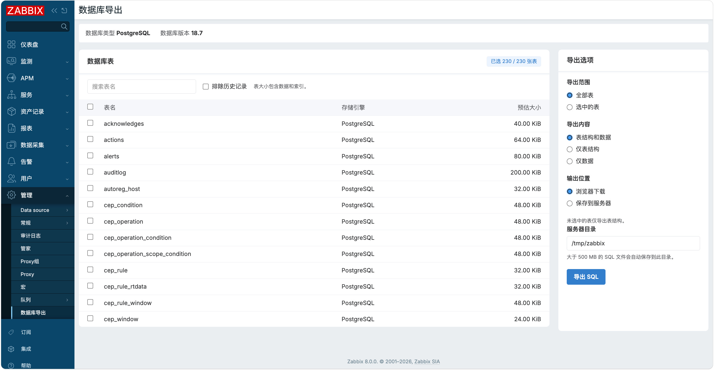

# Zabbix Database Export Module

[中文](README.md)

## ✨ Version Compatibility

| Zabbix | PHP | manifest_version | Result |
|---|---|---|---|
| 6.0.49 | 7.3.33 | 1.0 | Recognized, enabled; pages pass |
| 7.0.32 | 8.0.30 | 2.0 | Recognized, enabled; pages pass |
| 8.0.0 | 8.4.27 | 2.0 | Recognized, enabled; pages pass |

## Description

The current version is **3.0.4**, installed under `zabbix_database_export`.

This frontend module exports database backups from Zabbix Web. It reuses the frontend's database connection to export base table definitions and rows as a SQL file. Open **Administration → Database export** as a Zabbix Super admin.

## Features

- **Database detection**. Automatically choose the MySQL/MariaDB or PostgreSQL export implementation and display the database type and version.
- **Table selection**. View table names, storage engines, and estimated sizes including data and indexes. Filter by name and select tables in bulk.
- **Export modes**. Export structure and data, structure only, or data only. Unselected tables always retain their `CREATE TABLE` statements, including columns, indexes, and constraints.
- **Output destination**. Download in the browser or save on the server. When browser download is selected, files up to 500 MB (500,000,000 bytes) download directly. Larger files are saved automatically to the specified directory.
- **Time zone and language**. Filenames include the database type and use the current user's time zone. The interface follows the frontend language setting and supports English and Chinese.
- **Interface**. Local CSS and JavaScript provide a responsive layout styled after Element Plus.



## Installation

### Install Module

Copy `manifest.json`, `Module.php`, `actions/`, `assets/`, `lib/`, and `views/` from this directory into `modules/zabbix_database_export/` under your Zabbix frontend. Common package paths are shown below.

| Zabbix version | Module directory |
| --- | --- |
| 7.0 | `/usr/share/zabbix/modules/zabbix_database_export/` |
| 8.0 | `/usr/share/zabbix/ui/modules/zabbix_database_export/` |

### ⚠️ Modify manifest.json

For Zabbix 6.0, change the module manifest version to 1.0. Keep 2.0 on 7.0/8.0.

```bash
sed -i 's/"manifest_version": 2.0/"manifest_version": 1.0/' /usr/share/zabbix/modules/zabbix_database_export/manifest.json
```

### Enable Module

1. Sign in as a Super admin and open **Administration → General → Modules**.
2. Select **Scan directory** and enable **Zabbix Database Export**.
3. Refresh the page and open **Administration → Database export**.

## Notes

- **Backup contents**. A full backup includes users and credentials. MySQL/MariaDB SQL uses `CREATE TABLE` and `INSERT` with explicit column names. PostgreSQL uses native `pg_dump` SQL and `COPY` data, including indexes, constraints, and sequences. When importing a file generated in **Data only** mode, selected tables need existing compatible definitions, and unselected tables must be creatable in the destination database.
- **Data consistency**. InnoDB data is read from a single transaction snapshot. PostgreSQL structure and data exports share one transaction snapshot.
- **PostgreSQL requirements**. Enable PHP `pgsql` and `proc_open`, and install a compatible `pg_dump` on the frontend server. The module reuses frontend connection and TLS settings. Its temporary password file has mode `0600` and is removed afterward.
- **SQL restore**. Import PostgreSQL files with `psql -v ON_ERROR_STOP=1 -d target_database -f backup.sql`. Dumps use the source database dialect and require compatible target database types and extensions.
- **Large files**. The module first writes the complete backup to the PHP temporary directory. Server saves also require enough free space at the destination. Web server, proxy, and PHP-FPM timeouts can affect long exports.

### Directory ownership and save errors

Module pages show an ownership command only when the directory owner or group differs from the PHP runtime account. Correct ownership produces no reminder. Save errors retain their original message and add directory ownership and SELinux (`getenforce`) reminders. Text follows the Zabbix Web user language. No extra dialogs or command panels are added.

## Development

- `manifest.json`, `Module.php` — Module registration and menu entry
- `actions/DatabaseExport.php`, `views/databaseexport.php` — Request handling and rendering
- `lib/SqlExport.php`, `lib/PostgresqlExport.php`, `lib/BackupFile.php` — SQL export and file saving
- `lib/LanguageManager.php`, `assets/` — Translations and frontend assets
- `tests/checks.php` — SQL export and 500 MB boundary regression checks

PostgreSQL regression checks in `tests/postgresql.php` cover table selection, history exclusion, sequences, binary data, JSON, and generated columns.

## Module Configuration

### Usage

1. Under **Table scope**, choose all tables or selected tables. Use the search field to narrow the list and the header checkbox to select all filtered tables.
   Check **Exclude history records** to export only the structure of every table whose name starts with `history`.
2. Choose the export **Contents**.

   | Mode | Selected tables | Unselected tables |
   | --- | --- | --- |
   | Structure and data | Table structure and rows | Table structure |
   | Structure only | Table structure | Table structure |
   | Data only | Rows | Table structure |

3. Choose **Download in browser** or **Save on server**, enter the server directory, and click **Export SQL**. For server saves, the page displays the absolute path and file size.

#### Export Filenames

Browser downloads, manual server saves, and automatic saves over 500 MB use the following formats. Timestamps follow the current Zabbix user's time zone.

| Database type | Filename format |
| --- | --- |
| MySQL | `zabbix_database_backup_mysql_yyyy-mm-dd_hh-mm-ss.sql` |
| MariaDB | `zabbix_database_backup_mariadb_yyyy-mm-dd_hh-mm-ss.sql` |
| PostgreSQL | `zabbix_database_backup_postgresql_yyyy-mm-dd_hh-mm-ss.sql` |

#### Configure the Server Backup Directory

The default directory is `/tmp/zabbix`. The module attempts to create it if needed. To allow other locations, add `config.local.php` to the deployed module directory:

```php
<?php
return ['/var/lib/zabbix/database-backups'];
```

Enter a configured directory or one of its existing subdirectories in the form. The directory must be outside the web root, owned by the web service account, and have mode `0700`. Exported files use mode `0600`, and existing files with the same name are preserved. In container deployments, the directory is inside the frontend container and can be backed by a persistent volume.

## License

See the repository [license terms](../README_en.md#license). Preserve third-party attribution when redistributing.
