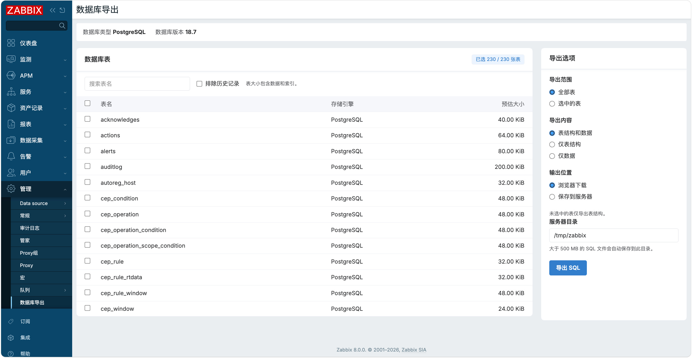

# Zabbix Database Export — экспорт базы данных

[中文](README.md) · [English](README_en.md)

## Совместимость версий

| Zabbix | PHP | `manifest_version` | Результат проверки |
| --- | --- | --- | --- |
| 6.0.49 | 7.3.33 | 1.0 | Модуль обнаружен и включён, страницы прошли проверку |
| 7.0.32 | 8.0.30 | 2.0 | Модуль обнаружен и включён, страницы прошли проверку |
| 8.0.0 | 8.4.27 | 2.0 | Модуль обнаружен и включён, страницы прошли проверку |

## Описание

Модуль `zabbix_database_export` версии **3.0.4** экспортирует структуру и данные обычных таблиц в SQL через соединение веб-интерфейса. Для доступа к **Администрирование → Экспорт базы данных** требуются права суперадминистратора.

## Возможности

- Автоматическое определение MySQL, MariaDB или PostgreSQL. Интерфейс показывает тип и версию СУБД.
- Просмотр названий, движков и приблизительных размеров таблиц с учётом данных и индексов. Доступны поиск и массовый выбор.
- Экспорт структуры и данных, только структуры или только данных выбранных таблиц. Для остальных таблиц сохраняются определения `CREATE TABLE` со столбцами, индексами и ограничениями.
- Скачивание через браузер или сохранение на сервере. При скачивании файлы размером до 500 МБ (500 000 000 байт) передаются в браузер, более крупные копии сохраняются в заданном каталоге.
- Часовой пояс из профиля пользователя используется в имени файла. Интерфейс адаптируется к размеру экрана и использует локальные ресурсы.



Интерфейс поддерживает китайский, английский и русский языки. Чтобы включить русский, выберите **Русский** в профиле Zabbix. При выборе языка по умолчанию используется системная настройка `default_lang`.

## Установка

### Размещение модуля

Скопируйте `manifest.json`, `Module.php`, `actions/`, `assets/`, `lib/` и `views/` в `modules/zabbix_database_export/` веб-интерфейса.

| Zabbix | Стандартный каталог |
| --- | --- |
| 7.0 | `/usr/share/zabbix/modules/zabbix_database_export/` |
| 8.0 | `/usr/share/zabbix/ui/modules/zabbix_database_export/` |

### Манифест для Zabbix 6.0

Для Zabbix 6.0 измените `manifest_version` на `1.0`. Для Zabbix 7.0 и 8.0 используется `2.0`.

```bash
sed -i 's/"manifest_version": 2.0/"manifest_version": 1.0/' /usr/share/zabbix/modules/zabbix_database_export/manifest.json
```

### Включение модуля

От имени суперадминистратора выполните следующие действия.

1. Откройте **Администрирование → Общие → Модули**.
2. Нажмите **Сканировать каталог**.
3. Найдите и включите **Zabbix Database Export**.
4. Обновите страницу и откройте **Администрирование → Экспорт базы данных**.

## Примечания

- Полная копия может содержать учётные данные. Экспорт MySQL/MariaDB использует `CREATE TABLE` и `INSERT` с явным перечислением столбцов, а PostgreSQL — штатный SQL `pg_dump` и `COPY` с индексами, ограничениями и последовательностями.
- Для импорта файла в режиме **Только данные** в целевой базе потребуются совместимые определения выбранных таблиц и возможность создать остальные таблицы. Дамп использует диалект исходной СУБД, поэтому проверьте совместимость целевой базы и расширений.
- Данные InnoDB выгружаются из одного снимка транзакции. В PostgreSQL структура и строки также читаются из одного снимка.
- Для PostgreSQL включите расширение PHP `pgsql` и функцию `proc_open`, установите совместимый `pg_dump`. Модуль использует настройки соединения и TLS веб-интерфейса. Временный файл пароля имеет права `0600` и удаляется по завершении.
- Для восстановления PostgreSQL используйте `psql -v ON_ERROR_STOP=1 -d target_database -f backup.sql`.
- Полная копия сначала записывается во временный каталог PHP. Для сохранения на сервере также нужно свободное место в целевом каталоге. На длительный экспорт влияют тайм-ауты веб-сервера, прокси и PHP-FPM.

### Владелец каталога и ошибки сохранения

Если владелец или группа каталога отличаются от учётной записи, под которой работает PHP, на странице модуля появится команда для изменения владельца. В сообщении об ошибке сохранения будут подсказки о правах на каталог и проверке SELinux командой `getenforce`.

## Разработка

- `manifest.json` и `Module.php` — регистрация и меню.
- `actions/DatabaseExport.php` и `views/databaseexport.php` — обработка запроса и представление.
- `lib/SqlExport.php`, `lib/PostgresqlExport.php` и `lib/BackupFile.php` — экспорт SQL и работа с файлом.
- `lib/LanguageManager.php` и `assets/` — локализация и ресурсы.
- `tests/checks.php` — регрессии экспорта и границы 500 МБ.
- `tests/postgresql.php` — выбор таблиц, исключение истории, последовательности, двоичные данные, JSON и вычисляемые столбцы.

## Использование

1. В поле **Область экспорта** выберите все таблицы или отдельные таблицы. Поиск сужает список, а флажок заголовка отмечает все строки по фильтру. Параметр **Исключить данные истории** оставляет только структуру таблиц, имена которых начинаются с `history`.
2. Выберите **Содержимое**.

   | Режим | Выбранные таблицы | Остальные таблицы |
   | --- | --- | --- |
   | Структура и данные | Определения и строки | Определения |
   | Только структура | Определения | Определения |
   | Только данные | Строки | Определения |

3. Выберите **Скачать через браузер** или **Сохранить на сервере**. Укажите каталог для серверных сохранений и нажмите **Экспортировать SQL**. После сохранения на сервере страница показывает абсолютный путь и размер.

### Имена файлов

Имена одинаковы для скачивания, ручного и автоматического сохранения. Время берётся из профиля Zabbix.

| СУБД | Шаблон имени файла |
| --- | --- |
| MySQL | `zabbix_database_backup_mysql_yyyy-mm-dd_hh-mm-ss.sql` |
| MariaDB | `zabbix_database_backup_mariadb_yyyy-mm-dd_hh-mm-ss.sql` |
| PostgreSQL | `zabbix_database_backup_postgresql_yyyy-mm-dd_hh-mm-ss.sql` |

### Каталог резервных копий

По умолчанию используется `/tmp/zabbix`. Если его нет, модуль пытается создать его. Чтобы разрешить другие каталоги, добавьте `config.local.php` в установленный модуль.

```php
<?php
return ['/var/lib/zabbix/database-backups'];
```

В форме укажите разрешённый каталог или существующий подкаталог. Он должен находиться вне корня сайта, принадлежать сервисной учётной записи веб-интерфейса и иметь права `0700`. Файлы создаются с правами `0600`, существующие копии с тем же именем сохраняются. В контейнере путь относится к контейнеру веб-интерфейса. Для сохранения между перезапусками используйте постоянный том.

## Лицензия

См. [условия лицензии проекта](../README_ru.md#лицензия). При распространении сохраняйте сведения об авторах сторонних компонентов.
