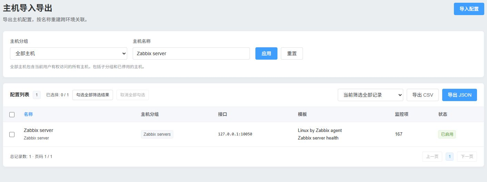
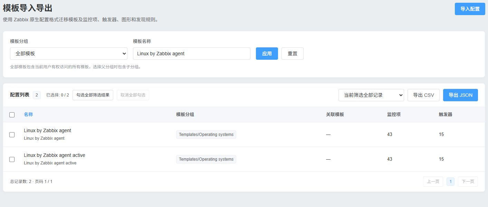
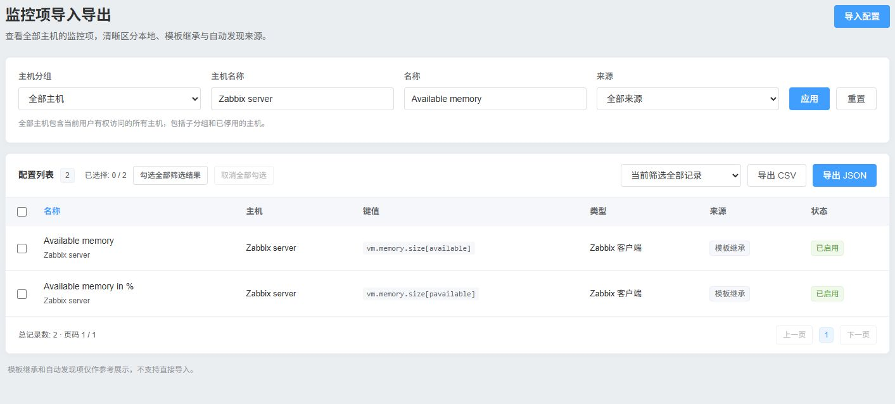

# Zabbix 导入导出

[English](README_en.md)

## ✨ 版本兼容性

| 环境 | 状态 |
|---|---|
| 7.0.32 / PHP 8.3.36 | 实际部署，执行 PHP、HTTP/API 与浏览器验证，见下方测试报告 |
| 7.4 | 按官方字段及模块机制实现，尚无独立 7.4 运行环境验收 |
| 6.0 | 提供 manifest、Core 基类、SID、旧 Proxy 和原生表单降级；需运行 prepare.php，尚无独立运行环境验收 |
| 8.0 | 不声明兼容 |

需要 PHP 7.4 或更高版本。

## 描述

独立前端模块，入口为 **资产记录 → Zabbix 导入导出**，提供主机、监控模板、自定义监控项三个页面。使用当前登录用户的 Zabbix API 权限，无额外数据库表。

### 主机导入导出



### 模板导入导出



### 监控项导入导出



## 功能特性

- 使用 CSV 或 JSON 迁移主机配置、监控模板和主机本地监控项，模板页也支持导入 Zabbix 原生 JSON。
- 按页面提供分组、名称和监控项来源筛选，筛选下拉框选中后自动搜索。支持当前页勾选和跨页全选筛选结果。
- 写入前可预览差异、选择重复处理策略，执行后可下载结果报告。
- 界面跟随 Zabbix 用户语言，内置简体中文和英文。导出文件名使用 Zabbix 用户设置的时区，用户继承默认设置时使用系统时区。

## 安装步骤

### 1. 部署文件

将本目录部署到 `<frontend>/modules/zabbix_export_import`，使 Web 服务用户可读取代码。

### 2. 准备 manifest

以下以 `/usr/share/zabbix` 为例；如果前端位于 `/usr/share/zabbix/ui`，请替换命令中的两个前端路径。

```sh
php /usr/share/zabbix/modules/zabbix_export_import/tools/prepare.php /usr/share/zabbix
```

### 3. 启用或升级

在“管理 → 常规 → 模块”扫描目录并启用 `Zabbix Import/Export`。`prepare.php` 根据目标源码设置 manifest：6.0 使用版本 1，7.x 使用版本 2。升级时覆盖本模块文件，再重新准备 manifest。不修改 CMDB 或 Zabbix 核心文件。

## 使用方法

1. 三个页面统一为紧凑筛选栏、配置卡片和顶部导出工具栏，参考 [Element Plus 颜色](https://element-plus.org/zh-CN/component/color)（主色 `#409eff`），样式限定在本模块内，不加载 Vue/CDN。主机组下拉默认“全部主机”，包含当前用户有权访问的启用、停用主机；选择父组包含子组。可按主机可见名称搜索。模板页使用模板分组与模板名称过滤，默认包含全部可访问模板。
2. 不再显示旧的 `table filter-forms` 大型原生过滤器，不恢复旧 Profile 中的隐含筛选。页面间通过查询参数携带主机组和名称；重设回到全部主机。监控项页可按名称、来源筛选，默认全部来源；继承与发现项可查看和导出引用，不能直接导入。旧的显式导出请求仍支持已有高级筛选字段。
3. 列表每页 50 条。表头复选框只选择当前页；新增“勾选全部筛选结果”和“取消全部勾选”：全部勾选覆盖所有分页，支持取消单条；同一筛选下的选择保存在当前浏览器会话。点击勾选会自动将导出范围切换为“选中的记录”。导出范围明确区分“选中的记录”和“当前筛选全部记录”。全量导出包含所有匹配页。
4. 点击右上角“导入配置”打开侧栏（支持 Esc、关闭和焦点返回）。上传 CSV/JSON 后先预览解析结果、目标关系及字段差异。上传与预览不会写配置。修正错误后重新上传。主机技术名、模板技术名可用 JSON 映射，例如 `{"source-host":"target-host"}`，不按显示名称自动绑定。
5. 默认仅创建缺失对象、跳过重复对象。更新只处理目标已经存在的对象，必须显式选择；重复报错策略可逐条报告冲突。主机本地项有独立的重复策略。
6. 选择缺少组的停止/跳过/创建策略（创建组需 Super admin）；缺少模板可映射、跳过关联或停止该记录。不会生成空模板。默认保留目标已有模板、接口、标签与资产信息，覆盖需单独勾选。
7. 确认每批处理最多 25 条，直到所有批次完成；显示创建、更新、跳过、失败及子项失败。可下载执行结果 JSON。失败对象不阻止其他独立对象，已完成的 API 操作不会全局回滚。

### 数据关系

- 主机按 `host` 精确匹配，组按名称，模板按 `host` 技术名，Proxy/Proxy 组按对应对象名称匹配。源环境整数 ID 不作为目标 ID。
- 先解析关系与接口，创建或更新主机并链接模板，再按选项恢复本地项。模板项由 Zabbix 继承；LLD 生成项仅保留引用，恢复应通过原发现规则和原型完成。
- 监控项在目标主机内按 `key_` 匹配。接口优先匹配类型与完整标识，否则选对应类型的唯一主接口。值映射必须在目标主机预先存在。依赖项按拓扑排序，缺失主项和循环依赖会报告失败。
- 模板页通过原生 `configuration.export` / `configuration.importcompare` / `configuration.import` 迁移模板及其监控项、触发器、图形、发现规则/原型、值映射、仪表盘和关联模板。模板组按名称解析，父组筛选包含子组；缺少组默认报错，可由 Super admin 显式选择创建。文件内关联模板按依赖顺序导入，文件外的关联模板和跨模板引用需在目标存在。
- 模板更新允许新增和更新源文件内对象，但始终关闭 `deleteMissing`，保留目标额外对象及已有模板关联。UUID 与技术名冲突会明确拒绝；上传文件不能夹带主机、地图、媒介等非模板顶层对象。模板中的脚本、命令、主动请求、JavaScript 预处理和 Web 场景沿用默认拦截与 Super admin 审查授权。
- 旧的“模块导入导出”入口已替换为“模板导入导出”，不再提供前端扩展注册信息迁移。

### 自动语言识别

所有页面、菜单、导出/导入按钮、勾选状态和提示自动读取当前 Zabbix 用户的 `lang`；用户选择默认语言时读取系统 `default_lang`。内置完整简体中文与英文，语言文件位于 `locales/zh_CN.php` 和 `locales/en_US.php`，支持按 Zabbix locale 增加语言目录项。其他语言的公共标签交给原生 gettext，模块特有且未翻译的词条回退英文，不依赖浏览器语言。

### CSV / JSON 规范

主机、监控项和 CSV 使用本模块可迁移 envelope。模板页另外直接接受 Zabbix 原生导出的 JSON：包含 `zabbix_export`，允许多个模板，自动拆分并按关联顺序导入。正式 envelope 定义见 [schemas/transfer.schema.json](schemas/transfer.schema.json)，六份双记录示例见 [examples](examples)。

JSON：UTF-8，`schema_version="1.0"`，`record_type=hosts|items|templates`，`source_zabbix_version`、ISO 时间 `exported_at`、`records` 列表。输出缩进；输入接受 UTF-8 BOM，导出不添加 BOM。

CSV：UTF-8、RFC 4180 引号和换行转义，固定五列：

| 列 | 内容 |
|---|---|
| schema_version | 固定 `1.0` |
| record_type | `hosts`、`items` 或 `templates` |
| source_zabbix_version | 源 Zabbix 版本 |
| exported_at | ISO 时间 |
| record | 完整记录的 JSON 对象字符串，嵌套数组/对象均保留 |

**公式防护**：业务字段始终装入 `record` JSON 对象，该单元格内容以 `{` 开始，其他列是受控元数据。不会给业务值添加或移除单引号；`=SUM(...)`、`+`、`-`、`@` 等值可原样往返。不要将 JSON 对象拆列后直接作为不受信任的电子表格公式运行。

| 类型 | 必填标识/字段 | 主要可选字段 |
|---|---|---|
| hosts | host、host_groups | name、description、status、interfaces、monitored_by、proxy_name、proxy_group_name、templates、tags、inventory、inventory_mode、item_references |
| items | host、name、key_、type、value_type | status、delay、history、trends、units、description、interface、master_item、valuemap、tags、preprocessing、各监控项类型参数 |
| templates | template、configuration | name、_redacted；configuration 为包含一个模板的 Zabbix 原生 JSON 配置对象 |

本地项默认 `origin=local`；模板引用 `origin=template` 并附模板技术名/名称/Key；LLD 引用 `origin=discovery` 并附发现来源。API 字段按版本核对，不支持的关键字段或类型会报错。`source_hostid`、`source_itemid`、`_debug` 可用于诊断，不会应用为目标 ID。

## 注意事项

- 页面读取、导出受当前 API 权限约束；导入需要 Admin，模板读写遵循当前用户的模板权限；创建缺失模板组和导入执行类内容需要 Super admin。每个写入重新解析对象并由 API 校验写权限。
- POST 保持原生 CSRF/SID 校验。预览保存到 Web 根目录外的私有临时目录，0600 文件、0700 目录、30 分钟有效期，绑定用户和登录会话。确认不能替换已预览的内容，使用文件锁避免重复执行。
- 限制 10 MiB、10000 条记录、JSON 深度 32、字段长度 256 KiB、主机批次 100、确认批次 25。超过限制明确要求缩小筛选，不会静默只导出一页。
- 默认移除密码、Token、PSK、认证 Header 和敏感配置键，记录 `_redacted` 路径。带此标记的记录会阻止导入；管理员需在安全环境补全凭据并删除标记后重新预览。任意脚本或自定义键中的机密无法仅靠字段名完全识别，导出前仍需按本地数据规范审查。
- 不导出历史值、趋势、运行时数据。错误报告可能包含对象名称与 API 返回原因；审计日志仅记录操作者、时间、类型、对象哈希、行号及结果，不记录文件原文或凭据。
- 大批次使用分批 API 读取，但会在服务器内存中构造受上限约束的导出集合，未提供无限流式导出。浏览器 `sessionStorage` 保存选择，禁用存储时仍可选择当前页。
- 主机/监控项页面不单独迁移模板定义、值映射定义或 LLD 原型，应通过模板页面预先迁移；主机宏、TLS 私钥和秘密值不导出。前置对象缺失会明确报告。可见名称冲突遵守目标 Zabbix 的唯一性约束。

## 开发

参见[开发记录](DEVELOPMENT.md)、[安全说明](SECURITY.md)和[跨服务器测试报告](CROSS_SERVER_TEST_REPORT.md)。如果本地保留了测试目录，可在模块目录执行以下检查：

```sh
find . -name '*.php' -exec php -l {} \;
php tests/serializers.php
php tests/transfer_security.php
```
