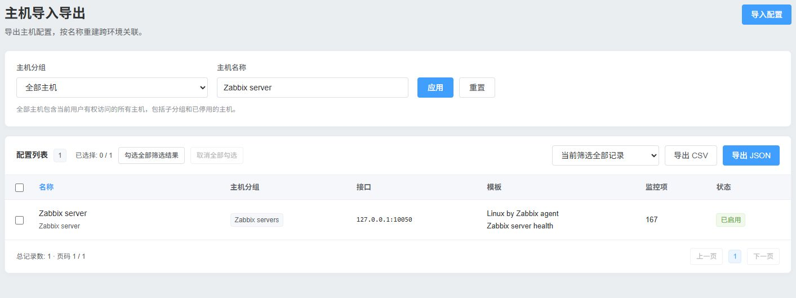
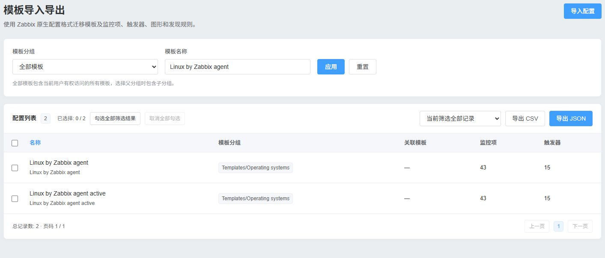
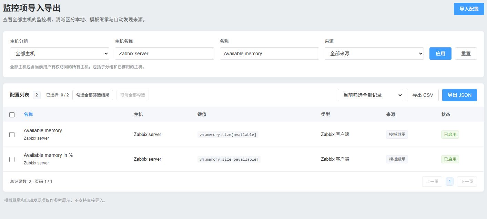

# Zabbix Import/Export

[中文](README.md)

## ✨ Version compatibility

| Environment | Verification |
|---|---|
| Zabbix 7.0.32 / PHP 8.3.36 | Actual deployment, PHP tests, HTTP/API tests and browser checks; see the test report below |
| 7.4 | Implemented against official APIs/module mechanisms; no separate runtime verification |
| 6.0 | Includes manifest preparation, Core base class, native SID, old proxy mapping and native form fallbacks; no separate runtime verification |
| 8.0 | Compatibility not claimed |

Requires PHP 7.4 or later.

## Description

A native frontend module under **Inventory → Zabbix Import/Export** with exactly three business pages: hosts, monitoring templates and custom host items. It uses the signed-in user's API context and creates no database tables.

### Hosts



### Templates



### Monitoring items



## Features

- Transfer host configuration, monitoring templates, and local items in CSV or JSON. The template page also accepts native Zabbix JSON.
- Filter by group, name, or item origin as applicable. Changing a search dropdown applies the filter immediately. Select the current page or all filtered results across pages.
- Preview imports before writing any configuration. Review differences, choose a duplicate handling policy, and download the result report.
- The interface follows the signed-in Zabbix user's language; English and Simplified Chinese are included. Export filenames use the user's Zabbix time zone, with the system default used when the profile inherits it.

## Installation

### 1. Deploy files

Deploy this directory as `<frontend>/modules/zabbix_export_import`, readable by the web service account.

### 2. Prepare the manifest

This example uses `/usr/share/zabbix`. If your frontend is under `/usr/share/zabbix/ui`, use that path in both places.

```sh
php /usr/share/zabbix/modules/zabbix_export_import/tools/prepare.php /usr/share/zabbix
```

### 3. Enable or upgrade

Scan and enable **Zabbix Import/Export** under Administration → General → Modules. The preparation command selects manifest version 1 for 6.0 and version 2 for 7.x. To upgrade, replace the module files and rerun the preparation command. The module does not change the CMDB module or core frontend files.

## Usage

The three pages use scoped Element Plus-inspired cards, compact host-group/name filters and an export toolbar above the table. All hosts is the default and includes every authorized enabled/disabled host. Parent groups include descendants. Old invisible profile filters are not restored. Items default to every origin, with name/source filters; inherited and discovered records remain read-only. Import settings open in a side drawer and only show options relevant to the current page. No Vue or CDN assets are loaded. Explicit legacy export requests retain advanced API filter support.

Lists show 50 rows per page. The header checkbox selects the current page. Selections across pages of the same filter are retained in browser session storage. Export scope explicitly distinguishes selected rows from all filtered records, including every page. Templates have dedicated template-group/name filters. Select all filtered records selects every page, supports individual exclusions, persists across pagination and automatically switches export scope to selected records. Clear selection removes every selection.

Upload a CSV or JSON file, review the preview and differences, then confirm. Uploading and previewing never write configuration. Previews are stored outside the web root, expire after 30 minutes and are bound to the current user and session. Confirming processes at most 25 rows; continue until the remaining batches finish. Results identify each failed row and can be downloaded as JSON. Completed API calls are not globally rolled back on partial failure.

The default strategy creates missing objects and skips existing objects. Updating existing objects requires an explicit selection; missing objects are skipped in update-only mode. Host-local items have a separate duplicate strategy. Host and template technical names can be mapped with a JSON object, for example `{"source":"target"}`.

Missing host groups can stop a row, be skipped, or be created by a Super admin. Missing templates can be mapped, skipped or stop the row; empty substitute templates are never created. Existing template links, interfaces, tags and inventory are preserved unless the corresponding replacement option is selected.

### Portable relationships

Hosts match by technical `host`; items by `(target host, key_)`; templates by technical `host`; groups, proxies, proxy groups and value maps by their relevant names. Source integer IDs are never applied as target IDs. Interface references match exact type and endpoint when possible, then the unique main interface of the required type.

Host imports resolve groups/templates/proxies/interfaces, create or update the host and template links, then optionally restore local items. Inherited items are recreated by Zabbix template inheritance. Discovered items are references only and must be restored through their original discovery rules/prototypes. Dependent items are sorted topologically; cycles and missing masters are errors. Target value maps must already exist.

Template transfer uses native Zabbix configuration export/import and preserves monitoring entities. Missing template groups are rejected unless a Super admin explicitly chooses to create them. Template UUID/name conflicts and unrelated top-level objects are rejected.

### Language selection

The UI resolves the signed-in Zabbix user's language, falling back to the system default when the profile uses Default. Simplified Chinese and English catalogs live in `locales`; additional Zabbix locale catalogs can be added. Shared strings delegate to Zabbix gettext, with English fallback for untranslated module strings. Browser language is not used to override the profile.

### Format

This is a custom portable format, not Zabbix `configuration.import`. See [schemas/transfer.schema.json](schemas/transfer.schema.json) and the six two-record [examples](examples).

JSON is UTF-8 with readable indentation and this envelope: `schema_version="1.0"`, `record_type=hosts|items|templates`, `source_zabbix_version`, ISO `exported_at`, and a `records` list. Input accepts a UTF-8 BOM; output has none.

CSV has exactly five columns: `schema_version,record_type,source_zabbix_version,exported_at,record`. Each `record` cell is a JSON object, including nested arrays and objects. Standard CSV quote, comma and newline escaping preserves Chinese, emoji and multiline strings.

Formula protection is lossless: business values are inside a JSON object cell starting with `{`; other columns are controlled metadata. No apostrophes are added or stripped. Formula-looking business strings therefore round-trip without becoming spreadsheet formulas in the exported cells.

Required fields:

| Type | Required | Additional supported data |
|---|---|---|
| hosts | host, host_groups | name, description, status, interfaces, monitoring mode and proxy names, templates, tags, inventory, inventory_mode, item_references |
| items | host, name, key_, type, value_type | status, delay/history/trends, units, description, interface, master_item, valuemap, tags, preprocessing and type-specific API parameters |
| templates | template, configuration | name; configuration contains one native template |

Item sources are `local`, `template` and `discovery`. Template and discovery references contain their source names/keys. Optional `source_hostid`, `source_itemid` and `_debug` fields are diagnostic only. Unsupported fields and types are reported rather than silently accepted as successful migrations.

## Notes

Reads and exports use current API permissions. Imports require Admin and native target write permissions; creating template groups or approving executable content requires Super admin. Every write resolves target objects again and is subject to the API's write permission checks. POST retains native CSRF/SID validation.

Limits are 10 MiB, 10000 records, JSON depth 32 and 256 KiB per field. Hosts are queried in batches of 100; import confirmations process 25 rows. Oversized exports report an error rather than silently truncating to a page. Export data is assembled in bounded memory; unlimited streaming export is not provided.

Password/token/PSK/private-key fields, sensitive headers and secret configuration keys are omitted and marked with `_redacted`. Such records cannot be imported until an administrator securely supplies the missing values and removes that marker before a new preview. Embedded secrets in arbitrary scripts or custom keys cannot be perfectly recognized from names alone; follow your local data-handling rules when reviewing exports.

Preview files use 0600 permissions inside a 0700 temporary directory and exclusive locking during confirmation. Audit entries contain user, timestamp, type, object hash, row and result, not uploaded documents or credentials. Result reports may contain object names and native API error details.

Use the template page to migrate template definitions, value maps and discovery rules/prototypes before restoring dependent hosts. Host macros, TLS private keys and secret values are excluded. Missing prerequisites are reported. Visible-name conflicts obey the target Zabbix uniqueness rules.

## Development

See [Development notes](DEVELOPMENT.md), the [security review](SECURITY.md), and the [cross-server test report](CROSS_SERVER_TEST_REPORT.md). If you have the local test directory, run the CLI checks from the module directory:

```sh
find . -name '*.php' -exec php -l {} \;
php tests/serializers.php
php tests/transfer_security.php
```
