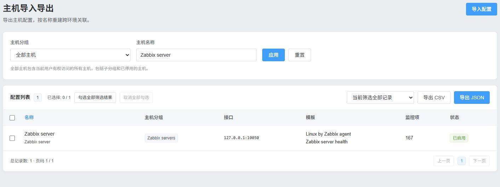
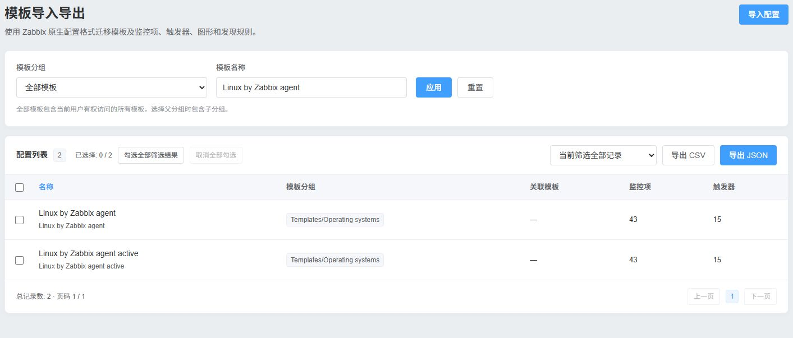
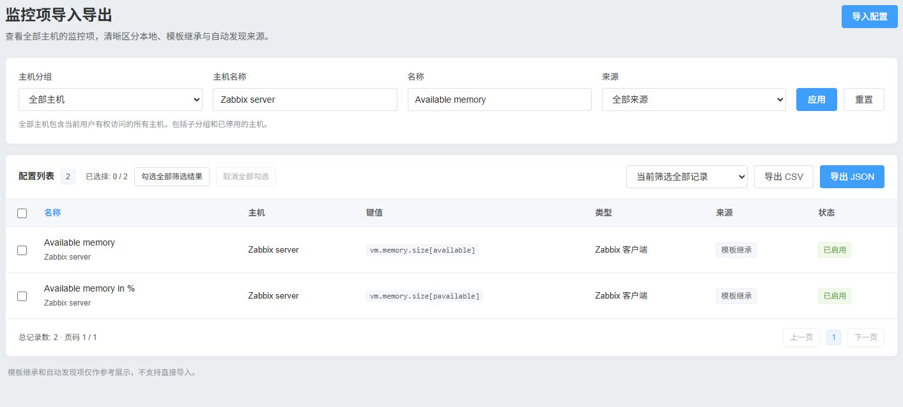

# Zabbix Import/Export — перенос конфигурации

[中文](README.md) · [English](README_en.md)

## Совместимость версий

| Zabbix | PHP | `manifest_version` | Результат проверки |
| --- | --- | --- | --- |
| 6.0.49 | 7.3.33 | 1.0 | Модуль обнаружен и включён, страницы прошли проверку |
| 7.0.32 | 8.0.30 | 2.0 | Модуль обнаружен и включён, страницы прошли проверку |
| 8.0.0 | 8.4.27 | 2.0 | Модуль обнаружен и включён, страницы прошли проверку |

## Описание

В разделе **Инвентаризация → Импорт и экспорт Zabbix** доступны страницы узлов, шаблонов и локальных элементов данных. Модуль работает в API-контексте вошедшего пользователя.

### Узлы сети



### Шаблоны



### Элементы данных



## Возможности

- Перенос узлов, шаблонов и локальных элементов в CSV или JSON. Страница шаблонов принимает штатный JSON Zabbix.
- Фильтры по группам, именам и источникам элементов. Можно выбрать текущую страницу или все результаты фильтра.
- Предпросмотр изменений, обработка дубликатов и выгрузка результатов.
- Имя файла использует часовой пояс профиля или системный пояс при наследовании настроек.

Интерфейс поддерживает китайский, английский и русский языки. Чтобы включить русский, выберите **Русский** в профиле Zabbix. При выборе языка по умолчанию используется системная настройка `default_lang`.

## Установка

### Размещение модуля

Разместите каталог в `<frontend>/modules/zabbix_export_import` и предоставьте веб-сервису доступ на чтение.

### Манифест

В примере используется `/usr/share/zabbix`. Если веб-интерфейс установлен в `/usr/share/zabbix/ui`, замените путь. Сценарий подготовки для стенда используется при его наличии в рабочей копии.

```sh
php /usr/share/zabbix/modules/zabbix_export_import/tools/prepare.php /usr/share/zabbix
```

### Включение и обновление

Войдите с правами суперадминистратора.

1. Откройте **Администрирование → Общие → Модули**.
2. Нажмите **Сканировать каталог**.
3. Найдите и включите **Zabbix Export Import**.

Команда подготовки выбирает версию манифеста 1 для Zabbix 6.0 и 2 для 7.0 и 8.0. Если сценарий подготовки доступен в вашей рабочей копии, запустите его после установки и обновления. Для ручной настройки обычного модуля `zabbix_export_import` на Zabbix 6.0 достаточно указать `"manifest_version": 1.0` в установленном `manifest.json`.

## Права и ограничения

- Чтение и экспорт учитывают права API. Для импорта нужны роль администратора и право записи на целевой объект. Создание групп шаблонов и одобрение исполняемой конфигурации требуют роли суперадминистратора.
- Каждый запрос записи заново разрешает целевые объекты и проверяет разрешения API. POST использует штатные проверки CSRF/SID.
- Лимиты: 10 МиБ, 10 000 записей, глубина JSON 32 и 256 КиБ на поле. Узлы запрашиваются группами по 100. Одно подтверждение обрабатывает до 25 строк. Если экспорт превышает лимиты, модуль сообщает ошибку.
- Пароли, токены, PSK, закрытые ключи и чувствительные заголовки удаляются и помечаются `_redacted`. Перед повторным предпросмотром администратор должен безопасно заполнить пропущенные значения и убрать этот признак. Проверяйте экспорт на секреты, встроенные в произвольные скрипты и ключи. Они могут не определяться по имени поля.
- Предпросмотр хранится за пределами корня сайта в каталоге `0700` и файлах `0600`. При подтверждении используется эксклюзивная блокировка. Журнал содержит пользователя, время, тип, хеш объекта, строку и результат. В отчёт о результатах могут попасть названия объектов и ошибки API.
- Для типа значения JSON требуется Zabbix 8.0. При импорте шаблонов учитывайте формат целевой версии. Штатный формат шаблонов 8.0 требует целевой версии 8.0.

### Владелец каталога и ошибки сохранения

Если владелец или группа каталога отличаются от учётной записи, под которой работает PHP, на странице модуля появится команда для изменения владельца. В сообщении об ошибке сохранения будут подсказки о правах на каталог и проверке SELinux командой `getenforce`.

## Экспорт

Таблицы содержат по 50 строк. По умолчанию показываются все доступные узлы, включая отключённые. Родительские группы включают вложенные. Элементы можно отфильтровать по имени и источнику, а шаблоны — по имени и группе. Унаследованные и обнаруженные элементы доступны для чтения.

Флажок в заголовке выбирает текущую страницу. Выбор между страницами сохраняется в сеансе браузера для текущего фильтра. Кнопка **Выбрать все записи по фильтру** отмечает записи со всех страниц и переводит экспорт в режим выбранных записей. Отдельные строки можно исключить. Очистка снимает все отметки. Выберите, экспортировать отмеченные строки или все записи по фильтру.

## Импорт

1. Загрузите CSV или JSON и проверьте различия. На этапе загрузки и предпросмотра конфигурация остаётся прежней. Предпросмотр действует 30 минут и привязан к пользователю и сеансу.
2. Выберите способ обработки дубликатов. По умолчанию создаются отсутствующие объекты, а существующие пропускаются. Режим обновления существующих объектов выбирается явно. Для локальных элементов есть отдельная политика.
3. Для переименования при переносе укажите JSON-сопоставление технических имён узлов или шаблонов, например `{"source":"target"}`.
4. Для отсутствующих групп узлов можно остановить строку, пропустить группу или создать её с правами суперадминистратора. Отсутствующие шаблоны можно сопоставить, пропустить или остановить строку. Связи, интерфейсы, теги и инвентаризация сохраняются, если не выбрана их замена.
5. Подтвердите запись и дождитесь завершения всех пакетов. Результат каждой строки можно скачать в JSON. Успешно выполненные вызовы API сохраняются при ошибке в других строках.

### Перенос зависимостей

Сначала перенесите шаблоны, их преобразования значений, правила обнаружения и прототипы. Затем переносите зависимые узлы. Узлы и шаблоны сопоставляются по техническому полю `host`, элементы — по целевому узлу и `key_`, группы, прокси и преобразования значений — по соответствующим именам. Исходные числовые ID используются только для справки. Интерфейс определяется по типу и адресу, затем по единственному основному интерфейсу нужного типа.

При импорте узла модуль определяет группы, шаблоны, прокси и интерфейсы, создаёт или обновляет узел и при необходимости восстанавливает локальные элементы. Унаследованные элементы восстанавливаются при привязке шаблона, обнаруженные — через исходное правило. Зависимые элементы обрабатываются в порядке зависимостей. Циклы и отсутствие главного элемента считаются ошибками. Целевые преобразования значений должны уже существовать.

Для шаблонов используется штатный экспорт и импорт Zabbix. Создание недостающих групп шаблонов требует явного выбора суперадминистратора. Конфликты UUID и имени и посторонние объекты верхнего уровня отклоняются.

### Формат файлов

Модуль использует переносимый формат со своей схемой. [Схема JSON](schemas/transfer.schema.json) · [Шесть примеров CSV и JSON](examples/)

JSON в UTF-8 имеет обёртку с `schema_version="1.0"`, `record_type` (`hosts`, `items` или `templates`), `source_zabbix_version`, `exported_at` в ISO и списком `records`. При чтении принимается BOM, при экспорте JSON записывается без BOM.

CSV содержит ровно пять столбцов `schema_version,record_type,source_zabbix_version,exported_at,record`. Каждая ячейка `record` содержит JSON-объект со вложенными массивами и объектами. Стандартное экранирование CSV сохраняет Unicode, кавычки, запятые и переводы строк. Поскольку каждое значение данных находится в JSON-объекте, начинающемся с `{`, при открытии CSV значения не становятся формулами. Исходные строки сохраняются без добавления апострофов.

| Тип | Обязательные поля | Дополнительные данные |
| --- | --- | --- |
| `hosts` | `host`, `host_groups` | `name`, `description`, `status`, интерфейсы, режим мониторинга и имена прокси, шаблоны, теги, инвентаризация, `inventory_mode`, `item_references`. |
| `items` | `host`, `name`, `key_`, `type`, `value_type` | Состояние, интервалы, история и динамика, единицы, описание, интерфейс, главный элемент, преобразование значений, теги, предобработка, параметры API по типу. |
| `templates` | `template`, `configuration` | `name`. В `configuration` хранится один штатный шаблон. |

Источники элементов — `local`, `template` и `discovery`. В ссылках на шаблоны и правила сохраняются исходные имена или ключи. `source_hostid`, `source_itemid` и `_debug` используются для диагностики. Неподдерживаемые поля и типы отображаются в ошибках.

## Разработка

Локализация хранится в `locales/`, включая `ru_RU.php`. Общие строки обрабатывает gettext Zabbix. Строки модуля без перевода возвращаются на английском.

См. [заметки о разработке](DEVELOPMENT.md), [обзор безопасности](SECURITY.md) и [отчёт о переносе между серверами](CROSS_SERVER_TEST_REPORT.md). Если в рабочей копии доступны локальные тесты, запускайте их из каталога модуля.

```sh
find . -name '*.php' -exec php -l {} \;
php tests/serializers.php
php tests/transfer_security.php
```

## Лицензия

См. [условия лицензии проекта](../README_ru.md#лицензия). При распространении сохраняйте сведения об авторах сторонних компонентов.
