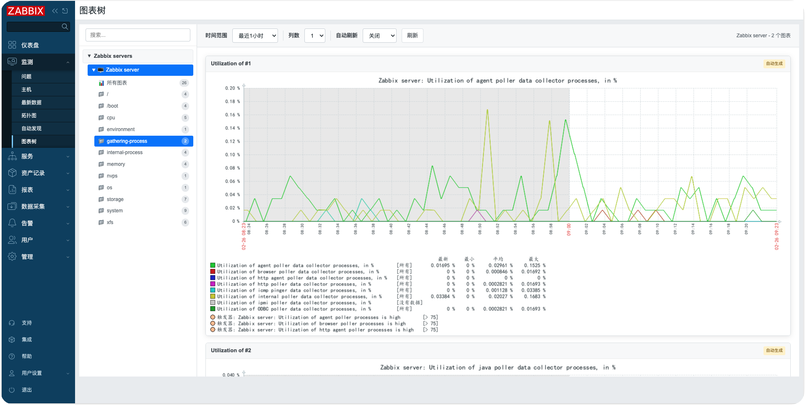

# Zabbix Graph Trees Module

[中文](README.md)

## ✨ Version Compatibility

| Zabbix | PHP | manifest_version | Result |
|---|---|---|---|
| 6.0.49 | 7.3.33 | 1.0 | Recognized, enabled; pages pass |
| 7.0.32 | 8.0.30 | 2.0 | Recognized, enabled; pages pass |
| 8.0.0 | 8.4.27 | 2.0 | Recognized, enabled; pages pass |

## Description

This is a Zabbix frontend module that provides tree-structured resource browsing and monitoring graph visualization. The module adds a Graph Trees menu under the Monitoring section of Zabbix Web, supporting tree navigation and real-time chart display.



## Features

- **Tree-structured Resource Browsing**:
  - Host group hierarchical display
  - Host list display
  - Quick search positioning
  - Expand/collapse control
- **Tag Filtering**:
  - Filter items by tags and tag values
  - Multi-select dropdown for flexible chart selection
- **Chart Display**:
  - SVG line charts for real-time monitoring data
  - Synchronized tooltip display across multiple charts
  - Full-screen chart zoom view
  - Auto-refresh (5/10/20/30/60 second intervals)
  - Multiple time range selections (1 hour to 30 days)
- **Internationalization**: Support for Chinese and English interfaces
- **Responsive Design**: Adapts to different screen sizes
- **Modern Interface**: Clean and concise design style

## Installation

### Install Module

```bash
# Zabbix 6.0 / 7.0 deployment
git clone https://github.com/X-Mars/zabbix_modules.git /usr/share/zabbix/modules/

# Zabbix 7.2+ / 7.4 / 8.0 deployment
git clone https://github.com/X-Mars/zabbix_modules.git /usr/share/zabbix/ui/modules/
```

### ⚠️ Modify manifest.json

```bash
# ⚠️ For Zabbix 6.0, modify manifest_version
sed -i 's/"manifest_version": 2.0/"manifest_version": 1.0/' zabbix_graphtrees/manifest.json
```

### Enable Module

1. Go to **Administration → General → Modules**.
2. Click **Scan directory** to scan for new modules.
3. Find the "Zabbix Graph Trees" module and enable it.
4. Refresh the page. The module will appear under the **Monitoring** menu as "Graph Trees" submenu.

## Notes

- **Performance**: For large environments, consider limiting query result quantities appropriately.
- **Data Accuracy**: Displayed information is based on the current state of the Zabbix database.
- **Item Dependencies**: Chart display depends on corresponding item configuration.

### Directory ownership and save errors

Module pages show an ownership command only when the directory owner or group differs from the PHP runtime account. Correct ownership produces no reminder. Save errors retain their original message and add directory ownership and SELinux (`getenforce`) reminders. Text follows the Zabbix Web user language. No extra dialogs or command panels are added.

## Development

The module is built on the Zabbix module framework. File structure:

- `manifest.json`: Module configuration
- `Module.php`: Menu registration
- `actions/GraphTrees.php`: Graph trees business logic
- `actions/GraphTreesData.php`: Data acquisition business logic
- `views/graphtrees.php`: Graph trees page view
- `lib/LanguageManager.php`: Internationalization language management
- `lib/ViewRenderer.php`: View rendering utilities
- `lib/ZabbixVersion.php`: Version compatibility utilities

For extensions, refer to [Zabbix module documentation](https://www.zabbix.com/documentation/7.0/en/devel/modules).

## Module Configuration

Select host groups and hosts, filter items by tags, and set the chart time range and automatic refresh interval.

## License

This project follows the Zabbix license. For details, see [Zabbix License](https://www.zabbix.com/license).
