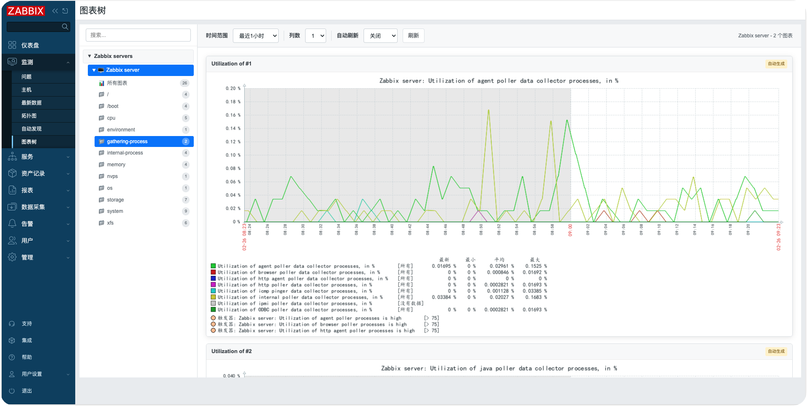

# Zabbix Graph Trees — дерево графиков

[中文](README.md) · [English](README_en.md)

## Совместимость версий

| Zabbix | PHP | `manifest_version` | Результат проверки |
| --- | --- | --- | --- |
| 6.0.49 | 7.3.33 | 1.0 | Модуль обнаружен и включён, страницы прошли проверку |
| 7.0.32 | 8.0.30 | 2.0 | Модуль обнаружен и включён, страницы прошли проверку |
| 8.0.0 | 8.4.27 | 2.0 | Модуль обнаружен и включён, страницы прошли проверку |

## Описание

Модуль добавляет раздел **Мониторинг → Дерево графиков**. В нём можно выбрать узлы сети и их группы в дереве, отфильтровать элементы данных и просмотреть графики с автообновлением.



## Возможности

- Дерево групп и узлов сети с поиском, разворачиванием и сворачиванием ветвей.
- Фильтрация элементов данных по тегам и значениям. Из выпадающего списка можно выбрать несколько элементов.
- Просмотр настроенных и автоматически созданных графиков Zabbix, в том числе в полноэкранном режиме.
- Автообновление каждые 30, 60, 120 или 300 секунд, готовые периоды от 10 минут до 30 дней и ручной ввод времени начала и окончания.
- Экспорт графика в PNG с областью построения 2400 × 600 пикселей через значок в правом верхнем углу.
- Адаптивная раскладка.

Интерфейс поддерживает китайский, английский и русский языки. Чтобы включить русский, выберите **Русский** в профиле Zabbix. При выборе языка по умолчанию используется системная настройка `default_lang`.

## Установка

### Размещение модуля

```bash
# Установка в Zabbix 6.0 / 7.0
git clone https://github.com/X-Mars/zabbix_modules.git /usr/share/zabbix/modules/

# Установка в Zabbix 7.2+ / 7.4 / 8.0
git clone https://github.com/X-Mars/zabbix_modules.git /usr/share/zabbix/ui/modules/
```

### Манифест для Zabbix 6.0

Для Zabbix 6.0 измените `manifest_version` на `1.0`. Для Zabbix 7.0 и 8.0 используется `2.0`.

```bash
# Для Zabbix 6.0 измените manifest_version
sed -i 's/"manifest_version": 2.0/"manifest_version": 1.0/' zabbix_graphtrees/manifest.json
```

### Включение модуля

1. Откройте **Администрирование → Общие → Модули**.
2. Нажмите **Сканировать каталог**.
3. Найдите и включите **Zabbix Graph Trees**.
4. Обновите страницу и откройте **Мониторинг → Дерево графиков**.

## Примечания

- Для крупных установок можно сократить выборку, ограничив число отображаемых узлов и элементов данных.
- Графики строятся на основе текущих данных и настроек элементов Zabbix.

### Владелец каталога и ошибки сохранения

Если владелец или группа каталога отличаются от учётной записи, под которой работает PHP, на странице модуля появится команда для изменения владельца. В сообщении об ошибке сохранения будут подсказки о правах на каталог и проверке SELinux командой `getenforce`.

## Разработка

- `manifest.json` — конфигурация модуля.
- `Module.php` — регистрация меню.
- `actions/GraphTrees.php` — контроллер страницы дерева графиков.
- `actions/GraphTreesData.php` — получение данных.
- `views/graphtrees.php` — представление.
- `lib/LanguageManager.php`, `lib/ViewRenderer.php` и `lib/ZabbixVersion.php` — локализация, вывод и совместимость версий.

Сведения о расширении модуля см. в [документации по разработке модулей Zabbix](https://www.zabbix.com/documentation/7.0/en/devel/modules).

## Использование

Выберите группы и узлы сети, отфильтруйте элементы данных по тегам и задайте период и интервал автообновления.

В режиме **Произвольный период** укажите время начала и окончания в часовом поясе профиля Zabbix. Начало должно предшествовать окончанию. После проверки графики в сетке и открытый полноэкранный график обновятся одновременно. Автообновление сохраняет применённый период.

Для проверки модуль использует штатный анализатор времени Zabbix и системное ограничение длительности. Если период недопустим, слишком короток или слишком длинен, модуль показывает ошибку и сохраняет последний применённый период. При переключении на готовый период результат более ранней проверки игнорируется.

Значок экспорта выгружает PNG за выбранный период для любого настроенного или автоматически созданного графика. Имя файла содержит узел сети, название графика и период. Перед выгрузкой модуль проверяет декодирование PNG и размер изображения, чтобы исключить страницы входа и изображения с ошибками.

## Лицензия

Применяются [условия лицензии Zabbix](https://www.zabbix.com/license).
