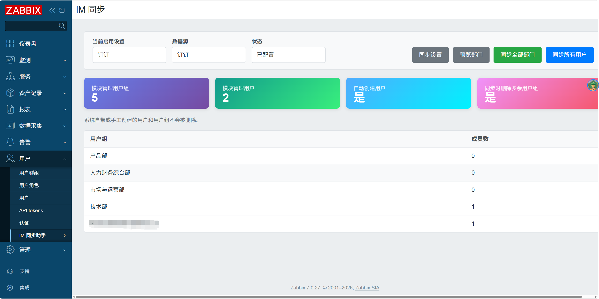
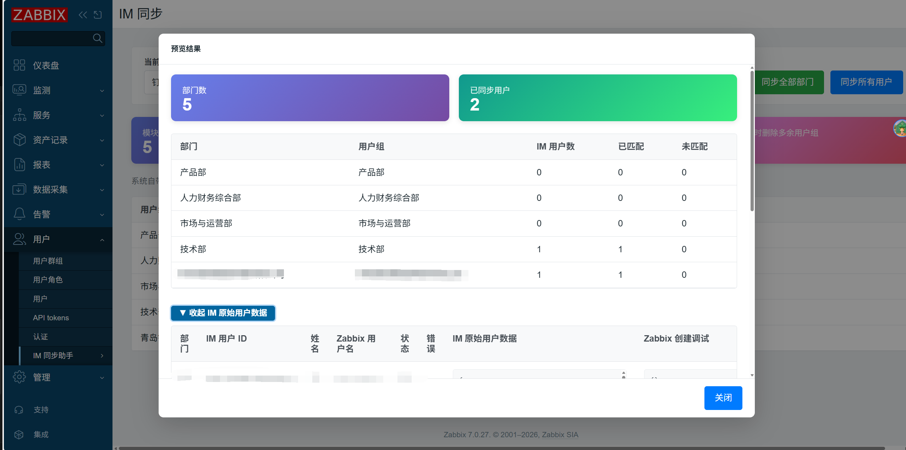
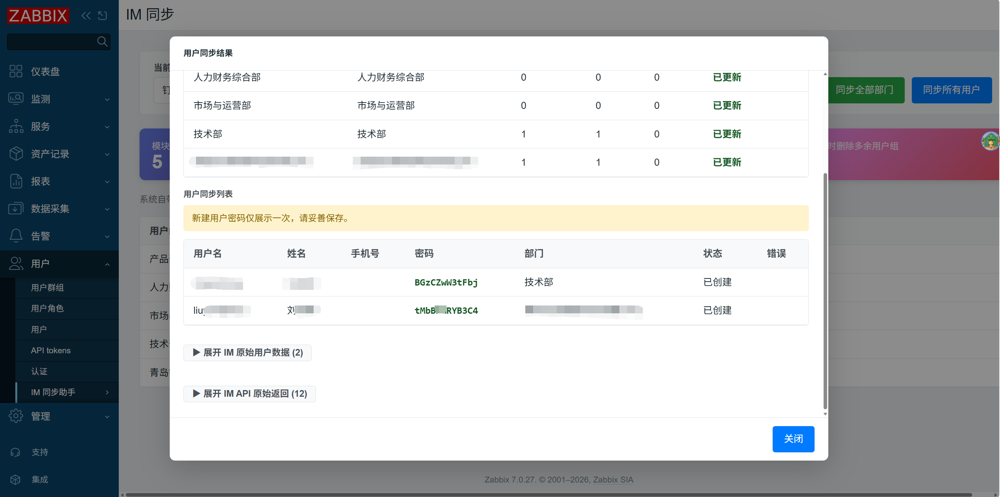

# IM Sync Assistant — синхронизация с мессенджерами

[中文](README.md) · [English](README_en.md)

## Совместимость версий

| Zabbix | PHP | `manifest_version` | Результат проверки |
| --- | --- | --- | --- |
| 6.0.49 | 7.3.33 | 1.0 | Модуль обнаружен и включён, страницы прошли проверку |
| 7.0.32 | 8.0.30 | 2.0 | Модуль обнаружен и включён, страницы прошли проверку |
| 8.0.0 | 8.4.27 | 2.0 | Модуль обнаружен и включён, страницы прошли проверку |

## Описание

Модуль синхронизирует подразделения WeCom, Feishu или DingTalk с группами пользователей Zabbix. Он сопоставляет участников с существующими пользователями или создаёт учётные записи и добавляет их в соответствующие группы.





Вход в модуль находится в разделе **Пользователи → Помощник синхронизации с мессенджерами**.

Интерфейс поддерживает китайский, английский и русский языки. Чтобы включить русский, выберите **Русский** в профиле Zabbix. При выборе языка по умолчанию используется системная настройка `default_lang`.

## Установка

### Размещение модуля

```bash
# Установка в Zabbix 6.0 / 7.0
git clone https://github.com/X-Mars/zabbix_modules.git /usr/share/zabbix/modules/

# Установка в Zabbix 7.2+ / 7.4 / 8.0
git clone https://github.com/X-Mars/zabbix_modules.git /usr/share/zabbix/ui/modules/
```

### Манифест для Zabbix 6.0

Для Zabbix 6.0 измените `manifest_version` на `1.0`. Для Zabbix 7.0 и 8.0 используется `2.0`.

```bash
# Для Zabbix 6.0 измените manifest_version
sed -i 's/"manifest_version": 2.0/"manifest_version": 1.0/' zabbix_im/manifest.json
```

### Включение модуля

1. Откройте **Администрирование → Общие → Модули**.
2. Нажмите **Сканировать каталог**.
3. Найдите и включите **Zabbix IM**.
4. Обновите страницу и откройте **Пользователи → Помощник синхронизации с мессенджерами**.

## Разрешения и правила синхронизации

- Для просмотра и синхронизации подразделений нужны права администратора Zabbix. Для управления настройками и автоматического создания пользователей нужен суперадминистратор. Начиная с Zabbix 7 метод `user.create` требует этой роли.
- Сервису веб-интерфейса нужен сетевой доступ к API мессенджера, а приложению — разрешения на чтение контактов.
- Модуль отслеживает управляемые записи в `data/sync_registry.json`. Объекты с происхождением `created` созданы модулем. Для `linked` синхронизируется только членство в группах. Встроенные и вручную созданные учётные записи и группы сохраняются.
- Если имя подразделения занято неуправляемой группой, подразделение пропускается и записывается в журнал. Участники, добавленные в управляемую группу вручную, сохраняются.
- Автоматически созданные пароли содержат 12 символов, включая прописные и строчные буквы и цифры. Пароли показываются один раз в результате синхронизации пользователей. Сохраните их безопасно.
- Если удалить синхронизированного пользователя, следующая синхронизация очищает старую запись в реестре и создаёт его заново, если включено автоматическое создание. Пользователь нескольких подразделений входит в соответствующие группы.
- DingTalk выбирает телефон, затем пиньинь имени, затем `userid`. Проверьте предпросмотр при переходе со старого сопоставления по `userid`. Для пиньиня нужен PHP `iconv` или `mbstring`.

### Владелец каталога и ошибки сохранения

Если владелец или группа каталога отличаются от учётной записи, под которой работает PHP, на странице модуля появится команда для изменения владельца. В сообщении об ошибке сохранения будут подсказки о правах на каталог и проверке SELinux командой `getenforce`.

## Настройка

Войдите с правами суперадминистратора и откройте **Пользователи → Помощник синхронизации с мессенджерами → Настройки синхронизации**.

1. Нажмите **Добавить настройки синхронизации**, выберите поставщика и введите ключи и ID корневого подразделения.
2. Сохраните и включите настройку. Одновременно активна одна настройка. При включении новой остальные отключаются.
3. При обновлении оставьте поля секретов пустыми, чтобы сохранить прежние значения.

Настройки сохраняются в списке `settings` в `zabbix_im/data/config.json`. Общие параметры верхнего уровня можно редактировать вручную. Старый формат с `provider` и отдельными разделами `wecom`, `feishu` или `dingtalk` при загрузке преобразуется в список `settings` с активным прежним поставщиком.

```json
{
    "use_full_path": false,
    "path_separator": "/",
    "username_lowercase": true,
    "remove_orphans": true,
    "remove_orphan_users": true,
    "auto_create_users": true,
    "auto_update_users": true,
    "default_roleid": "",
    "default_user_type": 2,
    "verify_ssl": true,
    "settings": [
        {
            "id": "set_default_wecom",
            "name": "WeCom",
            "provider": "wecom",
            "enabled": true,
            "root_department_id": "1",
            "corp_id": "your_corp_id",
            "corp_secret": "your_corp_secret",
            "app_id": "",
            "app_secret": "",
            "app_key": ""
        }
    ]
}
```

### Общие параметры

| Поле | Тип | Назначение |
| --- | --- | --- |
| `settings[].provider` | string | `wecom`, `feishu` или `dingtalk`. Используется поставщик активной настройки. |
| `use_full_path` | bool | Если `true`, имя группы строится из полного пути подразделения. Если `false`, используется имя текущего подразделения. |
| `path_separator` | string | Разделитель полного пути, по умолчанию `/`. |
| `username_lowercase` | bool | Приводит имена пользователей к нижнему регистру при сопоставлении и создании. |
| `remove_orphans` | bool | Удаляет управляемые модулем группы исчезнувших подразделений. |
| `remove_orphan_users` | bool | Удаляет исчезнувших пользователей с происхождением `created`. |
| `auto_create_users` | bool | Создаёт пользователей, для которых нет соответствия. Для Zabbix 7 и новее укажите `default_roleid`. |
| `auto_update_users` | bool | Обновляет имя и почту пользователей с происхождением `created`. |
| `default_roleid` | string | ID роли для новых пользователей Zabbix 7.0+. Роль можно найти в **Пользователи → Роли пользователей**. Если поле пустое, модуль пытается выбрать роль без прав администратора с `user` в имени. |
| `default_user_type` | int | Для Zabbix 6.x тип нового пользователя. `1` — пользователь, `2` — администратор, `3` — суперадминистратор. |
| `verify_ssl` | bool | Включает проверку сертификата HTTPS для API мессенджеров. |

Сопоставление всегда использует имя пользователя Zabbix. Имена групп берутся из названий подразделений или их полных путей.

| Платформа | Источник имени пользователя |
| --- | --- |
| WeCom | `userid` из адресной книги. |
| Feishu | `user_id` при наличии `contact:user.employee_id:readonly`, иначе `open_id`. |
| DingTalk | `mobile`, затем пиньинь `name`, затем `userid`. ASCII-имена используются как есть, китайские преобразуются с помощью таблицы GB2312. |

### WeCom

Используйте корпоративное приложение, созданное внутри организации (**self-built app**). Оно получает `access_token` по `corp_id` и `corp_secret`. [Документация WeCom](https://developer.work.weixin.qq.com/document/)

1. Откройте [консоль WeCom](https://work.weixin.qq.com/wework_admin/frame) и создайте приложение через **App Management → Apps → Built-in → Create app**.
2. Возьмите `corp_id` из **My Company → Company Info → Corp ID**, а `corp_secret` — из настроек созданного приложения. Введите их в Zabbix. Укажите `root_department_id`. Обычно `1` охватывает корень, а конкретный ID ограничивает синхронизацию поддеревом.
3. В **App Management → Built-in → приложение → Visible range** разрешите чтение всех нужных подразделений. Для всего предприятия укажите корневое подразделение или область, охватывающую все подразделения. Для одного направления укажите соответствующую ветвь. Недоступные сотрудники, подразделения или теги приводят к `60011`. [Область видимости приложения](https://developer.work.weixin.qq.com/document/path/90665)
4. Проверьте права просмотра контактов. Для настройки со списком доверенных IP добавьте исходящий IP веб-сервера Zabbix через **Admin Tools → Contact Sync → Trusted IP**.
5. Сохраните и включите подключение в Zabbix, затем откройте предпросмотр.

Используйте секрет именно созданного приложения. Для секрета **Contact Sync** действуют ограничения доверенных IP, которые могут вызывать `48009`. [Ограничения API контактов](https://developer.work.weixin.qq.com/document/path/90193)

| Назначение | Метод |
| --- | --- |
| Токен доступа | `GET /cgi-bin/gettoken`. [Описание](https://developer.work.weixin.qq.com/document/path/91039) |
| Дерево подразделений | `GET /cgi-bin/department/list?id={root_department_id}`. [Описание](https://developer.work.weixin.qq.com/document/path/90208) |
| Прямые участники подразделения | `GET /cgi-bin/user/list?department_id={id}&fetch_child=0`. [Описание](https://developer.work.weixin.qq.com/document/path/90201) |

Модуль запрашивает дерево и прямых участников каждого подразделения. Имя сотрудника берётся из ответа `user/list`. Для новых приложений получение телефона и почты через API контактов может требовать согласия пользователя через OAuth2 (`snsapi_privateinfo`). Модуль синхронизирует подразделения, `userid` и членство напрямую, поэтому чувствительные поля могут быть пустыми. Если API возвращает оба адреса, используется `email`, затем `biz_mail`. [Данные сотрудника](https://developer.work.weixin.qq.com/document/path/90196)

```json
{
    "id": "set_wecom_prod",
    "name": "WeCom Production",
    "provider": "wecom",
    "enabled": true,
    "root_department_id": "1",
    "corp_id": "wwxxxxxxxxxxxxxxxx",
    "corp_secret": "your_app_secret"
}
```

| Ошибка или симптом | Что проверить |
| --- | --- |
| `40001` | Совпадение `corp_id` и `corp_secret`, статус приложения и актуальность секрета. |
| `40014` | Токен и секрет нужного приложения. Токен обновляется автоматически. |
| `60011` или неполный список | Видимость всех нужных подразделений, сотрудников и тегов. |
| `48009` | Тип секрета и список доверенных IP. |
| `48002` | Тип секрета и права на вызов API. |
| `40066` | `root_department_id` в **Contacts → Organization**. |
| Имя отличается регистром | Параметр `username_lowercase`. |

[Коды ошибок WeCom](https://developer.work.weixin.qq.com/document/path/90313)

### Feishu

Используйте корпоративное приложение, созданное внутри организации. Модуль получает `tenant_access_token` по `app_id` и `app_secret`. [Открытая платформа Feishu](https://open.feishu.cn/document/home/index)

1. Создайте приложение в [консоли Feishu](https://open.feishu.cn/app). Возьмите **App ID** и **App Secret** из **Credentials & basic info**. [Руководство по созданию приложения](https://open.feishu.cn/document/home/introduction-to-custom-app-development/self-built-application-development-process)
2. В **Permission management → API permissions** выдайте права на контакты. Для приложения рекомендуется `contact:contact:readonly_as_app`. Доступ также задают `contact:contact:readonly`, `contact:contact:access_as_app`, `contact:contact.base:readonly` и `contact:department.organize:readonly` для структуры подразделений.
3. Настройте область данных в **Development config → Permission management → Accessible data scope** или **Workplace → App management → Contact settings**. Для `root_department_id="0"` нужна область **All members**. Для `open_department_id` вида `od-xxx` нужны само подразделение и его потомки. При ограниченной области API может вернуть `40004`. [Области доступа](https://open.feishu.cn/document/server-docs/contact-v3/scope/scope_authority)
4. Задайте разрешения полей: `contact:user.employee_id:readonly` для `user_id`, `contact:user.email:readonly` для почты, `contact:user.phone:readonly` для телефона, `contact:user.base:readonly` для имени. Если `user_id` недоступен, используется специфичный для приложения `open_id`.
5. Опубликуйте новую версию приложения после изменения области и разрешений. Для публикации требуется одобрение администратора предприятия.
6. Введите данные приложения и `root_department_id` в Zabbix. Сохраните, включите подключение и выполните предпросмотр.

| Назначение | Метод |
| --- | --- |
| Токен приложения | `POST /auth/v3/tenant_access_token/internal`. [Описание](https://open.feishu.cn/document/server-docs/authentication-management/access-token/tenant_access_token_internal) |
| Корневое или отдельное подразделение | `GET /contact/v3/departments/{department_id}`. [Описание](https://open.feishu.cn/document/server-docs/contact-v3/department/get) |
| Дочерние подразделения | `GET /contact/v3/departments`. [Описание](https://open.feishu.cn/document/server-docs/contact-v3/department/children) |
| Прямые участники | `GET /contact/v3/users/find_by_department`. [Описание](https://open.feishu.cn/document/server-docs/contact-v3/user/find_by_department) |

```json
{
    "id": "set_feishu_prod",
    "name": "Feishu Production",
    "provider": "feishu",
    "enabled": true,
    "root_department_id": "0",
    "app_id": "cli_xxxxxxxxxx",
    "app_secret": "your_app_secret"
}
```

| Ошибка или симптом | Что проверить |
| --- | --- |
| `40004 no dept authority error` | Область контактов и доступность `root_department_id`. |
| Корень не возвращает пользователей | Для корня `0` должна быть область **All members**. |
| Имя вида `ou_xxx` | Разрешение `contact:user.employee_id:readonly` и публикацию версии. |
| Пустые телефон или почта | Разрешения полей `contact:user.phone:readonly` и `contact:user.email:readonly`. |
| Изменения прав не вступили в силу | Публикацию и одобрение версии. |
| Ошибка `tenant_access_token` | `app_id`, `app_secret` и состояние приложения. |

[Список разрешений](https://open.feishu.cn/document/ukTMukTMukTM/uYTM5UjL2ETO14iNxkTN/scope-list) · [Типы ID пользователя](https://open.feishu.cn/document/home/user-identity-introduction/open-id)

### DingTalk

Используйте внутреннее приложение предприятия (**enterprise internal app**). Модуль получает `access_token` по `app_key` и `app_secret`. [Открытая платформа DingTalk](https://open.dingtalk.com/document/)

1. В консоли выберите **App development → Internal development → Create app**. Скопируйте **AppKey** (Client ID) и **AppSecret** (Client Secret) из **Credentials & basic info**.
2. В **Development config → Permission management** запросите `qyapi_get_department_list` для чтения подразделений и `qyapi_get_department_member` для чтения участников. Некоторые права требуют одобрения администратора.
3. Для телефона и почты выдайте права чтения контактных полей. Для почты модуль сначала проверяет `email`, затем `org_email`. При списке разрешённых IP укажите исходящий IP веб-интерфейса в **Development config → Development management**.
4. Укажите ключи и `root_department_id` в Zabbix. Обычно `1` — корень, а положительный ID — выбранное поддерево. Сохраните, включите подключение и выполните предпросмотр.

| Назначение | Метод |
| --- | --- |
| Токен | `GET /gettoken?appkey=&appsecret=`. [Описание](https://open.dingtalk.com/document/orgapp/obtain-orgapp-token) |
| Данные подразделения | `POST /topapi/v2/department/get`. [Описание](https://open.dingtalk.com/document/orgapp/query-department-details0-v2) |
| Следующий уровень дерева | `POST /topapi/v2/department/listsub`. [Описание](https://open.dingtalk.com/document/orgapp/obtain-the-department-list) |
| Прямые участники | `POST /topapi/v2/user/list`. [Описание](https://open.dingtalk.com/document/orgapp/queries-the-complete-information-of-a-department-user) |

Модуль добавляет корень, рекурсивно читает дочерние подразделения и запрашивает прямых участников с пагинацией `cursor` по 100 записей. Служебное школьное подразделение `-7` исключается. [Полная синхронизация](https://open.dingtalk.com/document/orgapp/obtains-information-about-all-employees-of-an-enterprise)

```json
{
    "id": "set_dingtalk_prod",
    "name": "DingTalk Production",
    "provider": "dingtalk",
    "enabled": true,
    "root_department_id": "1",
    "app_key": "dingxxxxxxxxxx",
    "app_secret": "your_app_secret"
}
```

| Ошибка или симптом | Что проверить |
| --- | --- |
| `88` или `sub_code=60011` | Права `qyapi_get_department_list` и `qyapi_get_department_member`. |
| `50004` или неполный список | Область контактов и выбранный корень. |
| `60003` или `40009` | Корневой ID в **Contacts → Departments**. Укажите положительное целое. |
| `40001` или `43007` | Ключ приложения, секрет, токен и права. |
| Пустые телефон и почта | Тип приложения и права на контактные поля. |
| Имя по `userid` вместо пиньиня | Поле `name` в ответе API, версию `PinyinHelper.php` и наличие `iconv` или `mbstring`. |
| Дублирующийся пиньинь | Укажите телефон или сопоставьте пользователей вручную в Zabbix. |
| Отклонён сетевой запрос | Список разрешённых исходящих IP в **Development management**. |

[Коды ошибок DingTalk](https://open.dingtalk.com/document/orgapp/server-api-error-codes-1) · [Операции с подразделениями](https://open.dingtalk.com/document/orgapp/operations-related-to-address-book-departments)

## Использование

1. Добавьте и включите подключение в **Настройках синхронизации**.
2. Откройте **Пользователи → Помощник синхронизации с мессенджерами → Синхронизация с мессенджером**. Сверху показана активная настройка.
3. Нажмите **Предпросмотр подразделений** и проверьте сопоставления.
4. Нажмите **Синхронизировать все подразделения**, чтобы создать или обновить группы Zabbix.
5. Нажмите **Синхронизировать всех пользователей**, чтобы сопоставить или создать пользователей и распределить их по группам.

## Разработка

- `manifest.json` и `Module.php` — конфигурация и пункты меню.
- `actions/Im.php`, `actions/ImPreview.php`, `actions/ImSync.php`, `actions/ImSyncUsers.php` — страница, предпросмотр и синхронизация.
- `actions/ImSettings.php`, `actions/ImSettingsSave.php`, `actions/ImSettingsDelete.php` и `actions/ImSettingsEnable.php` — управление подключениями.
- `views/im.php` и `views/im.settings.php` — представления.
- `lib/ImSyncService.php` и `lib/SyncRegistry.php` — синхронизация и реестр.
- `lib/WeComClient.php`, `lib/FeishuClient.php` и `lib/DingTalkClient.php` — клиенты платформ.
- `lib/PinyinHelper.php` и `lib/ConfigManager.php` — преобразование имён и управление конфигурацией.
- `lib/LanguageManager.php` — локализация. Исходные сообщения API платформ могут отображаться на английском.

## Лицензия

Применяются [условия лицензии Zabbix](https://www.zabbix.com/license).
