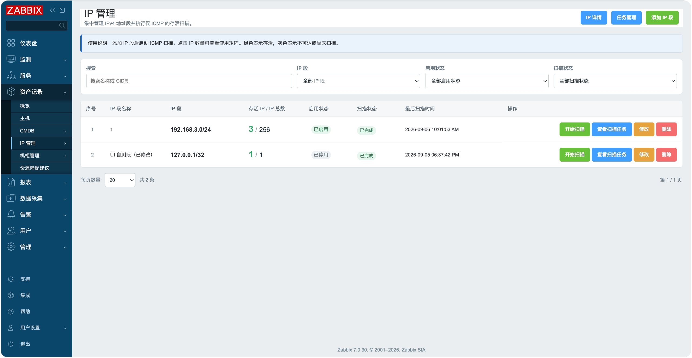
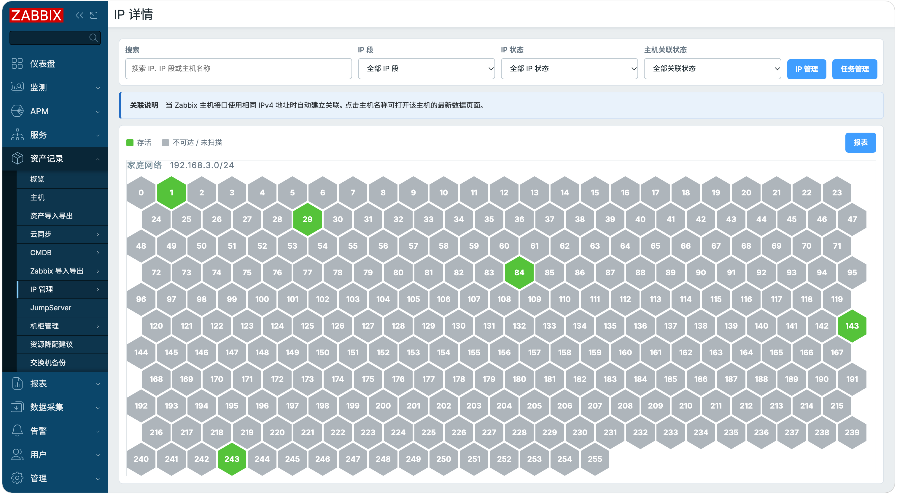
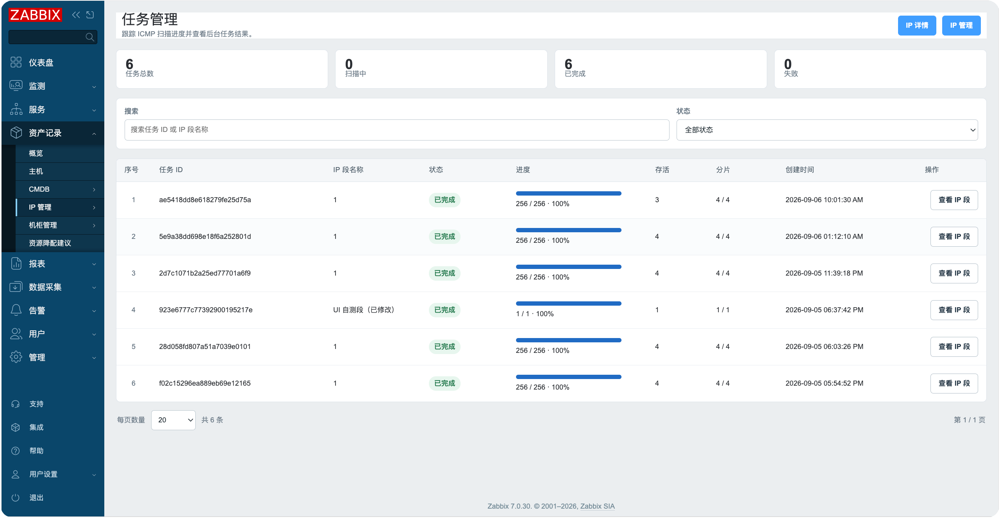

# Zabbix IPAM — управление IP-адресами

[中文](README.md) · [English](README_en.md)

## Совместимость версий

| Zabbix | PHP | `manifest_version` | Результат проверки |
| --- | --- | --- | --- |
| 6.0.49 | 7.3.33 | 1.0 | Модуль обнаружен и включён, страницы прошли проверку |
| 7.0.32 | 8.0.30 | 2.0 | Модуль обнаружен и включён, страницы прошли проверку |
| 8.0.0 | 8.4.27 | 2.0 | Модуль обнаружен и включён, страницы прошли проверку |

## Описание

В разделе **Инвентаризация → IPAM** можно управлять диапазонами IPv4, проверять доступность адресов по ICMP и сопоставлять адреса с интерфейсами узлов Zabbix. Проверки выполняются в фоне через PHP CLI. Большие диапазоны разбиваются на части.





## Возможности

- Диапазоны задаются в формате CIDR или начального и конечного IPv4-адресов.
- Поиск применяется по Enter, списки применяют фильтры при выборе.
- `fping` проверяет доступность адресов по ICMP. Задачи можно запустить в интерфейсе или по расписанию cron.
- Диапазон делится на части по 64 адреса. `pcntl_fork` позволяет выполнять проверки параллельно. В интерфейсе видны состояние задачи и счётчики адресов и частей.
- Матрица доступности, список IP-адресов и автоматические связи с узлами по IPv4-адресу интерфейса.
- Переход на страницу последних данных узла и настройка числа строк на каждой странице.
- Адаптивная раскладка, проверка IP-адресов и числовых полей. Доступ предоставляется администраторам Zabbix.

Интерфейс поддерживает китайский, английский и русский языки. Чтобы включить русский, выберите **Русский** в профиле Zabbix. При выборе языка по умолчанию используется системная настройка `default_lang`.

## Установка

### Размещение модуля

```bash
# Стандартный путь в Zabbix 6.0 / 7.0
cp -a zabbix_ipam /usr/share/zabbix/modules/

# Стандартный путь в Zabbix 7.2+ / 7.4 / 8.0
cp -a zabbix_ipam /usr/share/zabbix/ui/modules/
```

Если в веб-интерфейсе задан другой каталог `$ZBX_MODULES_DIR`, используйте его.

### Манифест для Zabbix 6.0

```bash
# Выполняйте, если Zabbix 6.0 не распознаёт manifest_version 2.0
sed -i 's/"manifest_version": 2.0/"manifest_version": 1.0/' zabbix_ipam/manifest.json
```

### Включение модуля

1. Откройте **Администрирование → Общие → Модули**.
2. Нажмите **Сканировать каталог**.
3. Найдите и включите **Zabbix IPAM**.
4. Обновите страницу и откройте **Инвентаризация → IPAM**.

## Примечания

- Проверяйте сети, на сканирование которых у вас есть разрешение. Сканирование использует ICMP и поддерживает до 65 536 IPv4-адресов в диапазоне.
- Учётным записям веб-интерфейса и cron нужна запись в `data/`.
- Разрешите ICMP на межсетевом экране и проверьте возможность запуска `fping`.
- Для запуска из браузера нужен PHP `exec()`. Задачи из cron выполняются напрямую в PHP CLI.
- По умолчанию используются до четырёх процессов. Доступ к связи с узлом определяется разрешениями текущего пользователя Zabbix.
- Для резервного копирования сохраняйте `data/` с файлами JSON.

### Устранение неполадок

| Симптом | Что проверить |
| --- | --- |
| Задача завершается сразу после запуска | Наличие PHP CLI, доступность `exec()` и права записи в `data/scan_tasks/`. |
| Все адреса недоступны | Запустите `fping` от имени пользователя веб-интерфейса или cron. Проверьте права и ICMP. Модуль ищет `/usr/sbin/fping`, `/usr/bin/fping` и `/sbin/fping` в этом порядке. |
| Задача остаётся в ожидании | Проверьте `data/scan_tasks/<ID задачи>.log`, путь PHP CLI и ограничения SELinux или AppArmor. |
| Cron не создаёт задачу | Проверьте, что диапазон включён и для него нет задачи `pending` или `running`. |
| Диапазон не сохраняется | Проверьте владельца и права `data/`. Модуль создаёт временные JSON-файлы и файлы блокировок. |
| Нет связи с узлом сети | Проверьте совпадение IPv4-адреса интерфейса и права на просмотр узла. |

### Владелец каталога и ошибки сохранения

Если владелец или группа каталога отличаются от учётной записи, под которой работает PHP, на странице модуля появится команда для изменения владельца. В сообщении об ошибке сохранения будут подсказки о правах на каталог и проверке SELinux командой `getenforce`.

## Разработка

- `manifest.json` и `Module.php` — метаданные, маршруты и меню.
- `actions/IpManager.php`, `actions/IpDetail.php`, `actions/IpScan.php` и `actions/IpAjax.php` — диапазоны, адреса, задачи и операции AJAX.
- `views/ip.manager.php`, `views/ip.detail.php` и `views/ip.scan.php` — представления страниц.
- `lib/HostMatcher.php` — сопоставление по интерфейсам Zabbix.
- `lib/IpScanner.php`, `lib/IpStorage.php` и `lib/TaskManager.php` — проверки ICMP, хранение и фоновые задачи.
- `lib/LanguageManager.php`, `lib/ViewRenderer.php` и `lib/ZabbixVersion.php` — локализация, вывод и совместимость.
- `assets/` — стили и скрипты.
- `cli/scan_cron.php` — запуск по расписанию.

Сведения о расширении модуля см. в [документации по разработке модулей Zabbix](https://www.zabbix.com/documentation/7.0/en/devel/modules).

## Настройка

### Как выполняется сканирование

```text
Страница управления IP-адресами или crontab
        ↓
Создание задачи сканирования диапазона
        ↓
Фоновый процесс PHP CLI
        ↓
Разбиение по 64 адреса → проверка ICMP через fping
        ↓
Результаты JSON и ход задачи → матрица, сведения об IP и управление задачами
```

- Кнопка **Начать сканирование** запускает отдельный PHP CLI через `exec()` и `nohup`.
- `cli/scan_cron.php` создаёт задачи для включённых диапазонов, у которых нет активной задачи.
- При наличии `pcntl_fork()` используется до четырёх процессов, иначе адреса проверяются последовательно в фоне.
- Состояния и результаты сохраняются в JSON с блокировками и атомарной заменой временного файла.

### Права на каталоги

Пользователям веб-сервера и cron нужен доступ на чтение и запись `data/`, `data/scan_tasks/` и `data/results/`. Можно использовать общую учётную запись или группу. Подставьте путь установленного модуля.

```bash
# Пример для Debian и Ubuntu
chown -R www-data:www-data zabbix_ipam/data
chmod -R 770 zabbix_ipam/data

# Пример для RHEL и Rocky Linux
chown -R apache:apache zabbix_ipam/data
chmod -R 770 zabbix_ipam/data
```

### Установка зависимостей

```bash
# Debian / Ubuntu
apt install fping php-cli php-pcntl

# RHEL / Rocky Linux
dnf install fping php-cli php-process
```

Для сканирования требуются PHP CLI и `fping`. Пакет `php-pcntl` или `php-process` включает многопроцессный режим. Проверьте запуск от имени учётной записи веб-сервера.

```bash
# Debian / Ubuntu
sudo -u www-data /usr/bin/php -r 'echo PHP_SAPI, PHP_EOL;'
sudo -u www-data /usr/bin/fping -c 1 -t 350 127.0.0.1

# RHEL / Rocky Linux
sudo -u apache /usr/bin/php -r 'echo PHP_SAPI, PHP_EOL;'
sudo -u apache /usr/sbin/fping -c 1 -t 350 127.0.0.1
```

Для ручного запуска проверьте, что PHP разрешает `exec` и веб-сервис может запустить PHP CLI. Если `exec` запрещён политикой сервера, используйте запуск по расписанию.

### Сканирование по расписанию

Период задаётся в crontab для `cli/scan_cron.php`. Примеры запускают сканирование всех включённых диапазонов раз в пять минут. Для диапазона с ожидающей или выполняющейся задачей дубликат не создаётся. Выполняйте проверку от сервисной учётной записи.

В файле `/etc/cron.d/zabbix-ipam` укажите пользователя запуска.

```cron
*/5 * * * * apache /usr/bin/php /usr/share/zabbix/modules/zabbix_ipam/cli/scan_cron.php >> /var/log/zabbix/ipam-cron.log 2>&1
```

В Debian и Ubuntu обычно используется `www-data` вместо `apache`. Если задание добавляется через `crontab -u apache -e` или `crontab -u www-data -e`, имя пользователя в строке не указывается.

```cron
*/5 * * * * /usr/bin/php /usr/share/zabbix/modules/zabbix_ipam/cli/scan_cron.php >> /var/log/zabbix/ipam-cron.log 2>&1
```

В Zabbix 7.2 и новее путь часто выглядит как `/usr/share/zabbix/ui/modules/zabbix_ipam/cli/scan_cron.php`. Предоставьте выбранному пользователю доступ на запись каталога журнала. Файлы состояния и блокировки защищают от одновременных задач для одного диапазона.

#### Проверка запуска вручную

```bash
# Выберите apache или www-data и подставьте путь к модулю
sudo -u apache /usr/bin/php /usr/share/zabbix/modules/zabbix_ipam/cli/scan_cron.php
```

При успешном запуске в списке задач появляется новая запись, а команда обычно не печатает результат. Ошибки записываются в стандартный поток ошибок.

### Страницы модуля

- **Управление IP-адресами** — диапазоны, запуск проверок, задачи и матрица.
- **Сведения об IP-адресах** — поиск и фильтрация по диапазону, состоянию адреса и связи с узлом.
- **Управление задачами** — поиск и фильтры ожидающих, выполняющихся, завершённых, неудачных и остановленных задач.

Нажмите **Доступных IP / всего**, чтобы открыть матрицу. Зелёные ячейки обозначают адреса, доступные во время последней проверки, серые — недоступные или ещё не проверенные. Нажатие на связанную зелёную ячейку открывает последние данные узла.

## Лицензия

Применяются [условия лицензии Zabbix](https://www.zabbix.com/license).
