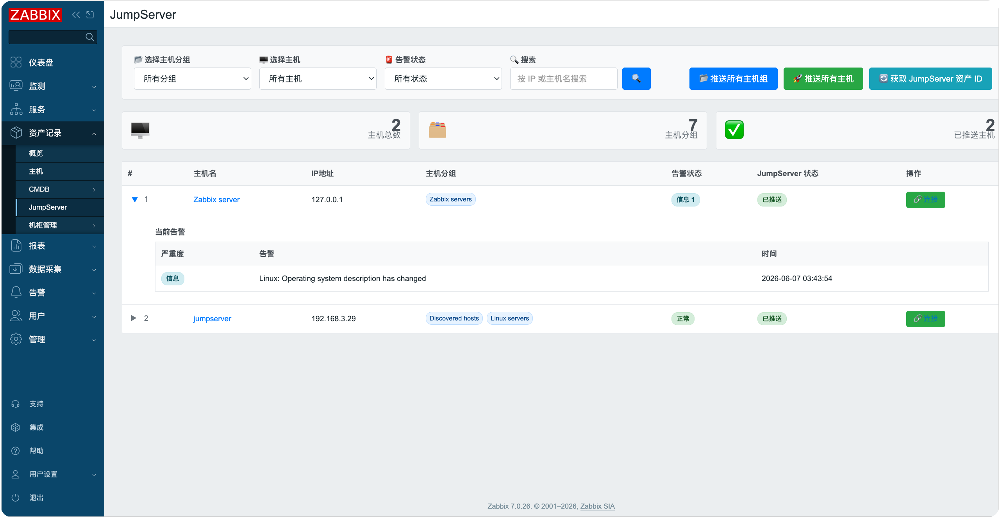

# Zabbix JumpServer — синхронизация с JumpServer

[中文](README.md) · [English](README_en.md)

## Совместимость версий

| Zabbix | PHP | `manifest_version` | Результат проверки |
| --- | --- | --- | --- |
| 6.0.49 | 7.3.33 | 1.0 | Модуль обнаружен и включён, страницы прошли проверку |
| 7.0.32 | 8.0.30 | 2.0 | Модуль обнаружен и включён, страницы прошли проверку |
| 8.0.0 | 8.4.27 | 2.0 | Модуль обнаружен и включён, страницы прошли проверку |

## Описание

Модуль отправляет узлы и группы узлов Zabbix на сервер доступа JumpServer. В разделе **Инвентаризация → JumpServer** можно создавать ресурсы и открывать страницу подключения к узлу.



## Возможности

- Выбор группы или отдельного узла, поиск по IP-адресу или имени и фильтр по важности проблем. По умолчанию показаны все группы, узлы и состояния.
- Массовая или индивидуальная отправка узлов и групп. Модуль создаёт недостающие группы в JumpServer, выбирает платформу Linux или Windows по элементу «Операционная система» и создаёт либо обновляет ресурс.
- Поиск существующих ресурсов JumpServer по IP-адресу и запись ID в тег узла `jumpserver_asset_id`.
- Счётчики проблем по важности и раскрытие строки для просмотра названия, времени и важности. При отсутствии проблем отображается **ОК**.
- Кнопка **Подключиться** у отправленных узлов. Наведение на статус позволяет запустить повторную отправку.

Интерфейс поддерживает китайский, английский и русский языки. Чтобы включить русский, выберите **Русский** в профиле Zabbix. При выборе языка по умолчанию используется системная настройка `default_lang`.

## Установка

### Размещение модуля

```bash
# Установка в Zabbix 6.0 / 7.0
git clone https://github.com/X-Mars/zabbix_modules.git /usr/share/zabbix/modules/

# Установка в Zabbix 7.2+ / 7.4 / 8.0
git clone https://github.com/X-Mars/zabbix_modules.git /usr/share/zabbix/ui/modules/
```

### Манифест для Zabbix 6.0

Для Zabbix 6.0 измените `manifest_version` на `1.0`. Для Zabbix 7.0 и 8.0 используется `2.0`.

```bash
# Для Zabbix 6.0 измените manifest_version
sed -i 's/"manifest_version": 2.0/"manifest_version": 1.0/' zabbix_jumpserver/manifest.json
```

### Включение модуля

1. Откройте **Администрирование → Общие → Модули**.
2. Нажмите **Сканировать каталог**.
3. Найдите и включите **Zabbix JumpServer**.
4. Обновите страницу и откройте **Инвентаризация → JumpServer**.

## Примечания

- С сервера веб-интерфейса Zabbix должен быть доступен адрес JumpServer.
- Для просмотра достаточно прав пользователя Zabbix. Для отправки и получения ID ресурсов требуются права администратора.
- Если элемент «Операционная система» отсутствует, используется Linux. При записи `jumpserver_asset_id` другие теги сохраняются.
- Ограничьте доступ к `data/config.json`, поскольку он содержит учётные данные.

### Владелец каталога и ошибки сохранения

Если владелец или группа каталога отличаются от учётной записи, под которой работает PHP, на странице модуля появится команда для изменения владельца. В сообщении об ошибке сохранения будут подсказки о правах на каталог и проверке SELinux командой `getenforce`.

## Разработка

- `manifest.json` и `Module.php` — конфигурация и регистрация меню.
- `actions/Jumpserver.php`, `actions/JumpserverPush.php`, `actions/JumpserverFetchIds.php` — список, отправка и получение ID ресурсов.
- `views/jumpserver.php` — представление.
- `lib/JumpserverClient.php` и `lib/ConfigManager.php` — API-клиент HTTP Signature и загрузка параметров соединения.
- `lib/LanguageManager.php`, `lib/ViewRenderer.php` и `lib/ZabbixVersion.php` — локализация, вывод и совместимость версий.
- `data/config.json` — параметры подключения.

Сведения о расширении модуля см. в [документации по разработке модулей Zabbix](https://www.zabbix.com/documentation/7.0/en/devel/modules).

## Настройка

Заполните `zabbix_jumpserver/data/config.json` и предоставьте учётной записи веб-интерфейса доступ на чтение.

```json
{
    "jumpserver_url": "http://192.168.3.29",
    "access_key_id": "<AccessKeyID>",
    "access_key_secret": "<AccessKeySecret>",
    "org_id": "00000000-0000-0000-0000-000000000002",
    "connect_url_template": "{base_url}/luna/connect?asset={asset_id}",
    "account_template_id": "",
    "verify_ssl": false
}
```

| Поле | Назначение |
| --- | --- |
| `jumpserver_url` | Базовый URL JumpServer. |
| `access_key_id` | ID ключа доступа пользователя JumpServer. |
| `access_key_secret` | Секрет ключа доступа. |
| `org_id` | ID организации. По умолчанию используется DEFAULT. |
| `connect_url_template` | Шаблон ссылки подключения с подстановкой `{base_url}` и `{asset_id}`. |
| `account_template_id` | ID шаблона учётной записи. Пустое значение отключает автоматическую привязку. |
| `verify_ssl` | Включает проверку HTTPS-сертификата. |

Чтобы получить ключ, войдите в JumpServer и в профиле пользователя создайте API-ключ (AccessKey). Укажите его ID и секрет. Для запросов используется HTTP Signature (HMAC-SHA256). [Документация REST API JumpServer](https://docs.jumpserver.org/zh/v4/dev/rest_api/)

### Автоматическая привязка учётной записи

1. В JumpServer откройте **Accounts → Account templates** и создайте шаблон с именем пользователя и паролем или SSH-ключом.
2. Укажите ID шаблона в `account_template_id`.
3. При создании ресурса модуль отправит `[{"template": "<template-id>"}]` в поле `accounts` запроса `POST /api/v1/assets/hosts/`. JumpServer подставит данные из шаблона. При обновлении уже существующих ресурсов поле `accounts` не передаётся.

Ключу доступа требуется разрешение `accounts.add_account`. Если JumpServer должен создать или изменить системную учётную запись на целевом узле, настройте автоматическую отправку в шаблоне и укажите учётную запись с нужными правами.

### Получение ID существующих ресурсов

Нажмите **Получить ID ресурсов JumpServer**. Модуль читает ресурсы из `/api/v1/assets/hosts/`, сопоставляет их `address` с IP-адресами основных интерфейсов Zabbix и записывает сопоставленный ID в `jumpserver_asset_id`. Если тег уже содержит тот же ID, запись пропускается.

## Лицензия

Применяются [условия лицензии Zabbix](https://www.zabbix.com/license).
