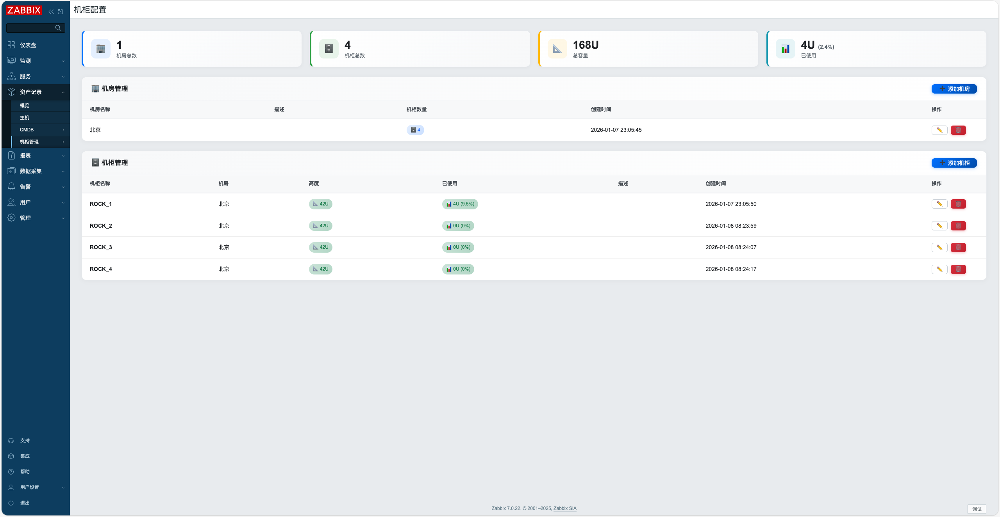
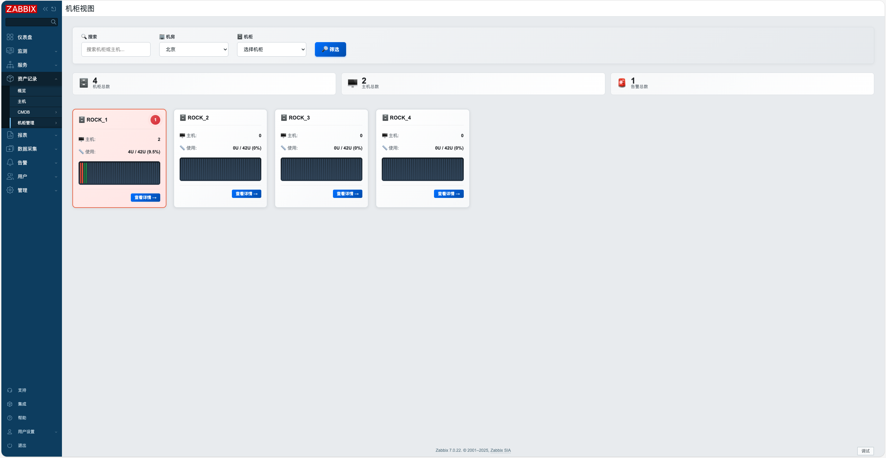
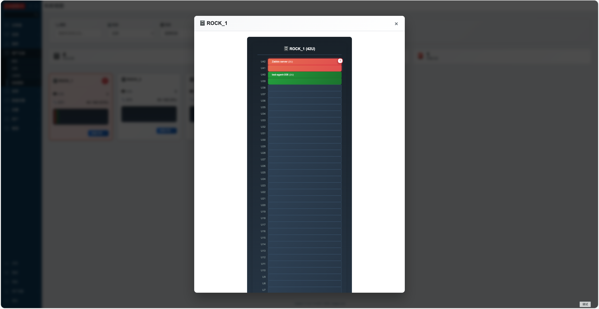

# Zabbix Rack 模块

[English](README_en.md)

## ✨ 版本兼容性

| Zabbix | PHP | manifest_version | 结果 |
|---|---|---|---|
| 6.0.49 | 7.3.33 | 1.0 | 可识别、可启用；页面通过 |
| 7.0.32 | 8.0.30 | 2.0 | 可识别、可启用；页面通过 |
| 8.0.0 | 8.4.27 | 2.0 | 可识别、可启用；页面通过 |

## 描述

这是一个 Zabbix 前端模块，用于数据中心机柜可视化和主机位置管理。模块在 Zabbix Web 的资产记录菜单下新增机柜管理功能，支持机房和机柜的配置，以及主机的可视化分配。





## 功能特性

- **机房管理**：
  - 创建、编辑、删除机房
  - 机房描述信息管理
  - 为机房分配 Zabbix 用户组和用户（访问控制）
- **访问权限**：
  - 机房可关联 Zabbix 用户组与具体用户
  - 配置权限时默认选中全部用户组与用户（表示全员可见）
  - 机柜视图仅展示当前用户有权限的机房/机柜
  - 未配置用户组与用户的机房对所有用户可见
  - **Super Admin** 在机柜视图中可查看全部机房，不受机房权限限制
- **机柜配置（管理页）**：
  - 仅 **Super Admin** 可访问机柜配置页面及相关保存/删除接口
  - 普通用户仅可使用机柜视图
- **机柜管理**：
  - 创建、编辑、删除机柜
  - 配置机柜高度（支持 1-60U）
  - 关联机房
- **机柜可视化**：
  - 42U 机柜垂直布局展示
  - 支持**正面 / 背面**视图切换（同一 U 位正反面可独立放置主机）
  - U 位占用状态实时显示
  - 主机信息悬停提示
  - 空闲 U 位点击分配
- **主机分配**：
  - 将 Zabbix 主机分配到机柜指定 U 位
  - 支持按主机组过滤
  - 支持主机名搜索
  - U 位冲突检测
- **搜索功能**：
  - 按机柜名称搜索
  - 按主机名称搜索
  - 快速定位主机位置
- **国际化支持**：支持中英文界面
- **响应式设计**：适配不同屏幕尺寸

## 安装步骤

### 安装模块

```bash
# Zabbix 6.0 / 7.0 部署方法
git clone https://github.com/X-Mars/zabbix_modules.git /usr/share/zabbix/modules/

# Zabbix 7.2+ / 7.4 / 8.0 部署方法
git clone https://github.com/X-Mars/zabbix_modules.git /usr/share/zabbix/ui/modules/
```

### ⚠️ 修改 manifest.json 文件

```bash
# ⚠️ 如果使用Zabbix 6.0，修改manifest_version
sed -i 's/"manifest_version": 2.0/"manifest_version": 1.0/' zabbix_rack/manifest.json
```

### 启用模块

1. 转到 **Administration → General → Modules**。
2. 点击 **Scan directory** 按钮扫描新模块。
3. 找到 "Zabbix Rack" 模块，点击启用模块。
4. 刷新页面，模块将在 **Inventory** 菜单下显示为 "机柜管理" 子菜单。

## 注意事项

### 保存权限与 SELinux（2026-11-21 修复）

机房/机柜写入的是 **Web 前端服务器** 上的 `data/config.json`，并非 Zabbix Server 的目录。SELinux Enforcing 时，`usr_t` 标签会阻止 PHP-FPM 写入，即使文件已是 777。应按 Web PHP 进程账号（测试环境为 apache）设置归属和持久写标签：

```bash
# Tested Zabbix 8 frontend; adjust the path and PHP pool user for your installation.
dnf install policycoreutils-python-utils
mkdir -p /usr/share/zabbix/ui/modules/zabbix_rack/data
chown -R apache:apache /usr/share/zabbix/ui/modules/zabbix_rack/data
chmod 750 /usr/share/zabbix/ui/modules/zabbix_rack/data
# If config.json already exists:
chmod 600 /usr/share/zabbix/ui/modules/zabbix_rack/data/config.json
semanage fcontext -a -t httpd_sys_rw_content_t '/usr/share/zabbix/ui/modules/zabbix_rack/data(/.*)?'
restorecon -RFv /usr/share/zabbix/ui/modules/zabbix_rack/data
```

若规则已存在，使用 `semanage fcontext -m` 更新。不要使用 chmod 777 或关闭 SELinux；写标签仅限 data 目录。

代码已改为临时文件写入后原子替换，失败保留旧文件及缓存，并将错误写入 PHP/Web 日志，避免 warning 破坏 AJAX JSON。已通过 Chromium 新增、刷新持久化、编辑、删除闭环，临时机房已清理；失败保护回归使用独立临时目录。

- **性能考虑**：对于大型环境，建议适当限制查询结果数量。
- **数据准确性**：显示的信息基于Zabbix数据库的当前状态。
- **权限要求**：用户需要适当权限访问机柜视图。机柜视图按机房配置的 Zabbix 用户组/用户过滤可见范围；**Super Admin** 可查看全部机房。**机柜配置**页面仅 **Super Admin** 可访问。

### 机房访问权限（config.json）

在 `data/config.json` 的机房条目中，可**可选**增加 `user_groups`、`users` 字段（字符串 ID 数组）。未配置时与旧版完全兼容，机房对所有用户可见：

```json
{
    "id": "room1",
    "name": "Room 1",
    "description": "Test Room",
    "user_groups": ["7"],
    "users": ["1"]
}
```

- `user_groups`：允许访问的 Zabbix 用户组 ID 列表
- `users`：允许访问的 Zabbix 用户 ID 列表
- 两者均为空或未设置：全员可见
- 任一匹配即可访问（用户组 **或** 用户）
- 配置页保存时若选中全部用户组 **且** 全部用户，将自动规范化为全员可见（不写权限字段）

### 机柜正/背面（主机标签）

主机分配到机柜时，可通过 Zabbix 主机标签区分正/背面：

| 标签名 | 值 | 说明 |
|--------|-----|------|
| `rack_side` | `back` | 机柜**背面**；未设置或非 `back` 均视为**正面** |

- 机柜视图顶部可切换「正面 / 背面」，同一 U 位在正反面可分别放置不同主机
- 分配到正面时不写入 `rack_side` 标签（兼容旧数据）
- 分配到背面时写入 `rack_side=back`

1. 删除机房会同时删除该机房下的所有机柜配置
2. 从机柜移除主机只会删除主机上的机柜相关标签，不会删除主机本身
3. 分配主机时会自动检测 U 位冲突
4. 建议定期备份 `data/config.json` 文件

### 目录归属与保存提示

仅当模块目录的属主或属组与 PHP 运行账号不匹配时，显示实际安装目录的归属修改命令；归属正确时不显示提醒。保存失败时，在原错误提示中补充修改目录归属和 `getenforce` 检查 SELinux 的提醒。提示跟随 Zabbix Web 用户语言，不增加弹窗或命令折叠区。

## 开发

插件基于Zabbix模块框架开发。文件结构：

- `manifest.json`：模块配置
- `Module.php`：菜单注册
- `actions/RackManage.php`：机柜管理业务逻辑处理
- `actions/RackView.php`：机柜视图业务逻辑处理
- `views/rack.manage.php`：机柜管理页面视图
- `views/rack.view.php`：机柜视图页面视图
- `lib/LanguageManager.php`：国际化语言管理
- `lib/ViewRenderer.php`：视图渲染工具
- `lib/ZabbixVersion.php`：版本兼容工具
- `lib/RackConfig.php`：机柜配置管理
- `lib/RackPermission.php`：机房访问权限（Zabbix 用户组/用户）
- `lib/HostRackManager.php`：主机机柜关联管理

如需扩展，可参考[Zabbix模块开发文档](https://www.zabbix.com/documentation/7.0/en/devel/modules)。

## 模块配置

### 界面主题

机柜视图和配置页面采用 Element Plus 风格，使用本地 CSS 和 JavaScript，无需 Vue 或外部 CDN。保留原生 select、现有表单校验及六级告警区分。升级时请同时复制 views 和 assets 目录；共享主题位于 assets/css/element.css，消息和确认框位于 assets/js/element.js。

## 许可证

本项目遵循Zabbix的许可证。详情请见[Zabbix许可证](https://www.zabbix.com/license)。
