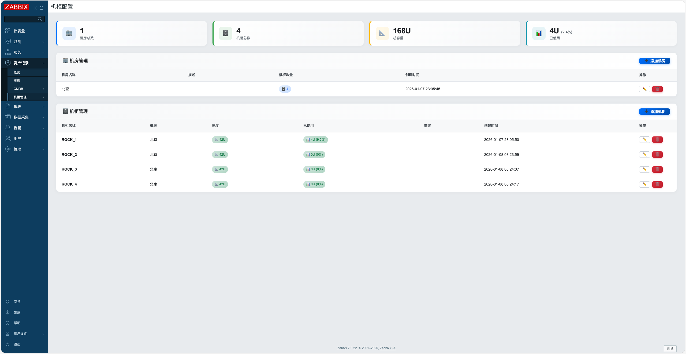
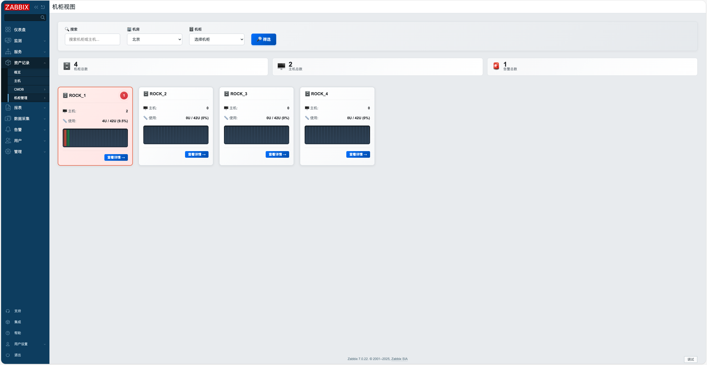
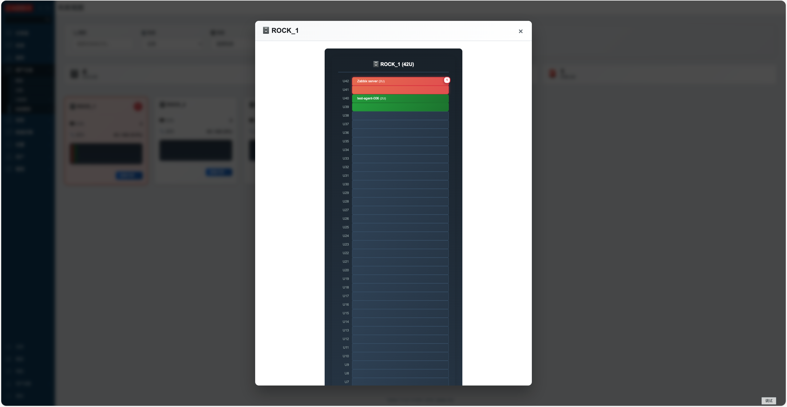

# Zabbix Rack Module

[中文](README.md)

## ✨ Version Compatibility

| Zabbix | PHP | manifest_version | Result |
|---|---|---|---|
| 6.0.49 | 7.3.33 | 1.0 | Recognized, enabled; pages pass |
| 7.0.32 | 8.0.30 | 2.0 | Recognized, enabled; pages pass |
| 8.0.0 | 8.4.27 | 2.0 | Recognized, enabled; pages pass |

## Description

This is a Zabbix frontend module for data center rack visualization and host placement management. The module adds rack management functionality under the Inventory menu in Zabbix Web, supporting room and rack configuration, as well as visual host assignment.





## Features

- **Room Management**:
  - Create, edit, and delete rooms
  - Room description management
  - Assign Zabbix user groups and users to rooms (access control)
- **Access Control**:
  - Rooms can be linked to Zabbix user groups and individual users
  - Permission UI defaults to all user groups and users selected (visible to everyone)
  - Rack view shows only rooms/racks the current user may access
  - Rooms without user groups or users are visible to everyone
  - **Super Admin** can view all rooms in rack view regardless of room permissions
- **Rack Config (manage page)**:
  - Only **Super Admin** can access the config page and related save/delete APIs
  - Other users can use rack view only
- **Rack Management**:
  - Create, edit, and delete racks
  - Configure rack height (supports 1-60U)
  - Associate racks with rooms
- **Rack Visualization**:
  - 42U rack vertical layout display
  - **Front / rear** view toggle (same U slot can host different devices on each side)
  - Real-time U position occupancy status
  - Host information hover tooltips
  - Click on free U positions for assignment
- **Host Assignment**:
  - Assign Zabbix hosts to specific U positions in racks
  - Filter by host groups
  - Search by hostname
  - U position conflict detection
- **Search**:
  - Search by rack name
  - Search by hostname
  - Quick host location lookup
- **Internationalization**: Support for Chinese and English interfaces
- **Responsive Design**: Adapts to different screen sizes

## Installation

### Install Module

```bash
# Zabbix 6.0 / 7.0 deployment
git clone https://github.com/X-Mars/zabbix_modules.git /usr/share/zabbix/modules/

# Zabbix 7.2+ / 7.4 / 8.0 deployment
git clone https://github.com/X-Mars/zabbix_modules.git /usr/share/zabbix/ui/modules/
```

### ⚠️ Modify manifest.json

```bash
# ⚠️ For Zabbix 6.0, modify manifest_version
sed -i 's/"manifest_version": 2.0/"manifest_version": 1.0/' zabbix_rack/manifest.json
```

### Enable Module

1. Go to **Administration → General → Modules**.
2. Click **Scan directory** to scan for new modules.
3. Find the "Zabbix Rack" module and enable it.
4. Refresh the page. The module will appear under the **Inventory** menu as "Rack Management" submenu.

## Notes

### Storage permissions and SELinux (2026-11-21 fix)

Room/rack configuration is stored in `data/config.json` on the **web frontend**. On SELinux-enforcing systems, ownership and chmod alone cannot make an `usr_t` file writable by PHP-FPM. Configure the web PHP pool owner (the test environment uses apache) and a persistent writable label:

```bash
# Tested Zabbix 8 frontend; adjust the path and PHP pool user for your installation.
dnf install policycoreutils-python-utils
mkdir -p /usr/share/zabbix/ui/modules/zabbix_rack/data
chown -R apache:apache /usr/share/zabbix/ui/modules/zabbix_rack/data
chmod 750 /usr/share/zabbix/ui/modules/zabbix_rack/data
# If config.json already exists:
chmod 600 /usr/share/zabbix/ui/modules/zabbix_rack/data/config.json
semanage fcontext -a -t httpd_sys_rw_content_t '/usr/share/zabbix/ui/modules/zabbix_rack/data(/.*)?'
restorecon -RFv /usr/share/zabbix/ui/modules/zabbix_rack/data
```

If the local fcontext rule already exists, use `semanage fcontext -m`. Do not use chmod 777 or disable SELinux. Keep writable labels restricted to the data directory.

Saving now writes a temporary file and atomically replaces the configuration. A failed write leaves the previous file/cache intact, logs an actionable error, and preserves valid AJAX JSON. Chromium create/refresh/edit/delete checks passed, and temporary rooms were removed. Storage failure tests use isolated temporary directories.

- **Performance**: For large environments, consider limiting query result quantities appropriately.
- **Data Accuracy**: Displayed information is based on the current state of the Zabbix database.
- **Permission Requirements**: Users need appropriate permissions to access rack view. Rack view is filtered by room-level settings; **Super Admin** can view all rooms. **Rack Config** is available to **Super Admin** only.

### Room access control (config.json)

You may **optionally** add `user_groups` and `users` (arrays of string IDs) to each room in `data/config.json`. When omitted, behavior matches older versions and the room is visible to all users:

```json
{
    "id": "room1",
    "name": "Room 1",
    "description": "Test Room",
    "user_groups": ["7"],
    "users": ["1"]
}
```

- `user_groups`: Zabbix user group IDs allowed to access the room
- `users`: Zabbix user IDs allowed to access the room
- Empty or missing both fields: visible to all users
- Access is granted if the user matches **either** a listed group **or** user
- Saving with all groups **and** all users selected is normalized to public (no permission fields written)

### Rack front / rear (host tags)

Host placement can be tagged for front or rear side:

| Tag | Value | Meaning |
|-----|-------|---------|
| `rack_side` | `back` | **Rear** side; missing tag or any other value means **front** |

- Use the **Front / Rear** toggle in rack view; the same U slot can host different devices on each side
- Front assignments omit the `rack_side` tag (backward compatible)
- Rear assignments write `rack_side=back`

### Important

1. Deleting a room will also delete all rack configurations under that room
2. Removing a host from a rack only deletes the rack-related tags on the host; it does not delete the host itself
3. U position conflicts are automatically detected when assigning hosts
4. It is recommended to regularly back up the `data/config.json` file

### Directory ownership and save errors

Module pages show an ownership command only when the directory owner or group differs from the PHP runtime account. Correct ownership produces no reminder. Save errors retain their original message and add directory ownership and SELinux (`getenforce`) reminders. Text follows the Zabbix Web user language. No extra dialogs or command panels are added.

## Development

The module is built on the Zabbix module framework. File structure:

- `manifest.json`: Module configuration
- `Module.php`: Menu registration
- `actions/RackManage.php`: Rack management business logic
- `actions/RackView.php`: Rack view business logic
- `views/rack.manage.php`: Rack management page view
- `views/rack.view.php`: Rack view page view
- `lib/LanguageManager.php`: Internationalization language management
- `lib/ViewRenderer.php`: View rendering utilities
- `lib/ZabbixVersion.php`: Version compatibility utilities
- `lib/RackConfig.php`: Rack configuration management
- `lib/RackPermission.php`: Room access control (Zabbix user groups/users)
- `lib/HostRackManager.php`: Host-rack association management

For extensions, refer to [Zabbix module documentation](https://www.zabbix.com/documentation/7.0/en/devel/modules).

## Module Configuration

### UI theme

Rack view and configuration use an Element Plus-inspired theme with local CSS and JavaScript, without Vue or an external CDN. Native selects, form validation, and all six alarm levels are retained. Deploy both views and assets when upgrading. The shared theme is in assets/css/element.css; messages and confirmation dialogs are in assets/js/element.js.

## License

This project follows the Zabbix license. For details, see [Zabbix License](https://www.zabbix.com/license).
