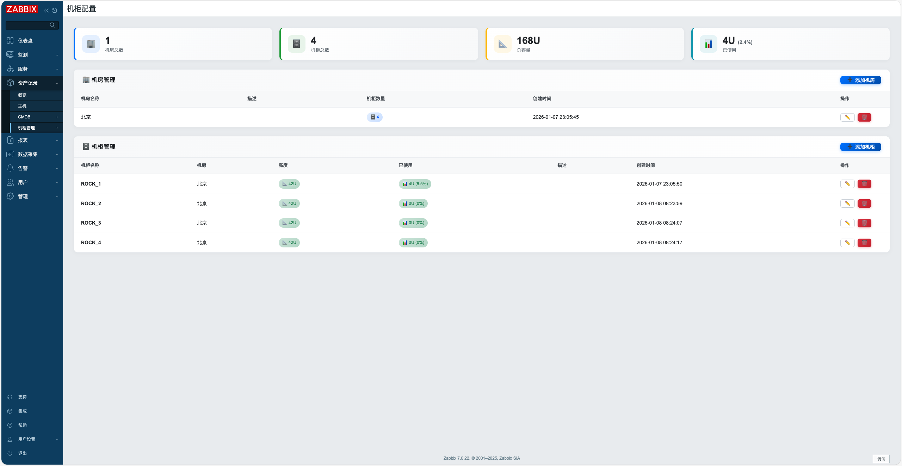
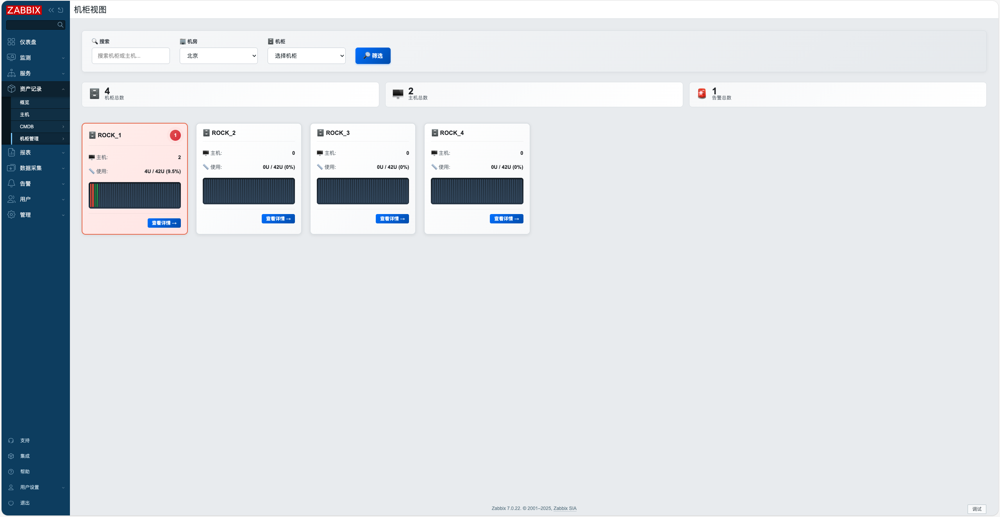
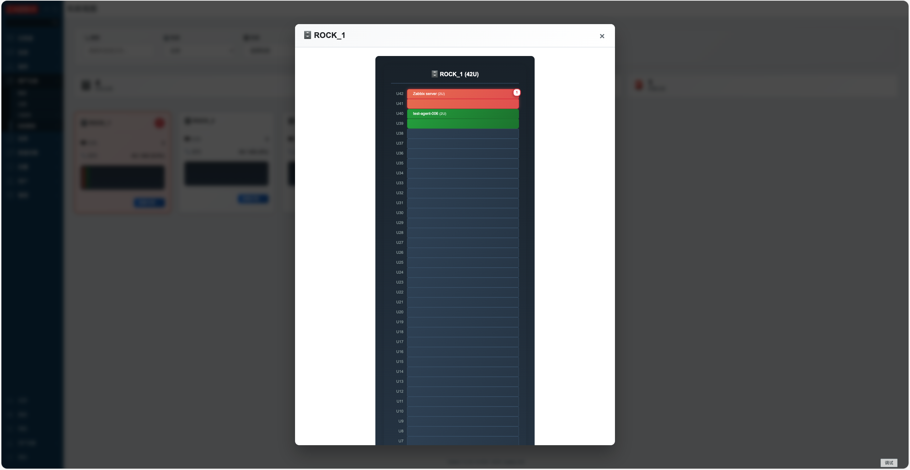

# Zabbix Rack — управление стойками

[中文](README.md) · [English](README_en.md)

## Совместимость версий

| Zabbix | PHP | `manifest_version` | Результат проверки |
| --- | --- | --- | --- |
| 6.0.49 | 7.3.33 | 1.0 | Модуль обнаружен и включён, страницы прошли проверку |
| 7.0.32 | 8.0.30 | 2.0 | Модуль обнаружен и включён, страницы прошли проверку |
| 8.0.0 | 8.4.27 | 2.0 | Модуль обнаружен и включён, страницы прошли проверку |

## Описание

В разделе **Инвентаризация** модуль показывает помещения и стойки центра обработки данных. Он позволяет настроить стойки, разместить узлы сети и найти, где установлено оборудование.





## Возможности

- Создание, изменение и удаление помещений и стоек с высотой от 1 до 60 U. Можно сохранить описание помещения и указать группы пользователей и отдельных пользователей с доступом.
- Настройка стоек, сохранение и удаление доступны суперадминистратору. Остальные пользователи видят разрешённые помещения и стойки. Суперадминистратор видит все помещения.
- Вертикальное представление стоек (по умолчанию 42 U), занятые и свободные юниты, подсказки с данными узлов.
- Отдельные передняя и задняя стороны. Один юнит может быть занят разными устройствами с обеих сторон.
- Назначение узлов щелчком по свободному юниту, поиск по имени узла или стойки, фильтрация по группам и проверка конфликтов размещения.

Интерфейс поддерживает китайский, английский и русский языки. Чтобы включить русский, выберите **Русский** в профиле Zabbix. При выборе языка по умолчанию используется системная настройка `default_lang`.

## Установка

### Размещение модуля

```bash
# Установка в Zabbix 6.0 / 7.0
git clone https://github.com/X-Mars/zabbix_modules.git /usr/share/zabbix/modules/

# Установка в Zabbix 7.2+ / 7.4 / 8.0
git clone https://github.com/X-Mars/zabbix_modules.git /usr/share/zabbix/ui/modules/
```

### Манифест для Zabbix 6.0

Для Zabbix 6.0 измените `manifest_version` на `1.0`. Для Zabbix 7.0 и 8.0 используется `2.0`.

```bash
# Для Zabbix 6.0 измените manifest_version
sed -i 's/"manifest_version": 2.0/"manifest_version": 1.0/' zabbix_rack/manifest.json
```

### Включение модуля

1. Откройте **Администрирование → Общие → Модули**.
2. Нажмите **Сканировать каталог**.
3. Найдите и включите **Zabbix Rack**.
4. Обновите страницу и откройте раздел стоек в меню **Инвентаризация**.

## Права на хранение и SELinux

Конфигурация хранится в `data/config.json` на сервере веб-интерфейса. В режиме enforcing SELinux настройте владельца каталога по учётной записи пула PHP-FPM и постоянный контекст с разрешением на запись. Пример рассчитан на пользователя `apache`.

```bash
# Пример для Zabbix 8. Укажите путь и пользователя пула PHP для вашей установки.
dnf install policycoreutils-python-utils
mkdir -p /usr/share/zabbix/ui/modules/zabbix_rack/data
chown -R apache:apache /usr/share/zabbix/ui/modules/zabbix_rack/data
chmod 750 /usr/share/zabbix/ui/modules/zabbix_rack/data
# Если config.json уже существует
chmod 600 /usr/share/zabbix/ui/modules/zabbix_rack/data/config.json
semanage fcontext -a -t httpd_sys_rw_content_t '/usr/share/zabbix/ui/modules/zabbix_rack/data(/.*)?'
restorecon -RFv /usr/share/zabbix/ui/modules/zabbix_rack/data
```

Если локальное правило контекста уже существует, измените его командой `semanage fcontext -m`. Ограничьте запись каталогом данных и сохраните SELinux включённым.

Сохранение использует временный файл и атомарную замену. При ошибке предыдущие файл и кэш сохраняются, а в журнал записывается причина. Проверки в Chromium охватывали создание, обновление страницы, редактирование и удаление. Тесты ошибок используют изолированные временные каталоги.

### Владелец каталога и ошибки сохранения

Если владелец или группа каталога отличаются от учётной записи, под которой работает PHP, на странице модуля появится команда для изменения владельца. В сообщении об ошибке сохранения будут подсказки о правах на каталог и проверке SELinux командой `getenforce`.

## Настройка доступа к помещениям

Для помещения в `data/config.json` можно задать `user_groups` и `users` как массивы строковых ID Zabbix.

```json
{
    "id": "room1",
    "name": "Room 1",
    "description": "Test Room",
    "user_groups": ["7"],
    "users": ["1"]
}
```

- Доступ разрешается, если пользователь есть в списке или входит в одну из указанных групп.
- При пустых или отсутствующих списках помещение видно всем пользователям.
- Если при сохранении выбраны все группы и все пользователи, модуль записывает открытый доступ без списков ограничений.

## Стороны стойки

| Тег узла сети | Значение | Сторона |
| --- | --- | --- |
| `rack_side` | `back` | Задняя |
| `rack_side` | Другие значения или отсутствие тега | Передняя |

Переключайте отображение кнопками **Спереди** и **Сзади**. Для размещения сзади добавляется `rack_side=back`, а спереди используется запись без этого тега.

## Управление данными

- При удалении помещения удаляются его стойки.
- Когда узел убирают со стойки, Zabbix сохраняет узел и удаляет теги размещения.
- При размещении модуль проверяет занятость юнитов.
- Для восстановления конфигурации регулярно сохраняйте копию `data/config.json`.

## Разработка

- `manifest.json` и `Module.php` — конфигурация и меню.
- `actions/RackManage.php`, `actions/RackView.php`, `views/rack.manage.php` и `views/rack.view.php` — контроллеры и представления.
- `lib/RackConfig.php`, `lib/RackPermission.php` и `lib/HostRackManager.php` — конфигурация, доступ по помещениям и размещение узлов.
- `lib/LanguageManager.php`, `lib/ViewRenderer.php` и `lib/ZabbixVersion.php` — локализация, вывод и совместимость версий.

Стиль страниц основан на Element Plus и использует локальные стили и скрипты. Штатные списки, проверка формы и шесть уровней важности сохранены. При обновлении устанавливайте представления и ресурсы вместе. Тема находится в `assets/css/element.css`, сообщения и диалоги — в `assets/js/element.js`.

Сведения о расширении модуля см. в [документации по разработке модулей Zabbix](https://www.zabbix.com/documentation/7.0/en/devel/modules).

## Лицензия

Применяются [условия лицензии Zabbix](https://www.zabbix.com/license).
