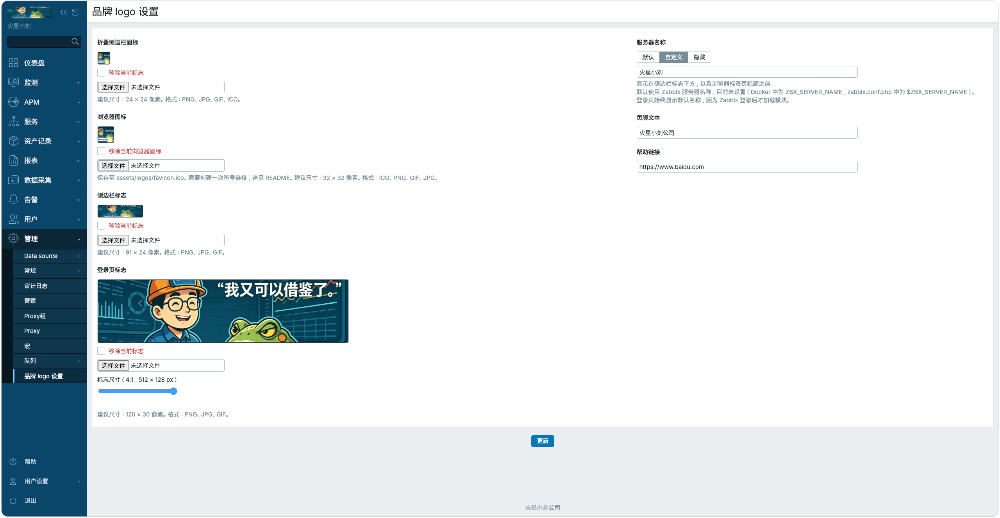

# Zabbix 品牌 logo 设置

[English](README_en.md)

## ✨ 版本兼容性

- ✅ Zabbix 7.0.32 / PHP 8.0
- ✅ Zabbix 8.0.0 / PHP 8.4

以上为已验证的组合。其他版本请先在目标环境测试。

## 描述

这是一个 Zabbix 前端模块。超级管理员可以在「管理 → 品牌 logo 设置」中更换登录页标志、侧边栏标志、折叠侧边栏图标和浏览器图标，也可以调整服务器名称、页脚文本和帮助链接。模块使用 Zabbix 的品牌配置机制，无需修改核心文件。



## 功能特性

- **图片预览与裁剪**：选图后原位预览，通过滑块调整缩放和位置。裁剪导出为静态 PNG。
- **登录页标志尺寸**：宽高锁定为 4:1，默认 120 × 30 像素，最高 512 × 128 像素，实际范围受服务器上传限制影响。原图细节和文件大小允许时，裁剪可保留最多 2 倍显示分辨率。
- **服务器名称**：可以保留 Zabbix 默认名称、使用自定义名称或隐藏名称。登录页使用 Zabbix 默认名称。
- **页脚和帮助链接**：可自定义页脚文字和用户菜单中的帮助链接，链接支持 HTTP 和 HTTPS。
- **中英文界面**：跟随 Zabbix 用户语言，支持浅色和深色主题。
- **持久化存储**：设置和图片副本保存在 `local/conf/rebrand/`，方便升级时保留。

| 图片 | 建议尺寸 | 支持格式 |
| --- | --- | --- |
| 折叠侧边栏图标 | 24 × 24 像素 | PNG、JPG、GIF、ICO |
| 浏览器图标 | 32 × 32 像素 | PNG、JPG、GIF、ICO |
| 侧边栏标志 | 91 × 24 像素 | PNG、JPG、GIF |
| 登录页标志 | 120 × 30 像素 | PNG、JPG、GIF |

## 安装步骤

### 安装模块

从本仓库根目录执行。将 `ZABBIX_ROOT` 设置为实际提供 Zabbix Web 的目录，例如 `/usr/share/zabbix` 或 `/usr/share/zabbix/ui`。将 `WEB_USER` 和 `WEB_GROUP` 改为 PHP-FPM 池使用的用户和组，例如 `apache` 或 `www-data`。

```bash
ZABBIX_ROOT=/usr/share/zabbix
WEB_USER=apache
WEB_GROUP=apache

sudo cp -a zabbix_rebrand_logo "$ZABBIX_ROOT/modules/"
MODULE_DIR="$ZABBIX_ROOT/modules/zabbix_rebrand_logo"
CONF_DIR="$ZABBIX_ROOT/local/conf"

sudo install -d -o "$WEB_USER" -g "$WEB_GROUP" -m 0755 \
  "$MODULE_DIR/assets/logos" "$CONF_DIR/rebrand"
sudo chgrp "$WEB_GROUP" "$CONF_DIR"
sudo chmod g+w "$CONF_DIR"
```

PHP-FPM 需要写入图片目录、`local/conf/rebrand/` 和 `local/conf/`，以便保存图片和原子更新 `brand.conf.php`。模块代码应由部署账户维护。启用 SELinux 时，需为这些可写目录配置 `httpd_sys_rw_content_t`，并用 `restorecon` 应用标签。

### 启用模块

1. 以超级管理员登录，打开「管理 → 常规 → 模块」。
2. 点击「扫描目录」，启用 **Zabbix Rebrand Logo**。
3. 打开「管理 → 品牌 logo 设置」，选择图片、预览或裁剪，然后点击「更新」。

### 启用登录页尺寸滑块（可选）

在前端根目录安装本地登录视图。仅在目标文件不存在时执行以下命令。已有自定义视图的环境，应先评估两者的兼容性再启用。

```bash
LOGIN_VIEW="$ZABBIX_ROOT/local/app/views/general.login.php"
if [ ! -e "$LOGIN_VIEW" ] && [ ! -L "$LOGIN_VIEW" ]; then
  sudo install -D -m 0644 "$MODULE_DIR/install/login-view.php" "$LOGIN_VIEW"
fi
```

### 启用浏览器图标（可选）

在模块中上传并保存浏览器图标后，备份前端原有的 `favicon.ico`，再创建指向模块图标的符号链接。以下命令适用于前端仍使用原始图标且尚无备份的环境。已有自定义链接时，请核对目标路径后更新链接。

```bash
if [ -f "$MODULE_DIR/assets/logos/favicon.ico" ] \
  && [ -f "$ZABBIX_ROOT/favicon.ico" ] && [ ! -L "$ZABBIX_ROOT/favicon.ico" ] \
  && [ ! -e "$ZABBIX_ROOT/favicon.ico.zabbix-default" ]; then
  sudo mv "$ZABBIX_ROOT/favicon.ico" "$ZABBIX_ROOT/favicon.ico.zabbix-default"
  sudo ln -s "$MODULE_DIR/assets/logos/favicon.ico" "$ZABBIX_ROOT/favicon.ico"
fi
```

### 从旧目录升级

1. 备份旧模块目录和 `local/conf/rebrand/`、`local/conf/brand.conf.php`。在模块列表中停用旧模块。
2. 将旧模块目录（`zabbix_brand_logo`、`zabbix_branding` 或 `Branding`）移出前端的 `modules/`，然后扫描目录，清理旧登记。
3. 安装新目录 `zabbix_rebrand_logo`，按上述步骤重新扫描并启用。若旧版的配置或图片只保存在旧模块的 `assets/logos/`，将其复制到新模块的同名目录。
4. 打开品牌设置并点击「更新」，使 `brand.conf.php` 中的图片 URL 指向新目录。如已设置浏览器图标符号链接，将它改为指向新目录。

当前模块 ID 为 `zabbix-rebrand-logo`，持久化目录仍为 `local/conf/rebrand/`。

## 注意事项

- 单个文件最多 2 MB，实际还受 PHP 上传限制。保存时，待裁剪或超限的登录页图片会自动导出为符合限制的 PNG。
- 需要保留 GIF 动画时，请上传符合大小限制的原图，并跳过裁剪。浏览器图标建议使用 ICO。
- 更换图片后，如仍显示旧图，尝试强制刷新页面。浏览器图标也可以在隐私窗口中核对。

## 开发

- `manifest.json` 和 `Module.php`：模块声明及菜单注册。
- `actions/`：读取、校验和保存设置及图片。
- `views/` 和 `assets/css/`：设置界面、图片预览与裁剪。
- `install/login-view.php`：可选的登录页尺寸适配。
- `lib/`：语言、尺寸和服务器名称相关逻辑。

在 PHP 8.1 或更高版本的命令行中运行服务器名称回归测试：

```bash
php zabbix_rebrand_logo/tests/ServerNameOverrideTest.php
```

## 致谢

感谢 [Keberneth](https://github.com/Keberneth) 创建并公开分享 [Zabbix Branding 模块](https://github.com/Keberneth/Zabbix-Modules/tree/main/Branding)。本项目基于该模块修改。
