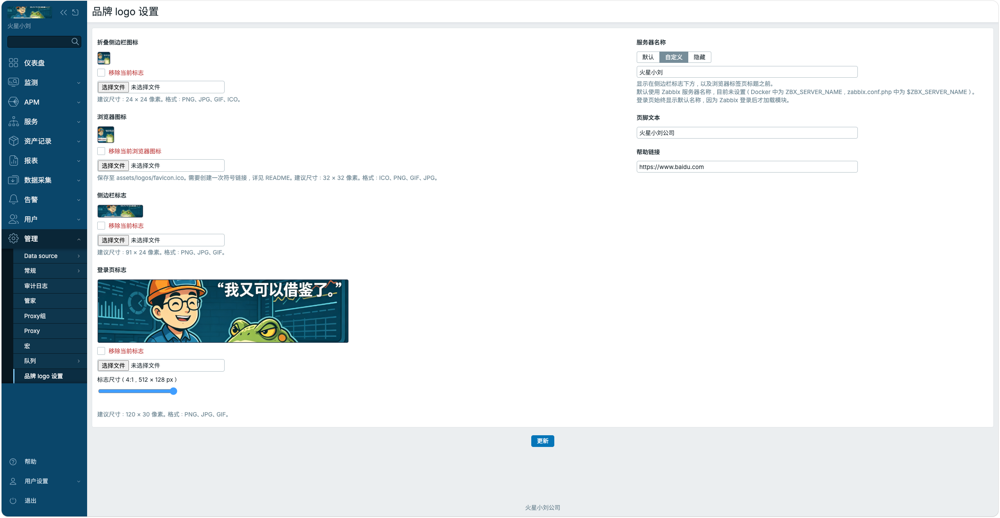

# Zabbix Rebrand Logo — оформление Zabbix

[中文](README.md) · [English](README_en.md)

## Совместимость версий

| Zabbix | PHP | `manifest_version` | Результат проверки |
| --- | --- | --- | --- |
| 6.0.49 | 7.3.33 | 1.0 | Модуль обнаружен и включён, страницы прошли проверку |
| 7.0.32 | 8.0.30 | 2.0 | Модуль обнаружен и включён, страницы прошли проверку |
| 8.0.0 | 8.4.27 | 2.0 | Модуль обнаружен и включён, страницы прошли проверку |

## Описание

В разделе **Администрирование → Оформление Zabbix** суперадминистратор может заменить логотипы страницы входа и боковой панели, значок свёрнутой панели и favicon. Здесь же настраиваются имя сервера, текст подвала и ссылка на справку. Модуль использует штатную конфигурацию оформления Zabbix.



## Возможности

- Предпросмотр и кадрирование с изменением масштаба и положения. Кадрированный результат сохраняется как статический PNG.
- Пропорции логотипа входа — 4:1. Размер по умолчанию — 120 × 30 пикселей, максимум — 512 × 128 с учётом серверного лимита загрузки. При достаточном размере исходника можно сохранить до двойного разрешения относительно отображаемого.
- Имя сервера можно оставить стандартным, изменить или скрыть. На странице входа используется имя Zabbix по умолчанию.
- Настраиваемый текст внизу страницы и ссылка HTTP или HTTPS в пользовательском меню.
- Светлая и тёмная темы. Настройки и копии изображений сохраняются в `local/conf/rebrand/` между обновлениями.

| Изображение | Рекомендуемый размер | Форматы |
| --- | --- | --- |
| Значок свёрнутой панели | 24 × 24 пикселя | PNG, JPG, GIF, ICO |
| Значок вкладки | 32 × 32 пикселя | PNG, JPG, GIF, ICO |
| Логотип боковой панели | 91 × 24 пикселя | PNG, JPG, GIF |
| Логотип страницы входа | 120 × 30 пикселей | PNG, JPG, GIF |

Интерфейс поддерживает китайский, английский и русский языки. Чтобы включить русский, выберите **Русский** в профиле Zabbix. При выборе языка по умолчанию используется системная настройка `default_lang`.

## Установка

### Размещение модуля

Выполните команды из корня репозитория. Задайте `ZABBIX_ROOT` по расположению веб-интерфейса, например `/usr/share/zabbix` или `/usr/share/zabbix/ui`. Задайте `WEB_USER` и `WEB_GROUP` по настройкам пула PHP-FPM, например `apache` или `www-data`.

```bash
ZABBIX_ROOT=/usr/share/zabbix
WEB_USER=apache
WEB_GROUP=apache

sudo cp -a zabbix_rebrand_logo "$ZABBIX_ROOT/modules/"
MODULE_DIR="$ZABBIX_ROOT/modules/zabbix_rebrand_logo"
CONF_DIR="$ZABBIX_ROOT/local/conf"

sudo install -d -o "$WEB_USER" -g "$WEB_GROUP" -m 0755 \
  "$MODULE_DIR/assets/logos" "$CONF_DIR/rebrand"
sudo chgrp "$WEB_GROUP" "$CONF_DIR"
sudo chmod g+w "$CONF_DIR"
```

PHP-FPM нужен доступ на запись каталога изображений, `local/conf/rebrand/` и `local/conf/` для сохранения и атомарной замены `brand.conf.php`. Код модуля может принадлежать учётной записи развёртывания. В системах с SELinux назначьте записываемым каталогам контекст `httpd_sys_rw_content_t` и примените его через `restorecon`.

### Манифест для Zabbix 6.0

Для Zabbix 6.0 измените `manifest_version` на `1.0`. Для Zabbix 7.0 и 8.0 используется `2.0`.

```bash
sed -i 's/"manifest_version": 2.0/"manifest_version": 1.0/' /usr/share/zabbix/modules/zabbix_rebrand_logo/manifest.json
```

### Включение модуля

От имени суперадминистратора выполните следующие действия.

1. Откройте **Администрирование → Общие → Модули**.
2. Нажмите **Сканировать каталог**.
3. Найдите и включите **Zabbix Rebrand Logo**.
4. Откройте **Администрирование → Оформление Zabbix**, выберите изображения, проверьте предпросмотр или кадрируйте, затем нажмите **Обновить**.

### Логотип страницы входа и favicon

Для изменения размера логотипа установите локальное представление страницы входа. Выполните команду, если целевой файл отсутствует. Если вы уже используете своё представление, сначала проверьте совместимость.

```bash
LOGIN_VIEW="$ZABBIX_ROOT/local/app/views/general.login.php"
if [ ! -e "$LOGIN_VIEW" ] && [ ! -L "$LOGIN_VIEW" ]; then
  sudo install -D -m 0644 "$MODULE_DIR/install/login-view.php" "$LOGIN_VIEW"
fi
```

Загрузите и сохраните favicon. Если у веб-интерфейса есть исходный `favicon.ico` и ещё нет его резервной копии, сохраните оригинал и создайте символическую ссылку на файл модуля. Для уже настроенной ссылки сначала проверьте её цель.

```bash
if [ -f "$MODULE_DIR/assets/logos/favicon.ico" ] \
  && [ -f "$ZABBIX_ROOT/favicon.ico" ] && [ ! -L "$ZABBIX_ROOT/favicon.ico" ] \
  && [ ! -e "$ZABBIX_ROOT/favicon.ico.zabbix-default" ]; then
  sudo mv "$ZABBIX_ROOT/favicon.ico" "$ZABBIX_ROOT/favicon.ico.zabbix-default"
  sudo ln -s "$MODULE_DIR/assets/logos/favicon.ico" "$ZABBIX_ROOT/favicon.ico"
fi
```

## Примечания

- Лимит каждого изображения — 2 МБ с учётом настроек PHP. При сохранении кадрированный логотип входа или слишком большой файл преобразуется в PNG подходящего размера.
- Для сохранения анимации загружайте исходный GIF допустимого размера и пропустите кадрирование. Для значка вкладки рекомендуется ICO.
- Если отображается прежнее изображение, перезагрузите страницу с очисткой кэша. Значок вкладки можно проверить в приватном окне.

### Владелец каталога и ошибки сохранения

Если владелец или группа каталога отличаются от учётной записи, под которой работает PHP, на странице модуля появится команда для изменения владельца. В сообщении об ошибке сохранения будут подсказки о правах на каталог и проверке SELinux командой `getenforce`.

## Разработка

- `manifest.json` и `Module.php` — декларация и меню.
- `actions/` — чтение, проверка и сохранение.
- `views/` и `assets/css/` — интерфейс, предпросмотр и кадрирование.
- `install/login-view.php` — необязательная интеграция для размеров логотипа входа.
- `lib/` — локализация, размеры и имя сервера.

Запустите регрессионный тест имени сервера с PHP CLI 8.1 или новее.

```bash
php zabbix_rebrand_logo/tests/ServerNameOverrideTest.php
```

### Благодарности

Модуль основан на работе Keberneth. [Исходный модуль Zabbix Branding](https://github.com/Keberneth/Zabbix-Modules/tree/main/Branding)

## Обновление со старого каталога

1. Сохраните копии старого каталога, `local/conf/rebrand/` и `local/conf/brand.conf.php`. Отключите старый модуль в списке.
2. Переместите `zabbix_brand_logo`, `zabbix_branding` или `Branding` за пределы каталога `modules/`. Просканируйте каталог, чтобы убрать старую регистрацию.
3. Установите `zabbix_rebrand_logo`, повторите сканирование и включите модуль. Скопируйте прежние настройки и изображения из старого `assets/logos/`, если они хранятся только там.
4. Нажмите **Обновить**, чтобы переписать URL изображений в `brand.conf.php`. Если используется ссылка на favicon, направьте её в новый каталог.

ID модуля — `zabbix-rebrand-logo`. Постоянные настройки находятся в `local/conf/rebrand/`.

## Лицензия

См. [условия лицензии проекта](../README_ru.md#лицензия). При распространении сохраняйте сведения об авторах сторонних компонентов.
