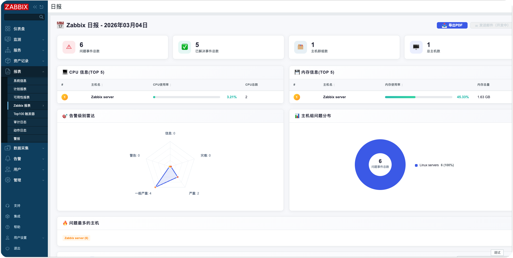
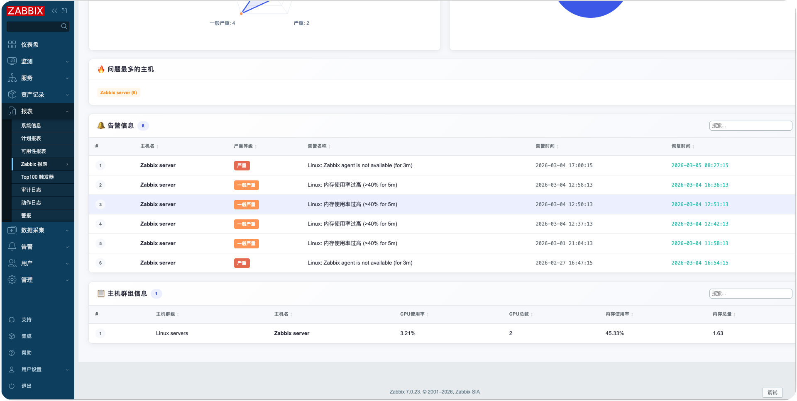

# Zabbix Reports — отчёты

[中文](README.md) · [English](README_en.md)

## Совместимость версий

| Zabbix | PHP | `manifest_version` | Результат проверки |
| --- | --- | --- | --- |
| 6.0.49 | 7.3.33 | 1.0 | Модуль обнаружен и включён, страницы прошли проверку |
| 7.0.32 | 8.0.30 | 2.0 | Модуль обнаружен и включён, страницы прошли проверку |
| 8.0.0 | 8.4.27 | 2.0 | Модуль обнаружен и включён, страницы прошли проверку |

## Описание

Модуль добавляет в меню **Отчёты** веб-интерфейса Zabbix раздел **Отчёты Zabbix**. Он формирует дневные, недельные и месячные отчёты, а также отчёты за произвольный период.




## Возможности

- Сводка по количеству и состоянию проблем.
- Десять узлов сети с наибольшим количеством проблем, максимальной загрузкой ЦП и максимальным использованием памяти.
- Предпросмотр, ручной экспорт в PDF и отправка отчёта по электронной почте в формате HTML.
- Работа с шаблонами агентов Linux и Windows.
- Адаптивный интерфейс для разных размеров экрана.

Интерфейс поддерживает китайский, английский и русский языки. Чтобы включить русский, выберите **Русский** в профиле Zabbix. При выборе языка по умолчанию используется системная настройка `default_lang`.

## Установка

### Размещение модуля

```bash
# Установка в Zabbix 6.0 / 7.0
git clone https://github.com/X-Mars/zabbix_modules.git /usr/share/zabbix/modules/

# Установка в Zabbix 7.2+ / 7.4 / 8.0
git clone https://github.com/X-Mars/zabbix_modules.git /usr/share/zabbix/ui/modules/
```

### Манифест для Zabbix 6.0

Для Zabbix 6.0 измените `manifest_version` на `1.0`. Для Zabbix 7.0 и 8.0 используется `2.0`.

```bash
sed -i 's/"manifest_version": 2.0/"manifest_version": 1.0/' zabbix_reports/manifest.json
```

### Включение модуля

1. Откройте **Администрирование → Общие → Модули**.
2. Нажмите **Сканировать каталог**.
3. Найдите и включите **Zabbix Reports**.
4. Обновите страницу и откройте **Отчёты → Отчёты Zabbix**.

## Примечания

- В крупных установках ограничивайте размер выборки, чтобы ускорить подготовку отчёта.
- Отчёты отражают данные, доступные в базе Zabbix на момент формирования.
- Для отправки отчётов по электронной почте требуется настроить почту.

### Владелец каталога и ошибки сохранения

Если владелец или группа каталога отличаются от учётной записи, под которой работает PHP, на странице модуля появится команда для изменения владельца. В сообщении об ошибке сохранения будут подсказки о правах на каталог и проверке SELinux командой `getenforce`.

## Разработка

- `manifest.json` — конфигурация модуля.
- `Module.php` — регистрация меню.
- `actions/CustomReport.php` и `actions/DailyReport.php` — формирование отчётов за произвольный период и за день.
- `views/reports.custom.php` и `views/reports.daily.php` — представления отчётов.
- `lib/LanguageManager.php` — локализация.
- `lib/ViewRenderer.php` — вывод представлений.
- `lib/ZabbixVersion.php` — совместимость версий.

Сведения о расширении модуля см. в [документации по разработке модулей Zabbix](https://www.zabbix.com/documentation/7.0/en/devel/modules).

## Использование

Выберите группу узлов сети и период, затем сформируйте предпросмотр. Из отчёта можно запустить экспорт или отправку по электронной почте.

Для экспорта русского отчёта в PDF требуется TCPDF с Unicode-шрифтом. При отсутствии TCPDF отчёт выгружается в HTML, который можно открыть и распечатать в браузере.

## Лицензия

Применяются [условия лицензии Zabbix](https://www.zabbix.com/license).
