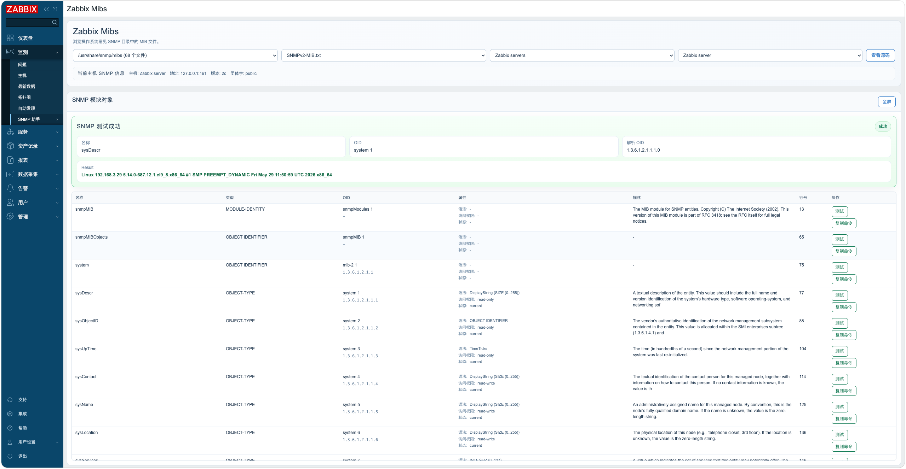
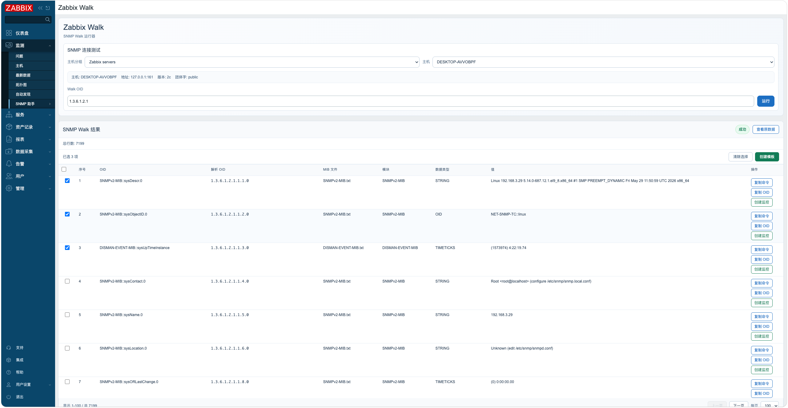
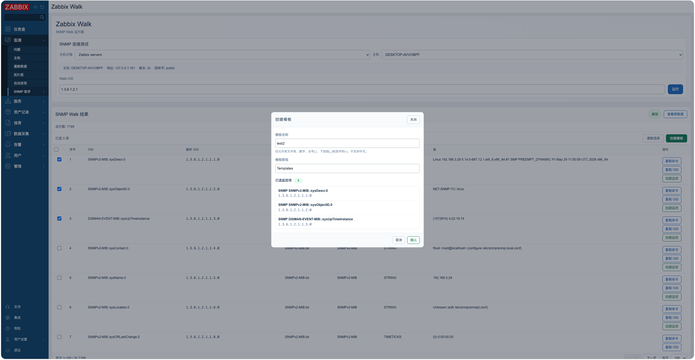

# Zabbix SNMP — помощник SNMP

[中文](README.md) · [English](README_en.md)

## Совместимость версий

| Zabbix | PHP | `manifest_version` | Результат проверки |
| --- | --- | --- | --- |
| 6.0.49 | 7.3.33 | 1.0 | Модуль обнаружен и включён, страницы прошли проверку |
| 7.0.32 | 8.0.30 | 2.0 | Модуль обнаружен и включён, страницы прошли проверку |
| 8.0.0 | 8.4.27 | 2.0 | Модуль обнаружен и включён, страницы прошли проверку |

## Описание

Модуль добавляет раздел **Сбор данных → Помощник SNMP** со страницами **MIB Zabbix** и **Обход SNMP**. Он позволяет просматривать MIB-файлы, расшифровывать OID, запускать обход SNMP и создавать элементы данных и шаблоны по результатам.





## Возможности

### Просмотр MIB

- Автоматический поиск стандартных каталогов MIB в Linux, Unix и Windows. Каталоги из переменной `MIBDIRS` имеют приоритет.
- Выбор каталога и файла из выпадающих списков.
- Просмотр таблицы объектов с OID, расшифрованным OID, синтаксисом, доступом, состоянием и описанием. Есть полноэкранный режим.
- Просмотр исходного файла, копирование команды `snmpget` и проверка запроса к выбранному узлу.

### Обход SNMP

- По выбранной группе и узлу сети модуль загружает параметры интерфейса SNMPv1, v2c или v3 с подстановкой макросов.
- Таблица результатов `snmpwalk` содержит номер строки, OID, расшифрованный OID, файл MIB, модуль, тип и значение. Доступен исходный вывод.
- Команду `snmpget` и числовой OID можно скопировать. Для больших выборок доступно разбиение по 50, 100 или 200 строк на страницу.
- Из одного результата можно создать элемент данных. Тип значения выбирается автоматически, а ключ проверяется на дубликаты.
- Из нескольких выбранных результатов можно создать шаблон в указанной группе и сразу добавить в него элементы данных.

Для создания элементов данных и шаблонов нужны права администратора Zabbix.

Интерфейс поддерживает китайский, английский и русский языки. Чтобы включить русский, выберите **Русский** в профиле Zabbix. При выборе языка по умолчанию используется системная настройка `default_lang`.

## Установка

### Размещение модуля

```bash
# Установка в Zabbix 6.0 / 7.0
git clone https://github.com/X-Mars/zabbix_modules.git /usr/share/zabbix/modules/

# Установка в Zabbix 7.2+ / 7.4 / 8.0
git clone https://github.com/X-Mars/zabbix_modules.git /usr/share/zabbix/ui/modules/
```

### Манифест для Zabbix 6.0

Для Zabbix 6.0 измените `manifest_version` на `1.0`. Для Zabbix 7.0 и 8.0 используется `2.0`.

```bash
# Для Zabbix 6.0 измените manifest_version
sed -i 's/"manifest_version": 2.0/"manifest_version": 1.0/' zabbix_snmp/manifest.json
```

### Включение модуля

1. Откройте **Администрирование → Общие → Модули**.
2. Нажмите **Сканировать каталог**.
3. Найдите и включите **Zabbix SNMP**.
4. Обновите страницу и откройте **Сбор данных → Помощник SNMP**.

## Примечания

- Установите инструменты `net-snmp` (`snmpwalk`, `snmpget` и `snmptranslate`) на сервере веб-интерфейса Zabbix.
- Если у веб-сервера есть доступ только к списку каталогов, модуль покажет найденные каталоги, но не сможет прочитать файлы.
- В технических именах шаблонов допускаются латинские буквы, цифры, точки, подчёркивания и дефисы. Названия групп шаблонов могут содержать символы Unicode.
- При больших объёмах данных пагинация выполняется в браузере.

### Владелец каталога и ошибки сохранения

Если владелец или группа каталога отличаются от учётной записи, под которой работает PHP, на странице модуля появится команда для изменения владельца. В сообщении об ошибке сохранения будут подсказки о правах на каталог и проверке SELinux командой `getenforce`.

## Разработка

- `manifest.json` и `Module.php` — конфигурация и меню модуля.
- `actions/Snmp.php` и `actions/SnmpWalk.php` — контроллеры просмотра MIB и обхода SNMP.
- `actions/SnmpSource.php` — чтение исходного файла MIB.
- `actions/SnmpItemCreate.php` и `actions/SnmpTemplateCreate.php` — создание элементов и шаблонов.
- `views/snmp.php` и `views/snmp.walk.php` — представления.
- `lib/MibRepository.php` — разбор MIB, выполнение обхода и обработка OID.
- `lib/LanguageManager.php`, `lib/ViewRenderer.php` и `lib/ZabbixVersion.php` — локализация, вывод и совместимость версий.

Сведения о расширении модуля см. в [документации по разработке модулей Zabbix](https://www.zabbix.com/documentation/7.0/en/devel/modules).

## Настройка

### Стандартные каталоги MIB

- `/usr/share/snmp/mibs`
- `/usr/local/share/snmp/mibs`
- `/usr/share/mibs`
- `/usr/local/share/mibs`
- `/var/lib/mibs`
- `/usr/share/net-snmp/mibs`
- `/opt/share/snmp/mibs`
- `/opt/local/share/snmp/mibs`
- `C:\usr\share\snmp\mibs`
- `C:\usr\local\share\snmp\mibs`
- `C:\net-snmp\share\snmp\mibs`
- `C:\Program Files\Net-SNMP\share\snmp\mibs`
- `C:\Program Files (x86)\Net-SNMP\share\snmp\mibs`

## Лицензия

Применяются [условия лицензии Zabbix](https://www.zabbix.com/license).
