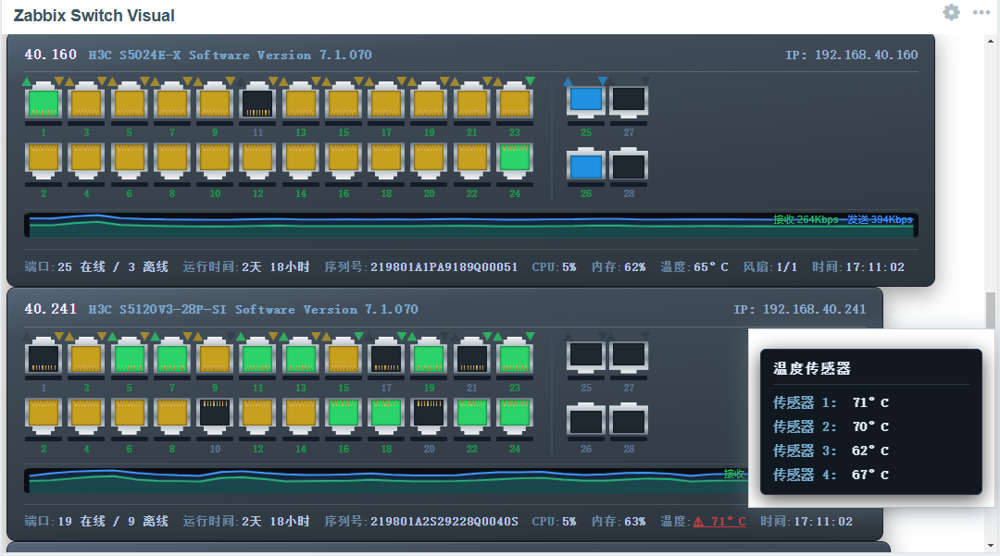

# Zabbix Switch Visual

[English](README_en.md)

## ✨ 版本兼容性

| Zabbix | PHP | manifest_version | 结果 |
|---|---|---|---|
| 6.0.49 | 7.3.33 | 1.0 | 可识别、可启用；页面通过 |
| 7.0.32 | 8.0.30 | 2.0 | 可识别、可启用；页面通过 |
| 8.0.0 | 8.4.27 | 2.0 | 可识别、可启用；页面通过 |

## 描述

Zabbix Switch Visual 是一个交换机端口监控仪表盘组件。它根据 Zabbix 监控项生成交换机机箱、RJ45/SFP 端口、状态、流量和汇总信息的可视化面板。界面支持中文和英文。



## 功能特性

- **主机选择**：可选择单台主机，或按主机群组展示多台交换机。
- **端口可视化**：展示 RJ45/SFP 端口、在线状态、速率、入/出流量、错误及告警；点击端口可跳转到相关监控数据。
- **端口布局**：支持手动配置或自动检测端口数量、堆叠成员、端口行序、SNMP 索引偏移、排除规则和手动别名。
- **趋势与汇总**：展示端口和整机流量微型趋势图，以及运行时间、型号、序列号、CPU、内存、温度、PoE 和风扇信息；可选指标仅在配置了对应监控项后显示。
- **外观设置**：可调整端口样式、颜色、缩放比例和汇总栏显示。
- **中英文界面**：根据 Zabbix 用户语言显示简体中文或英文。

## 安装步骤

### 安装模块

1. 将本仓库的 `zabbix_switch_visual` **整个目录**复制到 Zabbix 前端的 `modules` 目录。前端安装位置因发行版而异，例如 `/usr/share/zabbix/ui/modules/`；以实际安装目录为准。

### ⚠️ 修改 manifest.json 文件

7.0/8.0 保持清单版本 2.0 和仪表盘组件入口。6.0 使用独立页面 `switchvisual.view`；扫描模块前，在仓库根目录运行准备工具适配目标前端，仅修改 `manifest_version` 不足以适配组件。

```bash
python3 tools/compatibility/prepare.py /usr/share/zabbix
```

### 启用模块

1. 在 Zabbix 前端进入 **管理 → 常规 → 模块**（Administration → General → Modules），点击 **扫描目录**并启用 **Zabbix Switch Visual**。
2. Zabbix 7.0/8.0：打开仪表盘的编辑模式，添加 **Zabbix Switch Visual** 组件，选择主机或主机群组后保存。
3. Zabbix 6.0：打开 `zabbix.php?action=switchvisual.view` 独立页面。

## 注意事项

### 目录归属与保存提示

仅当模块目录的属主或属组与 PHP 运行账号不匹配时，显示实际安装目录的归属修改命令；归属正确时不显示提醒。保存失败时，在原错误提示中补充修改目录归属和 `getenforce` 检查 SELinux 的提醒。提示跟随 Zabbix Web 用户语言，不增加弹窗或命令折叠区。

保留完整的 `zabbix_switch_visual` 目录，包括 `manifest.json`、`Widget.php`、`actions/`、`includes/`、`views/` 和 `assets/`。

## 开发

- `manifest.json`：组件标识、动作和前端资源注册。
- `Widget.php`、`includes/WidgetForm.php`：组件名称及配置字段。
- `actions/WidgetView.php`、`includes/DataFetcher.php`：主机与监控项数据获取。
- `views/widget.edit.php`、`views/widget.view.php`：配置表单和端口可视化视图。
- `assets/js/class.widget.js`、`assets/css/switch_monitor.css`：前端交互和样式。
- `includes/Translation.php`：中英文文案。

组件开发接口可参考 [Zabbix 官方文档](https://www.zabbix.com/documentation/7.0/en/devel/modules/widgets)。

### 致谢

感谢 Mauro Serafini 开源的 [Zabbix Switch Visual Widget](https://github.com/Mauro-Serafini/Zabbix-Switch-Visual-Widget) 项目，为本模块的开发提供了参考。

## 模块配置

### 监控项配置

组件通过监控项 Key 模式匹配端口数据。默认值如下；`*` 代表端口索引部分，应按实际模板调整。

| 数据 | 默认 Key 模式 |
| --- | --- |
| 入流量 | `ifInOctets[*]` |
| 出流量 | `ifOutOctets[*]` |
| 端口状态 | `ifOperStatus[*]` |
| 端口速率 | `ifHighSpeed[*]` |
| 入错误 | `ifInErrors[*]` |
| 出错误 | `ifOutErrors[*]` |

默认勾选“流量监控项单位为比特/秒”。如果模板的监控项实际提供字节/秒，请取消该选项；如果监控项是原始累计计数器，需先在 Zabbix 中配置速率换算。PoE、双工、SFP 光功率及系统信息的 Key 均为可选项，空值不会显示相应数据。

自动检测可能匹配到 VLAN、隧道或管理接口，可使用“排除端口”规则过滤。大型主机群组会产生更多 Zabbix API 查询，建议先用单台交换机验证监控项模式和端口布局。

## 许可证

本模块的许可说明见仓库[许可证](../README.md#许可证)。分发时保留相关第三方署名。
