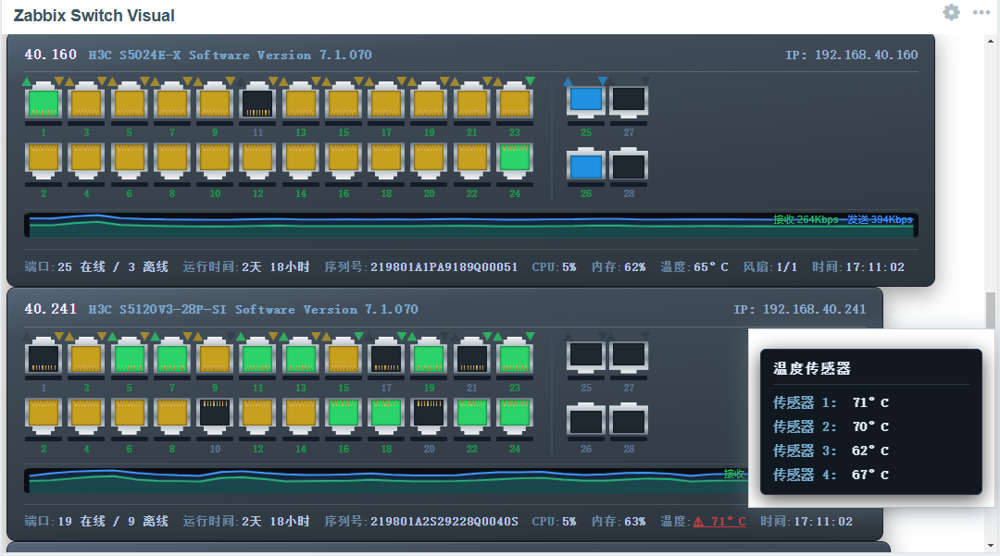

# Zabbix Switch Visual

[中文](README.md) · [Русский](README_ru.md)

## ✨ Version Compatibility

| Zabbix | PHP | manifest_version | Result |
|---|---|---|---|
| 6.0.49 | 7.3.33 | 1.0 | Recognized, enabled; pages pass |
| 7.0.32 | 8.0.30 | 2.0 | Recognized, enabled; pages pass |
| 8.0.0 | 8.4.27 | 2.0 | Recognized, enabled; pages pass |

## Description

Zabbix Switch Visual is a dashboard widget for monitoring switch ports. It builds a visual switch chassis with RJ45/SFP ports, status, traffic, and summary information from Zabbix items. The interface supports English and Simplified Chinese.



## Features

- **Host selection:** Display one host or multiple switches from selected host groups.
- **Port visualization:** Show RJ45/SFP ports, link state, speed, inbound/outbound traffic, errors, and alerts; click a port to open related monitoring data.
- **Port layout:** Configure a fixed or automatically detected port count, stack members, row order, SNMP index offset, exclusions, and manual aliases.
- **Trends and summary:** Show per-port and aggregate traffic sparklines, plus uptime, model, serial number, CPU, memory, temperature, PoE, and fan information. Optional metrics appear only when their items are configured.
- **Appearance:** Adjust port style, colors, zoom, and summary display.
- **Localization:** Use English or Simplified Chinese according to the Zabbix user's language.

## Installation

### Install Module

1. Copy the **entire** `zabbix_switch_visual` directory from this repository into the Zabbix frontend `modules` directory. Its location depends on the frontend package; `/usr/share/zabbix/ui/modules/` is one example.

### ⚠️ Modify manifest.json

On 7.0/8.0, keep manifest version 2.0 and the dashboard widget entry. The tested 6.0 setup uses the standalone `switchvisual.view` page. From the repository root, prepare the target frontend manifest before scanning; changing only `manifest_version` is insufficient.

```bash
python3 tools/compatibility/prepare.py /usr/share/zabbix
```

### Enable Module

1. In the frontend, open **Administration → General → Modules**, click **Scan directory**, and enable **Zabbix Switch Visual**.
2. On Zabbix 7.0/8.0, edit a dashboard, add the **Zabbix Switch Visual** widget, choose a host or host groups, and save.
3. On Zabbix 6.0, open the standalone page at `zabbix.php?action=switchvisual.view`.

## Notes

### Directory ownership and save errors

Module pages show an ownership command only when the directory owner or group differs from the PHP runtime account. Correct ownership produces no reminder. Save errors retain their original message and add directory ownership and SELinux (`getenforce`) reminders. Text follows the Zabbix Web user language. No extra dialogs or command panels are added.

Keep the complete `zabbix_switch_visual` directory, including `manifest.json`, `Widget.php`, `actions/`, `includes/`, `views/` and `assets/`.

## Development

- `manifest.json`: Widget identity, actions, and frontend assets.
- `Widget.php`, `includes/WidgetForm.php`: Widget name and configuration fields.
- `actions/WidgetView.php`, `includes/DataFetcher.php`: Host and item data retrieval.
- `views/widget.edit.php`, `views/widget.view.php`: Configuration form and port visualization.
- `assets/js/class.widget.js`, `assets/css/switch_monitor.css`: Frontend interaction and styling.
- `includes/Translation.php`: English, Chinese, and Russian UI text.

See the [official Zabbix widget development documentation](https://www.zabbix.com/documentation/7.0/en/devel/modules/widgets) for the widget APIs.

### Acknowledgements

Thanks to Mauro Serafini for the open-source [Zabbix Switch Visual Widget](https://github.com/Mauro-Serafini/Zabbix-Switch-Visual-Widget) project, which served as a reference for the development of this module.

## Module Configuration

### Item configuration

The widget matches port data by item-key patterns. The defaults are listed below; `*` stands for the port index and should be adjusted to your template.

| Data | Default key pattern |
| --- | --- |
| Inbound traffic | `ifInOctets[*]` |
| Outbound traffic | `ifOutOctets[*]` |
| Port status | `ifOperStatus[*]` |
| Port speed | `ifHighSpeed[*]` |
| Inbound errors | `ifInErrors[*]` |
| Outbound errors | `ifOutErrors[*]` |

“Bandwidth items deliver bits/sec” is enabled by default. Disable it if your items return bytes per second. Raw cumulative counters need rate preprocessing in Zabbix first. PoE, duplex, SFP optical power, and system item keys are optional; leaving them empty omits those metrics.

Automatic detection may include VLAN, tunnel, or management interfaces; use the excluded-port rules to filter them. Large host groups trigger more Zabbix API queries, so first validate the item patterns and layout on one switch.

## License

See the repository [license terms](../README_en.md#license). Preserve third-party attribution when redistributing.
