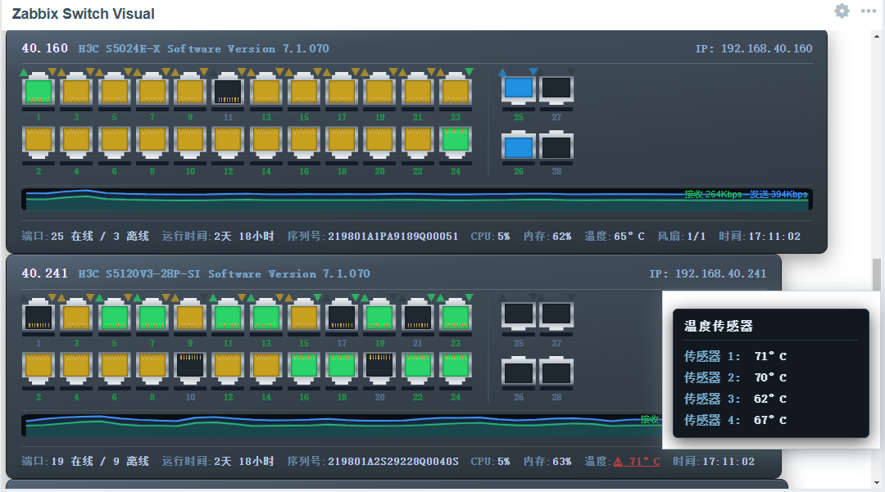

# Zabbix Switch Visual — панель коммутатора

[中文](README.md) · [English](README_en.md)

## Совместимость версий

| Zabbix | PHP | `manifest_version` | Результат проверки |
| --- | --- | --- | --- |
| 6.0.49 | 7.3.33 | 1.0 | Модуль обнаружен и включён, страницы прошли проверку |
| 7.0.32 | 8.0.30 | 2.0 | Модуль обнаружен и включён, страницы прошли проверку |
| 8.0.0 | 8.4.27 | 2.0 | Модуль обнаружен и включён, страницы прошли проверку |

## Описание

Виджет показывает корпус коммутатора, порты RJ45 и SFP, состояние соединений и трафик по данным элементов Zabbix.



## Возможности

- Один коммутатор или несколько устройств из выбранных групп узлов сети.
- Состояние и скорость портов, входящий и исходящий трафик, ошибки и предупреждения. Нажатие на порт открывает связанные данные мониторинга.
- Фиксированное или автоматически определяемое число портов, стек устройств, порядок рядов, смещение индекса SNMP, исключения и псевдонимы.
- Мини-графики трафика по портам и в целом. При наличии элементов данных видны время работы, модель, серийный номер, ЦП, память, температура, PoE и вентиляторы.
- Настройка формы и цвета портов, масштаба и сводной панели.

Интерфейс поддерживает китайский, английский и русский языки. Чтобы включить русский, выберите **Русский** в профиле Zabbix. При выборе языка по умолчанию используется системная настройка `default_lang`.

## Установка

### Размещение модуля

Скопируйте каталог `zabbix_switch_visual` целиком в `modules/` веб-интерфейса Zabbix. Например, в пакетной установке это может быть `/usr/share/zabbix/ui/modules/`.

### Манифест для Zabbix 6.0

В Zabbix 7.0 и 8.0 используется виджет с манифестом версии 2.0. Для проверенной конфигурации Zabbix 6.0 подготовьте манифест со страницей `switchvisual.view` перед сканированием каталога. Если вспомогательный сценарий доступен в вашей рабочей копии, запустите его из корня проекта.

```bash
python3 tools/compatibility/prepare.py /usr/share/zabbix
```

При ручной настройке для 6.0 укажите `manifest_version`: `1.0` и `type`: `module`, удалите раздел `widget`, задайте пустой объект `assets` и оставьте в `actions` только `switchvisual.view`. Убедитесь, что меняете манифест в каталоге установленного модуля.

### Включение модуля

1. Откройте **Администрирование → Общие → Модули**.
2. Нажмите **Сканировать каталог**.
3. Найдите и включите **Zabbix Switch Visual**.
4. В Zabbix 7.0 и 8.0 откройте редактирование панели, добавьте виджет **Zabbix Switch Visual**, выберите узел или группу и сохраните.
5. В Zabbix 6.0 откройте автономную страницу `zabbix.php?action=switchvisual.view`.

## Примечания

### Владелец каталога и ошибки сохранения

Если владелец или группа каталога отличаются от учётной записи, под которой работает PHP, на странице модуля появится команда для изменения владельца. В сообщении об ошибке сохранения будут подсказки о правах на каталог и проверке SELinux командой `getenforce`.

При установке и обновлении копируйте весь каталог модуля, включая `manifest.json`, `Widget.php`, `actions/`, `includes/`, `views/` и `assets/`.

## Разработка

- `manifest.json` — идентификатор виджета, действия и ресурсы.
- `Widget.php` и `includes/WidgetForm.php` — имя виджета и параметры настройки.
- `actions/WidgetView.php` и `includes/DataFetcher.php` — данные узлов и элементов.
- `views/widget.edit.php` и `views/widget.view.php` — форма настройки и изображение портов.
- `assets/js/class.widget.js` и `assets/css/switch_monitor.css` — взаимодействие и стили.
- `includes/Translation.php` — локализация.

См. [документацию по разработке виджетов Zabbix](https://www.zabbix.com/documentation/7.0/en/devel/modules/widgets).

### Благодарности

При разработке использован как пример открытый проект Мауро Серафини. [Zabbix Switch Visual Widget](https://github.com/Mauro-Serafini/Zabbix-Switch-Visual-Widget)

## Настройка элементов данных

Виджет ищет данные портов по шаблонам ключей. Звёздочка `*` соответствует индексу порта. Сверьте шаблоны с ключами элементов вашей конфигурации.

| Данные | Шаблон ключа по умолчанию |
| --- | --- |
| Входящий трафик | `ifInOctets[*]` |
| Исходящий трафик | `ifOutOctets[*]` |
| Состояние порта | `ifOperStatus[*]` |
| Скорость порта | `ifHighSpeed[*]` |
| Ошибки приёма | `ifInErrors[*]` |
| Ошибки передачи | `ifOutErrors[*]` |

По умолчанию значения трафика интерпретируются как бит/с. Если элементы возвращают байт/с, отключите этот параметр. Для накопительных счётчиков сначала настройте расчёт скорости в предобработке Zabbix. Пустые ключи для PoE, дуплекса, оптической мощности SFP и системных показателей скрывают соответствующие метрики.

При автоопределении в список могут попасть VLAN, туннели и интерфейсы управления. Добавьте их в исключения. Перед использованием большой группы проверьте соответствие ключей и расположение портов на одном коммутаторе.

## Лицензия

См. [условия лицензии проекта](../README_ru.md#лицензия). При распространении сохраняйте сведения об авторах сторонних компонентов.
